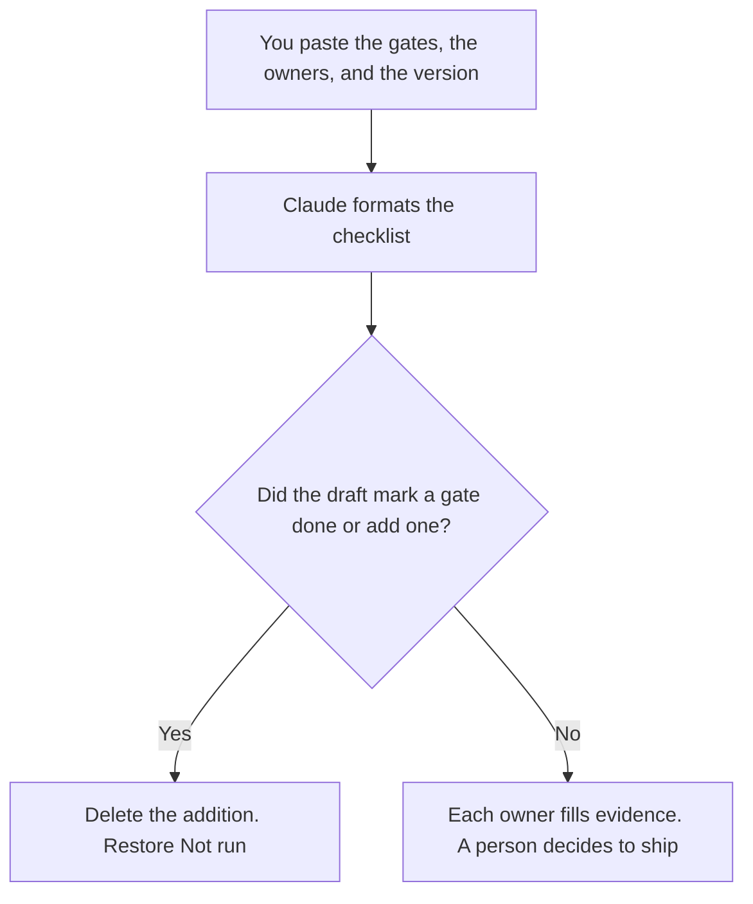

**A release checklist written with AI is the ordered list of gates your team already runs, with an owner on each line, formatted so a release can be stopped.** The model may number the steps you pasted. It may not add a gate, mark one done, or decide that you should ship. The checklist is not the changelog. It is the door the changelog has to pass.

The customer-facing list is [how to write a changelog with AI](/blog/how-to-write-a-changelog-with-ai-2026/). The longer notes are [how to write release notes with AI](/blog/how-to-write-release-notes-with-ai-2026/). The go-to-market list, which includes launch tasks that are not engineering gates, is [how to create a product launch checklist with AI](/blog/how-to-create-a-product-launch-checklist-with-ai-2026/). The note that points customers at what shipped is [how to write a product changelog email with AI](/blog/how-to-write-a-product-changelog-email-with-ai-2026/).

Prices are US list prices excluding tax from directory pages checked October 16, 2026. Published October 24, 2026. We did not score release quality. The model does not press deploy.

## The lines that have to be real

| Line | Who owns it | The model may |
|---|---|---|
| Version | The tag or build you pasted | Copy it. It may not write "current" |
| Gates | The checks you listed: tests, flag, rollback owner, docs | Order them. It may not add a check |
| Owner | A person or role per gate | Copy the name. It may not assign "the team" |
| Evidence | The link or the word Not run | Leave Not run alone. It may not check the box |
| Rollback | The known-good version and the person who can use it | Paste them. A rollback with no owner is a sentence |
| Stop rule | The condition you wrote for not shipping | Keep it visible. It may not soften it |

A return to a newer version after you already rolled back uses the same gates, with the failed check named first. That decision is [what AI rollforward is](/blog/what-is-ai-rollforward-2026/). The switch on the new behavior is [what AI feature flags are](/blog/what-is-ai-feature-flags-2026/).

## Where the list is written

**The draft.** [Claude](/tools/claude/) Pro is $20 a month, or $17 billed annually, when the standing gates live in a Project and each release only swaps the version and the owners. Free can format one list from a paste. The review is [Claude review](/blog/claude-review-2026/).

**A second formatting.** [ChatGPT](/tools/chatgpt/) Plus at $20 a month can turn a messy thread into the same columns. Discard any gate it added because the list "looked thin." The review is [ChatGPT review](/blog/chatgpt-review-2026/).

**The page.** [Notion AI](/tools/notion-ai/) Business is $20 a seat a month if the filled checklist is the record of the release. The chat is not the record.

**The repo.** [GitHub Copilot](/tools/github-copilot/) Pro is $10 a user a month if the checklist is a file next to the tag. Copilot does not know whether the tests passed. The evidence line is a link a person pastes. Writing the tests themselves is [Cursor vs GitHub Copilot for tests](/blog/cursor-vs-github-copilot-for-tests-2026/).

A prompt that holds the line:

"Format a release checklist from the version, gates, owners, and stop rule I pasted. Every evidence cell starts as Not run. Do not add a gate. Do not write Ship. If an owner is missing, write Missing."

## What not to delegate

Do not ask the model whether you are ready. Do not let a green paragraph replace a red evidence cell. Do not mix the marketing launch list into the engineering gates. If a gate has no owner, the checklist is unfinished even when the sentences are tidy. The hour where people hunt the build before this list is signed is [how to write a bug bash plan with AI](/blog/how-to-write-a-bug-bash-plan-with-ai-2026/).

## FAQ

### Is this the launch checklist?

The launch checklist includes the announcement, the enablement, and the other tasks around a release. This page is the gates that have to be true before the version ships. Use both when you are launching. Do not collapse them into one list a model invented.

### Can the model check the boxes?

No. Not run stays Not run until the owner pastes evidence. A model that infers "tests probably passed" has closed a gate you did not close.

### What belongs in the rollback line?

The version you can return to, and the person who is allowed to do it, both written before you ship. A rollback plan that says "revert if needed" is the line to rewrite. The flag that hides the new behavior is part of that line when you use one.

### Do small releases skip the list?

They use a shorter list you already agreed, not a blank page. If the only gate is "someone looked at it," write that down with a name. The model can format a three-line list. It should not be ashamed of a short one and add five more.

## Last verified

October 16, 2026 for Claude, ChatGPT, Notion AI, and GitHub Copilot. Published October 24, 2026.

**Sources:** [Claude pricing](https://claude.com/pricing), [ChatGPT pricing](https://chatgpt.com/pricing/), [Notion pricing](https://www.notion.com/pricing), [GitHub Copilot](https://github.com/features/copilot).

*Published by Andrew for [AI Tools Optimizer](https://aitoolsoptimizer.com).*

[GitHub Copilot](/tools/github-copilot/) is in the [coding directory](/tools/category/coding/). Directory pages may use affiliate links. A purchase through them may earn us a commission at no extra cost to you.
