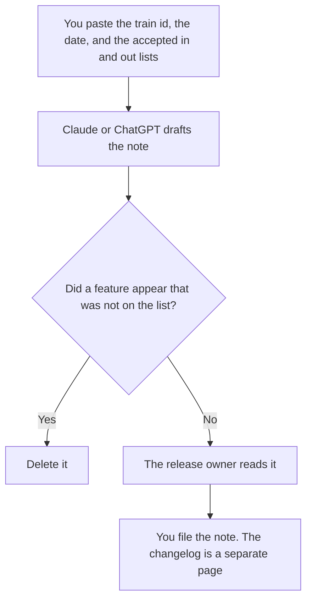

**A release train note written with AI is a short record of what is on this train, what missed it, the date, and the owner, using only the list a person already accepted.** The model may format that list. It may not add a feature, pull a date forward, or promise a customer outcome. The customer-facing version of a single change is [how to write a changelog announcement with AI](/blog/how-to-write-a-changelog-announcement-with-ai-2026/). The flag that may still be off is [how to create a feature flag rollout plan with AI](/blog/how-to-create-a-feature-flag-rollout-plan-with-ai-2026/).

Claude's prices are from claude.com/pricing on October 24, 2026. Notion, ChatGPT, and Grammarly prices are from directory pages checked October 16, 2026. chatgpt.com/pricing returned HTTP 403 on October 24. Published October 24, 2026. We did not score releases.

## What belongs on the note

| Row | Who owns it | The model may |
|---|---|---|
| The train id and the date | The release owner | Copy them. It may not pick a closer date |
| In this train | The accepted list | Phrase each item in one line. It may not add one |
| Not in this train | The same owner | Copy the misses. It may not call a miss "coming next week" unless you wrote that |
| The owner | You | Copy the name. If it is blank, write Owner missing |
| A customer impact line | Only if you pasted it | Not invent a percentage |

A train note is internal. It tells the people cutting the release what they are cutting. A changelog tells customers what they can use. If the two documents name different features, the train note is the source until a person updates both. A feature that is "in the train" but still behind a flag needs the flag's name on the row. Otherwise support will treat it as generally available.

## Where it is written

**The draft.** [Claude](/tools/claude/) Pro is $17 a month billed annually, $200 up front, or $20 monthly, when several trains live in one Project and the note should match the last one. The review is [Claude review](/blog/claude-review-2026/).

**The page the next train will open.** [Notion AI](/tools/notion-ai/) Business is $20 a seat a month if that is the release wiki. Plus at $10 is not the full AI tier. The invoice is [Notion AI pricing explained](/blog/notion-ai-pricing-explained-2026/).

**One train, from a short list.** [ChatGPT](/tools/chatgpt/) Plus is $20 a month. Free can format a single note. Discard a version that adds a theme paragraph about why the train "matters." The review is [ChatGPT review](/blog/chatgpt-review-2026/).

**The last pass.** [Grammarly](/tools/grammarly/) Pro is $12 a member a month billed annually, or $30 monthly. If the rewrite promotes a "not in this train" item into the shipped list, put it back. The invoice is [Grammarly pricing explained](/blog/grammarly-pricing-explained-2026/).

A prompt that holds the line:

"Write a release train note from the id, the date, and the in and out lists I pasted. Do not add a feature. Do not move the date. If the owner is missing, write Owner missing."

## What not to delegate

Do not ask the model which bugs are safe to slip. Do not announce the train in the changelog tool from this draft. Do not include a customer name. The public words, after the train is real, start from the changelog article, using only items still on the "in" list.

## FAQ

### How is this different from a changelog?

The train note is the cut list for the people shipping. The changelog is what customers can read. Every customer-facing item should appear on the "in" list. The reverse is not true: an internal fix can be on the train and off the changelog.

### How is this different from a flag rollout plan?

The rollout plan says how a flag turns on, and for whom. The train note says the change is in this cut. A row can be on the train and still off for customers until the flag plan says otherwise. Name the flag if that is the case.

### Can the model pull items from the issue tracker?

Only from items you pasted. A query it "would run" is not a list. If the tracker is the source, export the list, then draft.

### Who may call the train final?

The release owner. A model does not move the date because the prose is done. A note with no date and no owner is a draft.

## Last verified

October 24, 2026 for Claude. October 16, 2026 for Notion, ChatGPT, and Grammarly. Published October 24, 2026.

**Sources:** [Claude pricing](https://claude.com/pricing), [Notion pricing](https://www.notion.com/pricing), [ChatGPT pricing](https://chatgpt.com/pricing/), [Grammarly pricing](https://www.grammarly.com/plans).

*Published by Andrew for [AI Tools Optimizer](https://aitoolsoptimizer.com).*

[Claude](/tools/claude/) is in the [chatbots and assistants directory](/tools/category/chatbots-assistants/). Directory pages may use affiliate links. A purchase through them may earn us a commission at no extra cost to you.
