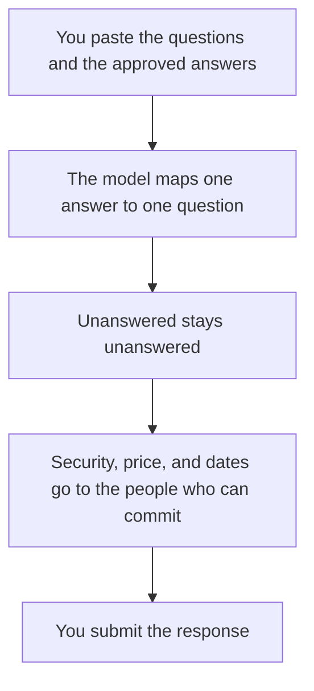

**An RFP response written with AI is the buyer's question, answered with a fact your team already approved, in the format the RFP asked for.** The model can map questions to your notes and tighten the sentences. It cannot promise a feature, a date, a price, or a certification you did not paste in. If the notes do not answer the question, the draft should say so.

The long-file seat, when the RFP is a PDF, is the subject of [Claude vs Gemini for long documents](/blog/claude-vs-gemini-for-long-documents-2026/). The research seat, when you are checking a public claim, is [Gemini vs Claude for research](/blog/gemini-vs-claude-for-research-2026/). The fact pass is [how to fact-check AI writing](/blog/how-to-fact-check-ai-writing-2026/).

Prices are US list prices excluding tax from directory pages checked October 16, 2026. Published October 24, 2026. We did not score proposals. This page is not legal advice.

## What the model may touch

| Piece | Who owns it | The model may |
|---|---|---|
| The question | The RFP | Repeat it. It may not merge two questions to hide a gap |
| The answer | Your approved notes | Phrase it. It may not add a capability |
| A requirement you miss | You | Leave a blank labeled Unanswered |
| Price and term | The person allowed to quote | Format a number you supplied. It may not estimate one |
| A security claim | The security owner | Paste the sentence they approved. It may not upgrade "in progress" to "certified" |
| The voice | Your style guide | Apply it after the facts are stable |

A fluent paragraph that "satisfies" a control you do not have is how RFP responses become incidents. The name for a confident invention is [what an AI hallucination is](/blog/what-is-ai-hallucination-2026/). The person who is allowed to commit is [what human-in-the-loop AI is](/blog/what-is-human-in-the-loop-ai-2026/).

## Where the draft happens

**The PDF is long.** [Claude](/tools/claude/) Pro is $20 a month, or $17 billed annually. Put the RFP and your last approved response in a Project. Ask for a table: question number, proposed answer, source note, gap. Do not ask for a finished PDF first. The container is [Claude Projects vs ChatGPT Projects](/blog/claude-projects-vs-chatgpt-projects-2026/).

**The team already lives in chat.** [ChatGPT](/tools/chatgpt/) Plus is $20 and includes projects and file uploads, with the limits on that plan. Go at $8 is a thin place to hold an RFP. The ladder is [ChatGPT Go vs Plus vs Pro](/blog/chatgpt-go-vs-plus-vs-pro-2026/).

**The answers already live in the wiki.** [Notion AI](/tools/notion-ai/) Business is $20 a seat. Search the approved pages, then paste the answer next to the question. The wiki is the record. The proposal is a view. That split is [what a system of record for AI is](/blog/what-is-a-system-of-record-for-ai-2026/). The card is [Notion AI pricing explained](/blog/notion-ai-pricing-explained-2026/).

**A public fact you need to check, such as a standard's name.** [Perplexity](/tools/perplexity/) Pro is $17 a month billed annually. Use it to find the source, then open the source. Do not paste Perplexity's paragraph into the response. The worth-it page is [is Perplexity Pro worth it](/blog/is-perplexity-pro-worth-it-2026/).

**The sentences, after legal and security have signed the claims.** [Grammarly](/tools/grammarly/) Pro is $12 a member a month billed annually. It will not notice a wrong certification. The card is [Grammarly pricing explained](/blog/grammarly-pricing-explained-2026/).

A prompt that holds the line:

"Here are the RFP questions and our notes. Draft an answer under each question using only the notes. If the notes do not cover it, write UNANSWERED and a question for us. Do not add features, dates, prices, certifications, or customer names that are not in the notes. Do not change a 'no' into a 'partial.'"

The terms you must spell the same way belong in [how to create a style guide with AI](/blog/how-to-create-a-style-guide-with-ai-2026/).

## Before anyone exports a PDF

Read every commitment out loud: a date, a price, an SLA, a compliance sentence. If the approved note does not contain it, it comes out. A case study you attach has its own workflow, and it needs the customer's permission: [how to write a case study with AI](/blog/how-to-write-a-case-study-with-ai-2026/).

Do not send the draft from the model to the buyer. Export from the document a human edited. Keep the question numbers. Evaluators score the question you skipped when you merged it into a neighbor.

## FAQ

### Can AI answer an RFP from our website?

It can draft marketing sentences. An RFP usually asks for commitments the website does not make. Start from the internal notes. Use the website only for wording you have already approved.

### How is this different from a sales email?

A sales email can be short and still be honest. An RFP answer is a response to a numbered question, and a gap is better than a blend. The email habit is [how to write customer emails with AI](/blog/how-to-write-customer-emails-with-ai-2026/).

### What if two old proposals disagree?

Stop and pick the current fact. Do not ask the model to reconcile them into a third claim. The current security page, or the current price sheet, wins. Then update the old file so the next draft does not find the stale one.

### Should we fine-tune a model on past RFPs?

Not as the first step. A Project with the approved answers is easier to correct when a feature changes. Fine-tuning is a later decision, and the definition is [what fine-tuning is](/blog/what-is-fine-tuning-ai-2026/). Past proposals also contain other customers' names. Strip those before any file is reused.

## Last verified

October 16, 2026 for Claude, ChatGPT, Notion, Perplexity, and Grammarly prices named above. Published October 24, 2026.

**Sources:** [Claude pricing](https://claude.com/pricing), [ChatGPT pricing](https://chatgpt.com/pricing), [Perplexity](https://www.perplexity.ai).

*Published by Andrew for [AI Tools Optimizer](https://aitoolsoptimizer.com).*

[Claude](/tools/claude/) is in the [chatbots and assistants directory](/tools/category/chatbots-assistants/). Directory pages may use affiliate links. A purchase through them may earn us a commission at no extra cost to you.
