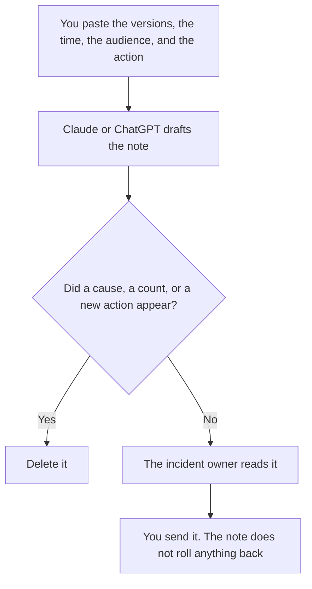

**A rollback comms note written with AI tells a named audience what version came back, when, what they should do, and what did not change, using only facts a person pasted.** The model may format that note. It may not invent a cause, a customer impact count, or a promise that the next release is safe. If a fact is missing, the line says Missing.

The steps to undo the change, which are a different document, are [how to create a rollback plan with AI](/blog/how-to-create-a-rollback-plan-with-ai-2026/). The message when customers must move, which is not a rollback, is [how to write a customer migration notice with AI](/blog/how-to-write-a-customer-migration-notice-with-ai-2026/). The forward path after you decide to go ahead again is [what an AI rollforward is](/blog/what-is-ai-rollforward-2026/).

Claude's prices are from claude.com/pricing on October 24, 2026. Notion, ChatGPT, and Grammarly prices are from directory pages checked October 16, 2026, except ChatGPT Plus, which is $20 a month on the October 24 Codex plan page. Published October 24, 2026. We did not score incidents. This page is not a status-page product.

## What belongs in the note

| Line | Who owns it | The model may |
|---|---|---|
| The version that was rolled back, and the version now serving | The person who ran the rollback | Copy both. It may not guess a build number |
| The time, in the zone you wrote | You | Copy it. A blank time stays Time missing |
| The audience | You | Internal and external notes stay separate |
| What the audience should do | Only if you wrote the action | Not add "clear your cache" because it sounds helpful |
| What did not change | Only the items you listed | Not reassure people about systems you did not name |

A comms note is not the rollback plan. The plan is how you undo the change. The note is what you tell people after that undo has happened, or while it is in progress if you say it is in progress. If the undo has not happened, the note says it has not happened. A sentence that says "service is fully restored" when the paste says "rollback in progress" is a false close.

## Where it is written

**The draft, when the wording has to match the last incident.** [Claude](/tools/claude/) Pro is $17 a month billed annually, $200 up front, or $20 monthly. Put the required lines in the Project. The review is [Claude review](/blog/claude-review-2026/).

**The page the company will keep.** [Notion AI](/tools/notion-ai/) Business is $20 a seat a month if that is the incident log. Plus at $10 is not the full AI tier on the October 16 card. The invoice is [Notion AI pricing explained](/blog/notion-ai-pricing-explained-2026/).

**One note, from a short paste.** [ChatGPT](/tools/chatgpt/) Plus is $20 a month. Discard a version that explains the root cause. The review is [ChatGPT review](/blog/chatgpt-review-2026/).

**A last pass on the words.** [Grammarly](/tools/grammarly/) Pro is $12 a member a month billed annually, or $30 monthly. If the rewrite softens "rolled back" into "improved," put the original verb back. The invoice is [Grammarly pricing explained](/blog/grammarly-pricing-explained-2026/).

A prompt that holds the line:

"Write a rollback comms note for the audience I named. Use only the versions, the time, the action, and the unchanged items I pasted. If a field is missing, write Missing. Do not state a cause. Do not say service is restored unless I pasted that sentence."

## What not to delegate

Do not ask the model whether you should roll back. That decision is already made, or it is not this note. Do not paste a customer list so the example looks specific. Do not send the note because the prose is finished. The incident owner sends it.

## FAQ

### How is this different from a rollback plan?

The plan is the sequence of steps, owners, and checks. This note is the message to people who need to know the outcome. You can have a plan and still owe a note. You can owe a note that says the rollback is not finished.

### How is this different from a migration notice?

A migration notice tells people to move to something new, on a date. A rollback note tells them a change was undone. Using the migration template for a rollback will tell customers to do the wrong thing. Keep the documents apart.

### Can the model pull the status from the deploy tool?

Only from text you paste or from a status a person has already confirmed. A model that "knows" the deploy is using a stale thread. Paste the version.

### Who may call the incident over?

The owner named on the incident. A calm paragraph is not a resolution. The rollforward, if you try again, is a new decision.

## Last verified

October 24, 2026 for Claude and for ChatGPT Plus. October 16, 2026 for Notion and Grammarly. Published October 24, 2026.

**Sources:** [Claude pricing](https://claude.com/pricing), [Notion pricing](https://www.notion.com/pricing), [ChatGPT and Codex pricing](https://learn.chatgpt.com/docs/pricing), [Grammarly plans](https://www.grammarly.com/plans).

*Published by Andrew for [AI Tools Optimizer](https://aitoolsoptimizer.com).*

[Claude](/tools/claude/) is in the [chatbots and assistants directory](/tools/category/chatbots-assistants/). Directory pages may use affiliate links. A purchase through them may earn us a commission at no extra cost to you.
