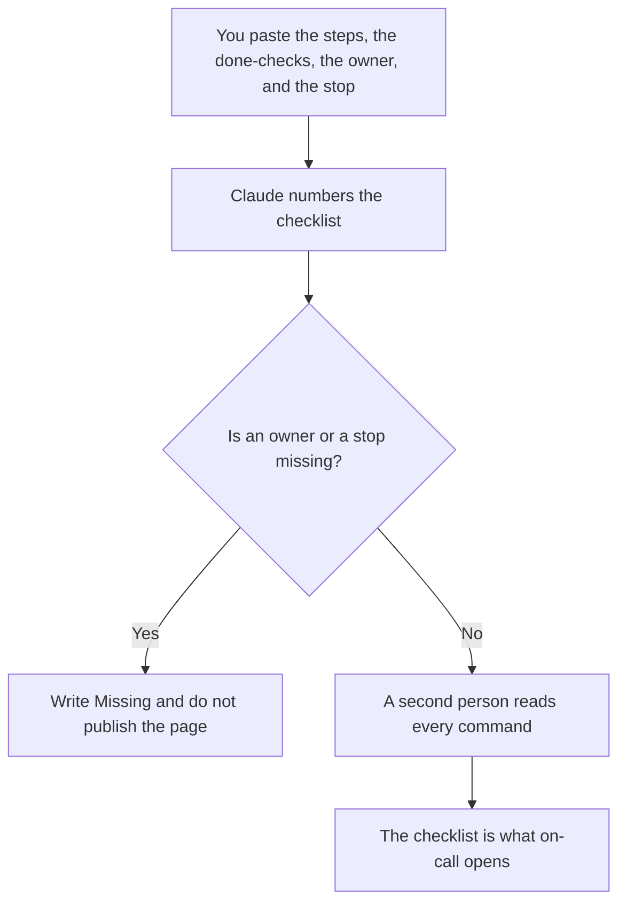

**A runbook checklist written with AI is a list of boxes a person on call can tick: the step, who does it, what "done" looks like, and when to stop.** The model may turn steps you paste into a list. It may not invent a command, a dashboard, or a severity. The page that explains the runbook as a document is [what an AI runbook is](/blog/what-is-an-ai-runbook-2026/). This page is the checklist form of that document. A migration, with a freeze and a backout, is [how to write a migration runbook with AI](/blog/how-to-write-a-migration-runbook-with-ai-2026/).

The timeline you write after the fact is [how to write an incident timeline with AI](/blog/how-to-write-an-incident-timeline-with-ai-2026/). The hour's roles are [what AI incident response is](/blog/what-is-ai-incident-response-2026/).

Prices are US list prices excluding tax from directory pages checked October 16, 2026. Published October 24, 2026. We did not score incidents.

## What fits on the checklist

| Box | Who owns it | The model may |
|---|---|---|
| The symptom | The alert or the sentence you wrote | Copy it. It may not rename the alert |
| The step | A command or a click you already use | Place it. It may not compose a new one |
| Done | The check a person can see | Format it. It may not mark the box ticked |
| The owner | A role you named | Copy it. If the role is missing, stop |
| Stop | When to escalate or roll back | Copy it. It may not add a hero step |

A box that says "verify the system" is not a check. The check names what you look at and what you expect to see. A command the model composed is a proposal until someone who can run it has read it on a system that is not production, if your process has one. The place that rehearsal belongs is [what an AI tool sandbox is](/blog/what-is-ai-tool-sandbox-2026/).

## Where the checklist is written

**The draft.** [Claude](/tools/claude/) Pro is $20 a month, or $17 billed annually, when the list is long and should sit beside the last incident's notes. The review is [Claude review](/blog/claude-review-2026/).

**The page on call opens.** [Notion AI](/tools/notion-ai/) Business is $20 a seat a month if that is the wiki. The chat is not the checklist. The page is.

**The commands.** [Cursor](/tools/cursor/) Plus is $8 a month, or $80 a year, when the boxes quote scripts in the repo. You read the diff. The ladder is [Cursor pricing explained](/blog/cursor-pricing-explained-2026/).

**A short card.** [ChatGPT](/tools/chatgpt/) Plus at $20 a month can format a one-screen list. Discard a step it added because every runbook "should restart the service."

A prompt that holds the line:

"Format a checklist from the steps, done-checks, owner, and stop condition I pasted. Do not add a command. Do not tick a box. If the stop is missing, write Stop missing and stop."

## What not to delegate

Do not ask the model what the severity is. Do not publish a checklist you have not rehearsed at least once on a safe system. Do not let the checklist and the migration runbook disagree about who can abort. One of them is wrong until a person picks.

## FAQ

### How is a checklist different from a runbook?

The runbook is the document: context, steps, and backout. The checklist is the form you can tick under pressure. Every box should point at a step the runbook already contains. A box with no runbook step is how folklore gets into the page.

### Can the model write the commands?

Only by formatting commands you pasted and have used. A new flag is not a box. The checklist does not become safer because the command looks specific.

### How many boxes?

Few enough that a tired person will finish them. If you have twenty, group them and name which group is the first five minutes. A checklist nobody can finish is a wiki article.

### Who updates it?

The owner of the service, after an incident or a change that made a step false. A model does not notice that the dashboard moved. A person does, and then the checklist changes in the same week.

## Last verified

October 16, 2026 for Claude, Notion AI, Cursor, and ChatGPT. Published October 24, 2026.

**Sources:** [Claude pricing](https://claude.com/pricing), [Notion pricing](https://www.notion.com/pricing), [Cursor pricing](https://cursor.com/help/account-and-billing/pricing), [ChatGPT pricing](https://chatgpt.com/pricing/).

*Published by Andrew for [AI Tools Optimizer](https://aitoolsoptimizer.com).*

[Cursor](/tools/cursor/) is in the [coding directory](/tools/category/coding/). Directory pages may use affiliate links. A purchase through them may earn us a commission at no extra cost to you.
