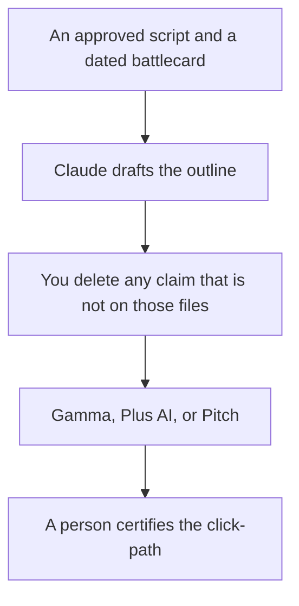

**A sales enablement deck written with AI is the file reps present: the segment, the problem in the buyer's words, the proof you can show, the demo clicks, and the next step.** The model can turn an approved script into slides. It cannot add a customer logo, a percent, or a competitor price. If enablement has not signed the claim, the slide does not exist.

The tool shelf is [best AI tools for enablement teams](/blog/best-ai-tools-for-enablement-teams-2026/). The script that should match the slides is [how to create a demo script with AI](/blog/how-to-create-a-demo-script-with-ai-2026/). The sourced claims are [how to create a competitive battlecard with AI](/blog/how-to-create-a-competitive-battlecard-with-ai-2026/). The one-page leave-behind is [how to write a sales one-pager with AI](/blog/how-to-write-a-sales-one-pager-with-ai-2026/).

Prices are US list prices excluding tax from directory pages checked October 16, 2026. Published October 24, 2026. We did not score win rates or slide design.

## What the deck is allowed to say

| Block | Source | The model may |
|---|---|---|
| Segment | The one segment on the battlecard | Name them. It may not widen the audience |
| Problem | Language from calls you paste | Shorten it |
| Demo path | Clicks a person verified this release | List them. It may not add a screen |
| Proof | A number, logo, or quote with permission | Place it. It may not round it |
| Competitor line | A dated row from the teardown or the card | Repeat it. It may not freshen it from memory |
| Next step | The meeting or trial you offer | One line |

A slide that says "most teams" with no source is [a hallucination](/blog/what-is-ai-hallucination-2026/). The check is [how to fact-check AI writing](/blog/how-to-fact-check-ai-writing-2026/).

## Where the file is made

**The outline.** [Claude](/tools/claude/) Pro is $20 a month, or $17 billed annually. Keep the script and the card in a Project. [ChatGPT](/tools/chatgpt/) Plus at $20 is the alternative if that is the rep's chat. Business at $20 a user a month billed annually is the admin seat when the deck is confidential. The ladder is [ChatGPT Go vs Plus vs Pro](/blog/chatgpt-go-vs-plus-vs-pro-2026/).

**The system of record.** [Notion AI](/tools/notion-ai/) Business is $20 a seat a month. The deck links to the script. It does not become a second, drifting copy of the price. The invoice is [Notion AI pricing explained](/blog/notion-ai-pricing-explained-2026/).

**A link reps send.** [Gamma](/tools/gamma/) Plus is $9 a seat a month. The invoice is [Gamma pricing explained](/blog/gamma-pricing-explained-2026/).

**Slides or PowerPoint.** [Plus AI](/tools/plus-ai/) Basic is $10 a user a month billed annually. The format pair is [Plus AI vs Gamma](/blog/plus-ai-vs-gamma-2026/).

**An editor with rooms and analytics.** [Pitch](/tools/pitch/) Team is $15 a seat a month billed yearly when you want pitch rooms. Plus at $10 is one member only. The invoice is [Pitch pricing explained](/blog/pitch-pricing-explained-2026/).

A prompt that holds the line:

"Draft an enablement deck outline from the script and battlecard I paste. One segment. Include only proof and competitor lines that appear in the paste, with their dates. If a click is not in the script, write Missing. Do not add logos, ROI, or discounts. Speaker notes must match the script."

The person who certifies a rep is [what human-in-the-loop AI is](/blog/what-is-human-in-the-loop-ai-2026/). A quiz, if you need one after the deck, is [how to create training quizzes with AI](/blog/how-to-create-training-quizzes-with-ai-2026/).

## What this deck is not

It is not a customer QBR. That file uses their numbers, and the workflow is [how to write a QBR deck with AI](/blog/how-to-write-a-qbr-deck-with-ai-2026/). It is not a partner brief. That workflow is [how to write a partner brief with AI](/blog/how-to-write-a-partner-brief-with-ai-2026/). It is not a case study. That needs permission: [how to write a case study with AI](/blog/how-to-write-a-case-study-with-ai-2026/).

## FAQ

### Can every rep generate their own version?

They can generate a cover with the account name from fields you allow. They should not generate a new proof point. The core slides stay on the approved file.

### How often should it be rebuilt?

When the script or the battlecard changes. A monthly "refresh" that rewrites claims from the open web will drift. The teardown habit is [how to create a competitor teardown with AI](/blog/how-to-create-a-competitor-teardown-with-ai-2026/).

### Should the price be in the deck?

If the rate card is approved for reps, yes, as written. If pricing is custom, the slide says so in the words legal approved. The model does not invent a range.

### Can the deck include a demo video?

Only after the script is true. An avatar that shows a click the product does not have is worse than no video. The sales-avatar choice is [HeyGen vs Synthesia for sales](/blog/heygen-vs-synthesia-for-sales-2026/).

## Last verified

October 16, 2026 for Claude, ChatGPT, Notion, Gamma, Plus AI, and Pitch. Published October 24, 2026.

**Sources:** [Claude pricing](https://claude.com/pricing), [Gamma pricing](https://gamma.app/pricing), [Pitch pricing](https://pitch.com/pricing).

*Published by Andrew for [AI Tools Optimizer](https://aitoolsoptimizer.com).*

[Gamma](/tools/gamma/) is in the [presentations directory](/tools/category/presentations/). Directory pages may use affiliate links. A purchase through them may earn us a commission at no extra cost to you.
