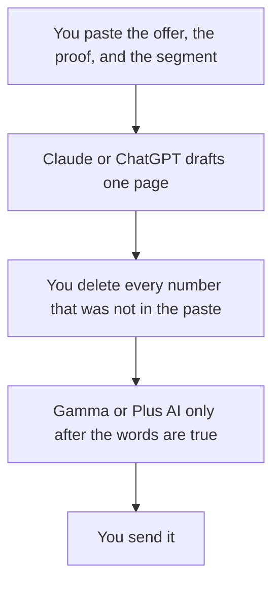

**A sales one-pager written with AI is a single page a buyer can read: who it is for, the problem you solve, the proof you can show, the offer, and the next step.** The model can compress notes you paste. It cannot invent a customer quote, a percent saved, or a discount. If the proof is not in the notes, the page says you will send it, or the section stays off the page.

The longer narrative, when a customer has agreed to be the story, is [how to write a case study with AI](/blog/how-to-write-a-case-study-with-ai-2026/). The deck, when they asked for slides, is [how to create a pitch deck with AI](/blog/how-to-create-a-pitch-deck-with-ai-2026/). The team stack is [best AI tools for sales teams](/blog/best-ai-tools-for-sales-teams-2026/).

Prices are US list prices excluding tax from directory pages checked October 16, 2026. Published October 24, 2026. We did not score one-pagers.

## What fits on the page

| Block | Who owns it | The model may |
|---|---|---|
| Audience | You, one segment | Name them. It may not widen to "everyone" |
| Problem | Language from calls or the site, that you paste | Shorten it. It may not add a fear the buyer did not state |
| Proof | A number, logo, or quote you have permission to use | Place it. It may not round it or anonymize it into a fake stat |
| Offer | The price and scope on the current rate card | State them. It may not add a discount |
| Next step | The meeting or the trial you actually offer | One line. It may not invent a calendar link |

A rounded "30% faster" that started as a rep's impression is [a hallucination](/blog/what-is-ai-hallucination-2026/) on a leave-behind. The check is [how to fact-check AI writing](/blog/how-to-fact-check-ai-writing-2026/).

## Where the words and the layout happen

**The long call notes.** [Claude](/tools/claude/) Pro is $20 a month, or $17 billed annually. Put the rate card in a Project so the next one-pager cannot drift the price. The container is [Claude Projects vs ChatGPT Projects](/blog/claude-projects-vs-chatgpt-projects-2026/).

**The rep's default chat.** [ChatGPT](/tools/chatgpt/) Plus is $20. Go at $8 can draft a short version. Business at $20 a user a month billed annually, for two or more users, is the admin seat when customer names are in the notes. The ladder is [ChatGPT Go vs Plus vs Pro](/blog/chatgpt-go-vs-plus-vs-pro-2026/).

**A link the buyer can open.** [Gamma](/tools/gamma/) Plus is $9 a seat a month once the words are frozen. Free credits do not refresh. Do not design the page before the proof is real.

**A file the buyer will edit in Slides or PowerPoint.** [Plus AI](/tools/plus-ai/) Basic is $10 a user a month billed annually. The format choice is [Plus AI vs Gamma](/blog/plus-ai-vs-gamma-2026/).

**The line edit.** [Grammarly](/tools/grammarly/) Pro is $12 a member a month billed annually. It will not know the rate card.

A prompt that holds the line:

"Draft a one-page leave-behind for the segment in my notes. Sections: audience, problem, proof, offer, next step. Use only the notes. If a proof point or a price is missing, write Missing and do not invent it. Do not add testimonials, percentages, or discounts. Keep it under 400 words."

The person who sends it is [what human-in-the-loop AI is](/blog/what-is-human-in-the-loop-ai-2026/). A video follow-up, if you use one, should say the same offer. The tool choice for that clip is [HeyGen vs Synthesia for sales](/blog/heygen-vs-synthesia-for-sales-2026/).

## What this page is not

It is not a partner brief. A mutual one-pager for a co-sell has two logos and a shared motion. The team that owns that file is [best AI tools for partnerships teams](/blog/best-ai-tools-for-partnerships-teams-2026/). It is not an RFP response. That workflow is [how to write an RFP response with AI](/blog/how-to-write-a-rfp-response-with-ai-2026/).

It is also not the PRD. Product agreement stays in [how to write a PRD with AI](/blog/how-to-write-a-prd-with-ai-2026/). Sales copy that adds a feature the PRD listed as a non-goal is a bug.

## FAQ

### Can AI write a different one-pager per account?

Yes, from facts you paste about that account. No, from a prompt that says "research them and sound specific" with no sources. Specific and invented is worse than generic and true.

### How much proof is enough?

One proof point you can defend. Zero is allowed. A page with three invented logos is not a stronger page. If you have no proof yet, say what the next step is and stop.

### Should the price be on the page?

If the rate card is public or the seller is allowed to show it, yes. If pricing is custom, the model should write "we'll scope this" only when your notes say that. It should not invent a range.

### Can the one-pager update itself from the CRM?

Only after a person checks the fields. A stale opportunity amount will print as confidence. The CRM remains the record. HubSpot's free CRM is a common place that record lives. This page does not turn the CRM into the writer.

## Last verified

October 16, 2026 for Claude, ChatGPT, Gamma, Plus AI, and Grammarly prices named above. Published October 24, 2026.

**Sources:** [Claude pricing](https://claude.com/pricing), [Gamma pricing](https://gamma.app/pricing), [Plus AI pricing](https://plusai.com/pricing).

*Published by Andrew for [AI Tools Optimizer](https://aitoolsoptimizer.com).*

[Gamma](/tools/gamma/) is in the [presentations directory](/tools/category/presentations/). Directory pages may use affiliate links. A purchase through them may earn us a commission at no extra cost to you.
