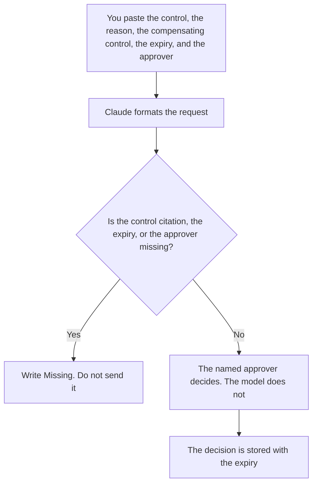

**A security exception request written with AI names the control you will not meet, the reason you already have, the compensating control you will actually run, the expiry, and the approver.** The model may format the request. It may not approve it, shorten the control, or invent a compensating control. A dependency that might fail later is a different note: [how to write a dependency risk note with AI](/blog/how-to-write-a-dependency-risk-note-with-ai-2026/). The place a tool is allowed to run is [what an AI tool sandbox is](/blog/what-is-ai-tool-sandbox-2026/). How long data may be kept is [what an AI data retention policy is](/blog/what-is-ai-data-retention-policy-2026/).

Prices are US list prices excluding tax from directory pages checked October 16, 2026. A live fetch of vendor pricing pages on October 24, 2026 returned HTTP 401, so this page stays on the directory record. Published October 24, 2026. We did not score risk. This page is not a security approval.

## What belongs on the request

| Row | Who owns it | The model may |
|---|---|---|
| The control | The policy, quoted | Copy the citation you pasted. It may not paraphrase the control into a weaker one |
| The reason | You | Format it. It may not add a business justification |
| The compensating control | The control owner | Copy what you will do instead. It may not suggest one and mark it accepted |
| The expiry | You | Copy the date. An exception with no date is a policy change in disguise |
| The approver | A person who is allowed to approve | Copy the name. If the name is missing, stop |

An exception that says "temporary" and has no date will still be in place next year. Pick a date a person can put on a calendar, and name who reviews it then. If the compensating control is "we will be careful," you do not have one. Name the log, the review, the network boundary, or the other control you will run, in words an auditor can find.

The sandbox article is about where a tool may execute. This request is about a control you are asking to skip. They meet when the exception is "let this agent run outside the sandbox." That sentence needs the sandbox's name, the expiry, and the approver. It does not need a model to agree that the idea is reasonable.

## Where the request is written

**The draft.** [Claude](/tools/claude/) Pro is $20 a month, or $17 billed annually, when the policy excerpt is long and should sit in a Project. Paste only the excerpt you are allowed to paste. Do not paste a full policy pack into a personal account your company forbids. The review is [Claude review](/blog/claude-review-2026/).

**The register.** [Notion AI](/tools/notion-ai/) Business is $20 a seat a month if exceptions live in a database with an expiry view. The chat is not the register. The invoice is [Notion AI pricing explained](/blog/notion-ai-pricing-explained-2026/).

**The change that implements the exception.** [Cursor](/tools/cursor/) Plus is $8 a month, or $80 a year, when the exception is also a code or config change. You review the diff. A generated change that opens the permission and forgets the expiry comment is a defect. The ladder is [Cursor pricing explained](/blog/cursor-pricing-explained-2026/).

**A short form.** [ChatGPT](/tools/chatgpt/) Plus is $20 a month. Discard a draft that adds "risk accepted" at the bottom. That line is the approver's, and only after they decide.

A prompt that holds the line:

"Format an exception request from the control citation, reason, compensating control, expiry, and approver I pasted. Do not weaken the control. If the approver is missing, write Approver missing and stop."

## What not to delegate

Do not ask the model whether the exception should be granted. Do not let a draft circulate with a blank expiry. Do not store the request in a channel that includes people who should not see the control's details. The approval is a record. A thumbs-up on a chat message is a record only if your process says so, and the expiry is still a date.

## FAQ

### How is this different from a dependency risk note?

The risk note says a dependency might hurt you and who watches it. The exception request asks to skip a control for a period, with something else in its place, and a named approver. You can have a risk note and still have no exception. You should not have an exception with no expiry.

### Can the model propose compensating controls?

It can list options you then reject or rewrite. It cannot mark one accepted. The accepted control is a sentence you are willing to operate. A list of five ideas is not a control.

### What if the policy forbids exceptions?

Then the request is the wrong artifact. The answer is to meet the control or to change the policy through the path the policy names. A fluent request does not create an exception process that does not exist.

### Who keeps the expiry?

The register owner. Put the date where a person will see it before it passes. A model will not wake up and revoke the permission. The config change has to be ticketed like any other change.

## Last verified

October 16, 2026 for Claude, Notion, Cursor, and ChatGPT. Published October 24, 2026.

**Sources:** [Claude pricing](https://claude.com/pricing), [Notion pricing](https://www.notion.com/pricing), [Cursor pricing](https://cursor.com/help/account-and-billing/pricing), [ChatGPT pricing](https://chatgpt.com/pricing/).

*Published by Andrew for [AI Tools Optimizer](https://aitoolsoptimizer.com).*

[Claude](/tools/claude/) is in the [chatbots and assistants directory](/tools/category/chatbots-assistants/). Directory pages may use affiliate links. A purchase through them may earn us a commission at no extra cost to you.
