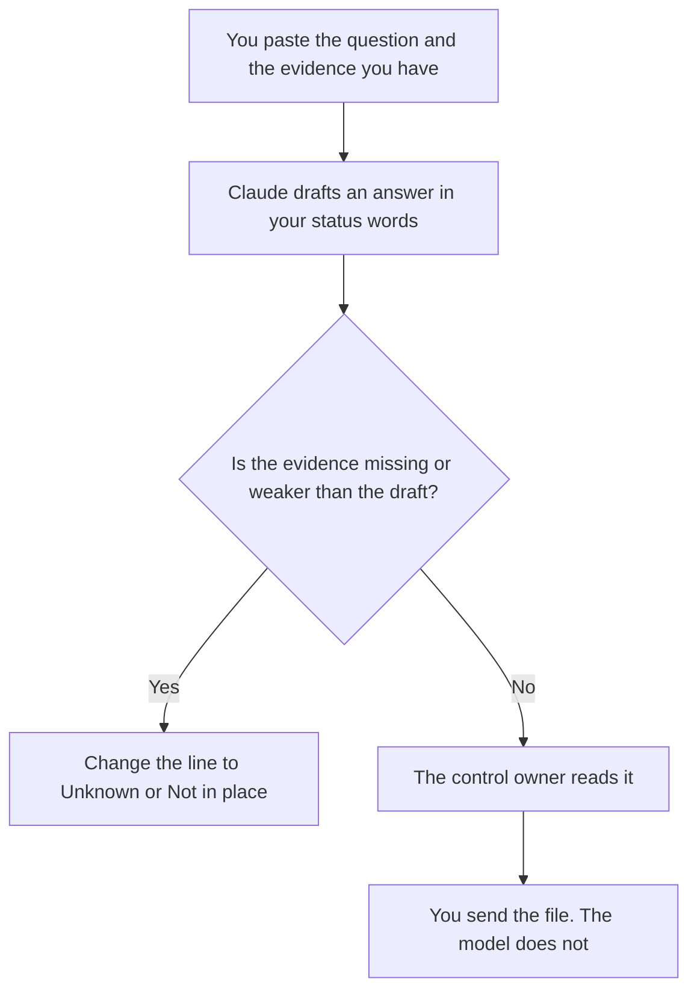

**A security questionnaire response written with AI is a draft of answers you already have evidence for.** The model formats the sentence. It does not invent a control, a certification, a date, or a tool you do not run. If the evidence is missing, the line says Unknown or Not in place. This page is honest drafting for the person who owns the answers. It is not a way to pass a review, soften a gap, or write around a question.

The internal page that names your checks is [what an AI guardrail policy is](/blog/what-is-ai-guardrail-policy-2026/). A customer document with their questions and your real answers is [how to write an RFP response with AI](/blog/how-to-write-a-rfp-response-with-ai-2026/). A scored view of a vendor, which is the other direction, is [how to write a vendor scorecard with AI](/blog/how-to-write-a-vendor-scorecard-with-ai-2026/). The person who releases the file is [what human-in-the-loop AI is](/blog/what-is-human-in-the-loop-ai-2026/).

Prices are US list prices excluding tax from directory pages checked October 16, 2026. Published October 24, 2026. This is not legal advice, not a penetration test, and not instructions for concealing a weakness.

## The lines that have to be real

| Line | Who owns it | The model may |
|---|---|---|
| The question | The customer's sheet, copied as they asked it | Repeat it. It may not merge two questions to dodge one |
| The answer | A control you operate, in words you already use | Shorten the sentence. It may not upgrade "partial" to "yes" |
| Evidence | A policy name, a setting, or a report you can hand over | Name only the exhibit you pasted |
| Status | Yes, no, partial, or unknown, using your scale | Copy the status. It may not pick the favorable one |
| Owner | The person who will defend the answer on a call | Leave Missing if unnamed |
| Date | When the evidence was last checked | Copy it. It may not set the date to today |

A polished "yes" without an exhibit is the failure this workflow exists to stop. Buyers compare answers to the evidence pack. An invented certification is not a writing problem. It is a false statement. The model is good at sounding complete. Read for completeness you did not earn.

## Where the draft is written

**The long packet.** [Claude](/tools/claude/) Pro is $20 a month, or $17 billed annually, when the policies and the last questionnaire should sit in a Project. Free can format one answer from a paste. The review is [Claude review](/blog/claude-review-2026/). Do not put a customer's confidential questionnaire in a consumer account if your policy forbids it. [ChatGPT](/tools/chatgpt/) Business is $20 a user a month billed annually, two-user minimum, when a company workspace is the rule. The card says Business does not train on business data by default.

**The record.** [Notion AI](/tools/notion-ai/) Business is $20 a seat a month if the answer library lives in Notion. The library is previous answers the owner still stands behind, with the date. A previous "yes" that is no longer true gets marked stale. The model does not copy last year's yes into this year's sheet.

**The call.** [Granola](/tools/granola/) Business is $14 a user a month if a reviewer call should be noted without a bot on the screen. The note is not a new control. It is what they asked. Free history is 30 days.

A prompt that holds the line:

"Answer only from the evidence I pasted. Use our status words. If the evidence does not support a yes, write Unknown. Do not mention a certification, a tool, or a date I did not paste. Do not suggest wording that hides a gap. Quote the question unchanged."

## What not to delegate

Do not ask how to make a weak control "sound enterprise." Do not ask for an answer that avoids the question. Do not let the model name a subprocess, a region, or a subprocessors list you did not paste. Do not send the file from the chat. The owner sends it, after they can point at the exhibit for every yes.

If the questionnaire asks about a check you wish you had, the status is Not in place, plus the owner and any date you have actually committed. A roadmap sentence is allowed only if you pasted the commitment. A generated roadmap is not a commitment.

## FAQ

### Can AI fill the whole spreadsheet?

It can draft rows where you pasted evidence. Empty evidence stays Unknown. A full sheet of confident answers from a blank evidence column is the outcome to reject.

### What if we are embarrassed by a no?

Say no, or partial, in the status you use. Offer the exhibit you have. A buyer who later finds the gap will trust the rest of the sheet less. This workflow will not help you bury it.

### Is this legal advice?

No. It is a drafting order: evidence, then words, then a human send. What you must disclose, and what a contract requires, is a question for counsel. The model does not answer it.

### Can we reuse last year's file?

Only the rows the owner re-checked. A date in the past means the row is stale until someone looks. Copying last year with a new cover date is how a questionnaire becomes fiction.

## Last verified

October 16, 2026 for Claude, ChatGPT, Notion AI, and Granola. Published October 24, 2026.

**Sources:** [Claude pricing](https://claude.com/pricing), [ChatGPT pricing](https://chatgpt.com/pricing/), [Notion pricing](https://www.notion.com/pricing), [Granola](https://www.granola.ai).

*Published by Andrew for [AI Tools Optimizer](https://aitoolsoptimizer.com).*

[Notion AI](/tools/notion-ai/) is in the [productivity and notes directory](/tools/category/productivity-notes/). Directory pages may use affiliate links. A purchase through them may earn us a commission at no extra cost to you.
