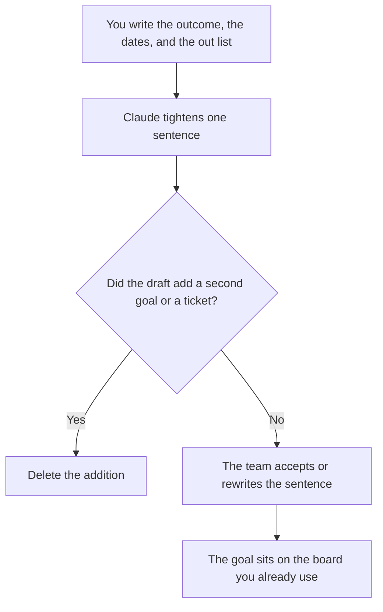

**A sprint goal written with AI is one sentence that names an outcome you already chose, for a sprint length you already set.** The model may tighten the wording and list the work you pasted under it. It may not add a feature, a date, or a second goal to make the sprint look full.

A quarter-sized target is [how to write OKRs with AI](/blog/how-to-write-okrs-with-ai-2026/), and the seat choice is [Claude vs ChatGPT for OKRs](/blog/claude-vs-chatgpt-for-okrs-2026/). The meeting after the sprint is [how to run a retro with AI](/blog/how-to-run-a-retro-with-ai-2026/). The spec underneath, when there is one, is [how to write a PRD with AI](/blog/how-to-write-a-prd-with-ai-2026/).

Prices are US list prices excluding tax from directory pages checked October 16, 2026. Published October 24, 2026. We did not score delivery. A goal is not a commitment the model can make.

## The lines that have to be real

| Line | Who owns it | The model may |
|---|---|---|
| Outcome | The change a user or a teammate can see when the sprint ends | Shorten the sentence. It may not swap the outcome |
| Sprint length | The dates you paste | Copy them |
| In | The tickets or slices you already pulled in | List them under the goal |
| Out | Work you named as not in this sprint | Keep it. It may not pull items back in |
| Owner | The role who will say the goal at planning | Leave Missing if unnamed |
| Proof | How you will know the outcome happened | Use only the check you wrote |

If the sentence needs "and" between two outcomes, you have two goals. Pick one. Park the other in Out. The model is good at hiding the "and" inside a longer sentence. Read for it.

## Where the sentence is written

**The draft.** [Claude](/tools/claude/) Pro is $20 a month, or $17 billed annually, when the PRD or the last retro notes should sit in a Project. Free can tighten one sentence from a paste. The review is [Claude review](/blog/claude-review-2026/).

**The board of record.** [Notion AI](/tools/notion-ai/) Business is $20 a seat a month if the sprint page lives in Notion. [ClickUp Brain](/tools/clickup-brain/) starts at $9 per user a month if the work already lives in ClickUp. Unlimited is $7 a user a month billed yearly. The goal and the tickets have to match. A chat goal with a different board is two plans.

**A second wording.** [ChatGPT](/tools/chatgpt/) Plus at $20 can offer a shorter sentence from the same bullets. Keep the outcome. Discard a clever line that changed it. The review is [ChatGPT review](/blog/chatgpt-review-2026/).

The facilitator's shelf is [best AI tools for scrum masters](/blog/best-ai-tools-for-scrum-masters-2026/). The person who accepts the goal is [what human-in-the-loop AI is](/blog/what-is-human-in-the-loop-ai-2026/).

A prompt that holds the line:

"Write one sprint goal sentence from the outcome I pasted. Include the dates I gave. Do not add a feature. Do not move anything from the out list into the sprint. If the outcome is missing, write Missing."

## What not to delegate

Do not ask the model to choose the sprint goal from a backlog. Do not let it assign points or promise a date the team did not set. Do not turn the goal into a status report. Status is [how to write a status update with AI](/blog/how-to-write-a-status-update-with-ai-2026/).

## FAQ

### Can AI split the goal into tickets?

It can format tickets you already named. New tickets are scope. If a slice is missing, write it yourself or leave the goal larger than the list and say so. A generated backlog is not an estimate.

### Is the sprint goal the OKR?

The OKR is the period you set on that page, often a quarter. The sprint goal is one increment you believe fits the dates you pasted. A sprint goal that repeats the OKR word for word usually hides the increment. Name the increment.

### What if the team cannot agree?

The model does not break the tie. Write the two candidate outcomes and pick in the room. Filing a compromise sentence nobody can demo is how the retro gets a vague goal to complain about.

### Can the goal mention a metric?

Only a metric you pasted, with the baseline you have. A target the model raised "to be ambitious" is the same failure as an invented OKR number. Copy your number or leave it out.

## Last verified

October 16, 2026 for Claude, Notion AI, ClickUp, and ChatGPT. Published October 24, 2026.

**Sources:** [Claude pricing](https://claude.com/pricing), [Notion pricing](https://www.notion.com/pricing), [ChatGPT pricing](https://chatgpt.com/pricing/).

*Published by Andrew for [AI Tools Optimizer](https://aitoolsoptimizer.com).*

[ClickUp Brain](/tools/clickup-brain/) is in the [productivity and notes directory](/tools/category/productivity-notes/). Directory pages may use affiliate links. A purchase through them may earn us a commission at no extra cost to you.
