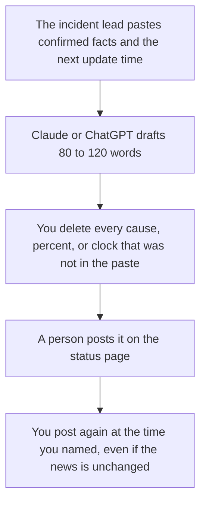

**A status page update written with AI is a short public note: what customers can see, what you are doing, and when you will post again.** The model can tighten sentences you paste. It cannot invent a root cause, a percent of users affected, or a restoration time. If those facts are not in the incident channel, the update says you are still investigating, and it names the next update time you will actually hit.

An internal note to your own team is a different page: [how to write a status update with AI](/blog/how-to-write-a-status-update-with-ai-2026/). The roles for the hour are [what AI incident response is](/blog/what-is-ai-incident-response-2026/). The steps you wish were printed are [what an AI runbook is](/blog/what-is-an-ai-runbook-2026/). After the incident, the shipped-change note is [how to write a changelog with AI](/blog/how-to-write-a-changelog-with-ai-2026/).

Prices are US list prices excluding tax from directory pages checked October 16, 2026. Published October 24, 2026. We did not score incident communications. This page does not price a status-page vendor, because the directory does not list one.

## What the public note is allowed to say

| Line | Who owns the fact | The model may |
|---|---|---|
| What customers see | The symptom you have confirmed: errors, delays, a feature that will not load | Describe it in plain language. It may not rename it as a deeper failure |
| Who is affected | A scope you measured, or "we do not know the scope yet" | Not a percentage you did not paste |
| What you are doing | The action in progress, named by the incident lead | Not a fix you hope will work |
| Cause | Only a cause the lead has confirmed | Investigating, until then |
| Next update | A clock time you will keep | Not "shortly" |
| Restoration | Only a time you are willing to miss in public | Not an estimate the model invented |

A restored time the model guessed is [a hallucination](/blog/what-is-ai-hallucination-2026/) with your logo on it. The check is [how to fact-check AI writing](/blog/how-to-fact-check-ai-writing-2026/).

## Where the sentence is drafted

**The tight public paragraph.** [Claude](/tools/claude/) Pro is $20 a month, or $17 billed annually. Keep the last three updates in a Project so the wording does not drift between "degraded" and "outage" without a decision. The review is [Claude review](/blog/claude-review-2026/).

**The default chat if that is where the incident notes already are.** [ChatGPT](/tools/chatgpt/) Plus is $20 a month. Business is $20 a user a month billed annually, for two or more users, when the paste includes customer names. Strip names before a public draft. The ladder is [ChatGPT Go vs Plus vs Pro](/blog/chatgpt-go-vs-plus-vs-pro-2026/).

**The log of what you posted and when.** [Notion AI](/tools/notion-ai/) Business is $20 a seat a month. The status page is the public record. The Notion page is your copy, with the author and the time. The invoice is [Notion AI pricing explained](/blog/notion-ai-pricing-explained-2026/).

**The line edit.** [Grammarly](/tools/grammarly/) Pro is $12 a member a month billed annually. It will not know whether the cause is confirmed.

A prompt that holds the line:

"Draft a public status update of under 120 words from these confirmed facts only. Include the symptom, the scope if I provided it, what we are doing, and the next update time I wrote. If a cause or a restoration time is missing, say we are investigating and do not invent one. Do not apologize with a story. Do not name customers."

The person who posts is [what human-in-the-loop AI is](/blog/what-is-human-in-the-loop-ai-2026/).

## What this note is not

It is not the customer email that explains a credit. That email needs finance's number, and the model may not invent the credit. It is not a social thread that speculates. Point people at the status page. It is not the internal timeline. Keep the timeline in the incident doc. The public note is the part you are willing to stand next to at the next update time.

If the failure was a model fallback or a rate limit, you still describe the customer symptom, not your architecture, unless you have decided that detail is public. Those mechanisms are [what AI fallback routing is](/blog/what-is-ai-fallback-routing-2026/) and [what AI rate limiting is](/blog/what-is-ai-rate-limiting-2026/).

## FAQ

### How often should we post?

At the time you promised, including a post that says nothing material has changed. Silence reads as a worse incident. A model does not choose the cadence. The incident lead does.

### Can AI watch the monitors and post by itself?

Not in this workflow. A wrong automated post is a second incident. Draft from facts a person confirmed. A person posts.

### Should we name the vendor that failed?

Only if the incident lead decided that name is public and accurate. Otherwise describe the symptom. A guessed vendor is a claim you may have to retract.

### What tone should we use?

Plain, short, and specific. Skip "we're incredibly sorry for any inconvenience this may have caused" until the facts are in the paragraph. Apology without a scope is filler. The next update time is the sentence customers use.

## Last verified

October 16, 2026 for Claude, ChatGPT, Notion, and Grammarly. No status-page product fee is recorded in the directory. Published October 24, 2026.

**Sources:** [Claude pricing](https://claude.com/pricing), [ChatGPT pricing](https://chatgpt.com/pricing/), [Notion pricing](https://www.notion.com/pricing).

*Published by Andrew for [AI Tools Optimizer](https://aitoolsoptimizer.com).*

[Claude](/tools/claude/) is in the [chatbots and assistants directory](/tools/category/chatbots-assistants/). Directory pages may use affiliate links. A purchase through them may earn us a commission at no extra cost to you.
