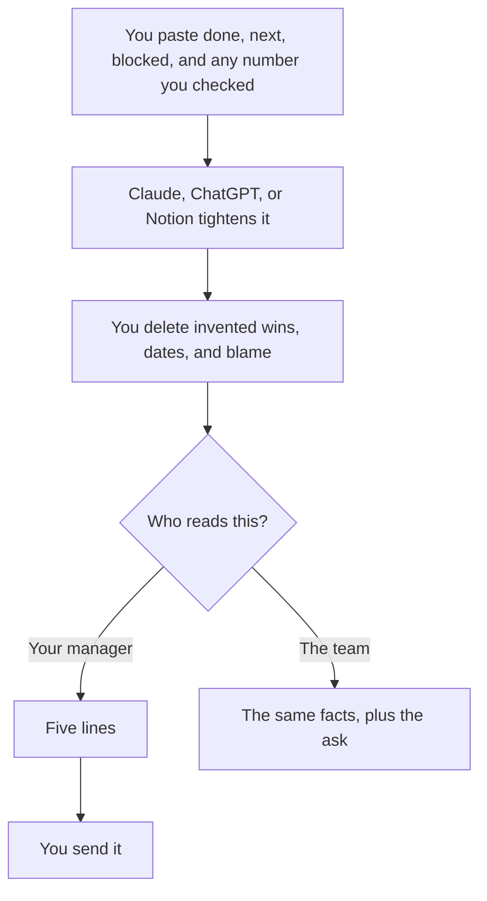

**A status update written with AI is your done, your next, and your blocker, rewritten so a busy reader can see them.** The model can tighten the sentences. It cannot know what shipped, what slipped, or which number you are allowed to say. Paste the notes. Delete anything you would not say in the meeting.

This is not a changelog. A changelog is the inventory of what the product shipped. That workflow is [how to write a changelog with AI](/blog/how-to-write-a-changelog-with-ai-2026/). A status update is a person's week. The fact pass is [how to fact-check AI writing](/blog/how-to-fact-check-ai-writing-2026/). The person who hits send is [what human-in-the-loop AI is](/blog/what-is-human-in-the-loop-ai-2026/).

Prices are US list prices excluding tax from directory pages checked October 16, 2026. Published October 24, 2026. We did not score updates.

## What the model may touch

| Line | Who owns it | The model may |
|---|---|---|
| Done | You, from a ticket that merged or a note you wrote | Shorten it. It may not add a win |
| Next | You | Order it. It may not invent a commitment |
| Blocked | You, including who you need | Make the ask visible. It may not name a villain |
| A metric | You, if you already have the number | Format it. It may not estimate one |
| The audience | You. Your manager, your team, or a customer | Drop internal names from the customer version |

If the note says "working on auth," the model will often upgrade it to "shipped auth." That upgrade is [a hallucination](/blog/what-is-ai-hallucination-2026/) with your name on it. Keep a verb you mean: started, in review, shipped, blocked.

## Where the draft happens

**A weekly note you want in a stable shape.** [Claude](/tools/claude/) Pro is $20 a month, or $17 billed annually. Put last week's update in a Project so the headings stay put. Free includes Projects, with limits. The container is [Claude Projects vs ChatGPT Projects](/blog/claude-projects-vs-chatgpt-projects-2026/).

**The team's default chat.** [ChatGPT](/tools/chatgpt/) Plus is $20. Go at $8 is enough for a short note. The ladder is [ChatGPT Go vs Plus vs Pro](/blog/chatgpt-go-vs-plus-vs-pro-2026/).

**The page the update already lives on.** [Notion AI](/tools/notion-ai/) Business is $20 a seat. Plus at $10 is not the full AI tier. If the status is a Notion database, generate there or paste the approved lines in. The card is [Notion AI pricing explained](/blog/notion-ai-pricing-explained-2026/). The writing choice is [ChatGPT vs Notion AI for writing](/blog/chatgpt-vs-notion-ai-for-writing-2026/).

**The sentence, after the facts are right.** [Grammarly](/tools/grammarly/) Free covers grammar. Pro is $12 a member a month billed annually. Do not ask it what you finished. The card is [Grammarly pricing explained](/blog/grammarly-pricing-explained-2026/).

A prompt that holds the line:

"Here are my notes under Done, Next, and Blocked. Rewrite them in under 120 words. Do not add accomplishments, dates, or numbers that are not in the notes. If a note is vague, leave it vague and add a question under Unclear. Do not assign blame."

One update you already liked, pasted above the notes, is [what few-shot prompting is](/blog/what-is-few-shot-prompting-2026/).

## Manager version versus team version

Your manager needs the slip and the ask. The team needs enough detail to help. Generate both from the same notes. Do not send the team version to a customer. Customer status is a different document, closer to [how to write customer emails with AI](/blog/how-to-write-customer-emails-with-ai-2026/).

If the notes came from a meeting, start from the decision, not from the transcript. A recording can feed the notes. [Fathom](/tools/fathom/) Free includes unlimited recordings and summaries, if a bot was allowed in the room. The summary is not the status. You still pick done, next, and blocked. The capture choice is [Fathom vs Fireflies](/blog/fathom-vs-fireflies-2026/).

People who collect these every week are the audience of [best AI tools for engineering managers](/blog/best-ai-tools-for-engineering-managers-2026/) and [best AI tools for scrum masters](/blog/best-ai-tools-for-scrum-masters-2026/). A goal line that should not be improvised inside the update is [how to write OKRs with AI](/blog/how-to-write-okrs-with-ai-2026/).

## FAQ

### Can AI write my status if I only share my calendar?

It can describe meetings. It cannot tell which one produced a decision. Paste three bullets in your own words first. A calendar is not a status.

### How is this different from a changelog?

A changelog lists product changes a user can see. A status update lists what you are doing, including work that is not shipped and work that is blocked. Write them as separate documents so a user does not read your blocker.

### What if I do not have a metric?

Leave it out. A model asked for a "crisp update" will invent a percent. Unclear is an acceptable line. A fake 20% is not.

### How long should it be?

Short enough that your manager reads it. Five lines is a useful target. The model can cut. You decide which cut removed a real blocker.

## Last verified

October 16, 2026 for Claude, ChatGPT, Notion, Grammarly, and Fathom prices named above. Published October 24, 2026.

**Sources:** [Claude pricing](https://claude.com/pricing), [ChatGPT pricing](https://chatgpt.com/pricing), [Notion pricing](https://www.notion.com/pricing).

*Published by Andrew for [AI Tools Optimizer](https://aitoolsoptimizer.com).*

[Claude](/tools/claude/) is in the [chatbots and assistants directory](/tools/category/chatbots-assistants/). Directory pages may use affiliate links. A purchase through them may earn us a commission at no extra cost to you.
