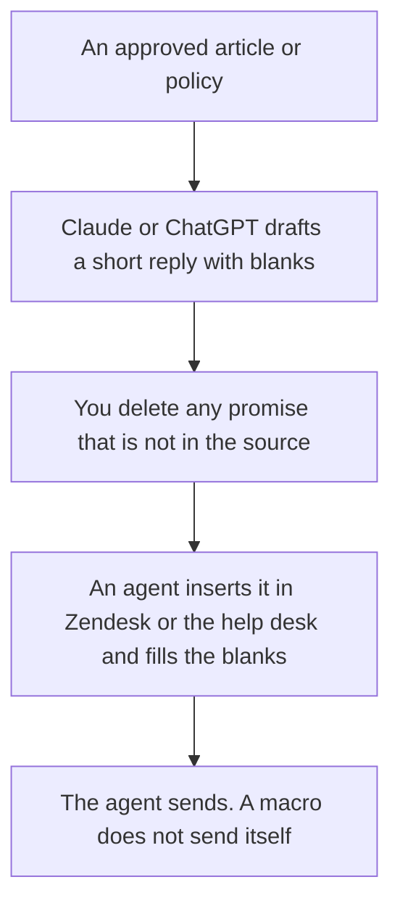

**A support macro library written with AI is a set of saved replies a person can insert, each tied to an article or a policy you already approved.** The model can turn that article into a short reply with blanks for the customer's name, order, and date. It cannot invent a refund rule, a shipping promise, or a workaround that is not in the source. If the article does not cover the case, there is no macro. The agent escalates, and the gap goes back to the people who own the article.

The team shelf is [best AI tools for support teams](/blog/best-ai-tools-for-support-teams-2026/). The public articles those macros must match are [how to build a help center with AI](/blog/how-to-build-a-help-center-with-ai-2026/). The voice those replies should sound like is [how to create a brand voice with AI](/blog/how-to-create-a-brand-voice-with-ai-2026/).

Prices are US list prices excluding tax from directory pages checked October 16, 2026. Published October 24, 2026. We did not score deflection or handle time.

## What a macro has to contain

| Piece | Write it from | Leave the macro unwritten when |
|---|---|---|
| Title agents can search | The customer's situation, not your internal joke | Two macros would share a name |
| Body | The approved article or policy, shortened | The article contradicts itself and nobody has picked a winner |
| Blanks | Name, order id, date, amount, only if the agent will fill them | The blank is a promise, such as a refund percent |
| Do-not-say | The offers you are not making | You have not decided |
| Owner | The person who can retire the macro | Nobody owns the article |
| Review date | A date on the calendar | "When we remember" |

A macro that says "I've refunded you" is [a hallucination](/blog/what-is-ai-hallucination-2026/) waiting for a click. The check is [how to fact-check AI writing](/blog/how-to-fact-check-ai-writing-2026/).

## Where the library is drafted and stored

**The draft.** [Claude](/tools/claude/) Pro is $20 a month, or $17 billed annually. Put the approved articles in a Project so a later macro cannot drift from the help center. [ChatGPT](/tools/chatgpt/) Plus at $20 is the other seat. Business is $20 a user a month billed annually, minimum two users, when the samples include real tickets. Strip personal data from the samples. The container is [Claude Projects vs ChatGPT Projects](/blog/claude-projects-vs-chatgpt-projects-2026/).

**The desk that will hold the saved reply.** [Zendesk AI](/tools/zendesk-ai/) Support Team is $19 an agent a month paid yearly. Suite Team is $55 an agent a month paid yearly and is the row that adds AI agents. Copilot is a $50 an agent a month add-on paid yearly on the card. A macro library can live in the help desk without buying the agent. Do not confuse a saved reply with an automated resolution, which the card bills separately.

**An agent that resolves on its own, which is not a macro.** [Intercom Fin](/tools/intercom-fin/) is $0.99 per outcome plus a $49 a month base plan that includes 50 outcomes. Use Fin when you want a resolution without a person. Use macros when a person must still send. The pricing pair is [Chatbase vs Intercom Fin pricing](/blog/chatbase-vs-intercom-fin-pricing-2026/).

**The index of which macro matches which article.** [Notion AI](/tools/notion-ai/) Business is $20 a seat a month, if the help desk is a poor library. Link the article URL and the review date. The invoice is [Notion AI pricing explained](/blog/notion-ai-pricing-explained-2026/).

**The line edit.** [Grammarly](/tools/grammarly/) Pro is $12 a member a month billed annually. Tone is not policy.

A prompt that holds the line:

"Draft a support macro from this article only. Under 90 words. Use blanks like {{order_id}} where the agent must insert a fact. If the article does not state a refund, a date, or a workaround, do not invent one. End with the escalation path I pasted, or write Missing if I did not paste one."

The person who sends is [what human-in-the-loop AI is](/blog/what-is-human-in-the-loop-ai-2026/).

## How the library stays true

Retire a macro when the article changes. A review date in the past is a bug. Keep one macro per situation. Variants for tone are how agents pick the wrong promise. Sample five real tickets a month and see whether the macro still matches. If agents are editing every send, the macro is a draft, not a library.

The record of the approved text is [what a system of record for AI is](/blog/what-is-a-system-of-record-for-ai-2026/).

## FAQ

### How many macros should we have?

As many as you have approved answers you send often, and no more. A library of 400 that nobody can search is a second help center with worse governance. Start with the ten tickets that repeat. Add a macro when the same edit shows up in the queue.

### Can the macro include a partial refund?

Only if the policy you pasted states the amount or the rule the agent is allowed to apply. Otherwise the blank is not a number. The agent follows the policy, or escalates.

### Should AI send the macro?

No. Insert and send are different. This workflow stops at a saved reply. An autonomous agent is Fin or a Zendesk AI agent, with its own bill and its own test. Do not sneak that launch in through a macro project.

### What if the help center and the macro disagree?

The article wins until a person changes it, and then both change together. Do not let the macro become the secret policy. Link them.

## Last verified

October 16, 2026 for Claude, ChatGPT, Zendesk, Intercom Fin, Notion, and Grammarly. Published October 24, 2026.

**Sources:** [Zendesk pricing](https://www.zendesk.com/pricing/), [Intercom Fin pricing](https://fin.ai/help/en/articles/13975800-fin-pricing-outcomes), [Claude pricing](https://claude.com/pricing).

*Published by Andrew for [AI Tools Optimizer](https://aitoolsoptimizer.com).*

[Zendesk AI](/tools/zendesk-ai/) is in the [customer support directory](/tools/category/customer-support/). Directory pages may use affiliate links. A purchase through them may earn us a commission at no extra cost to you.
