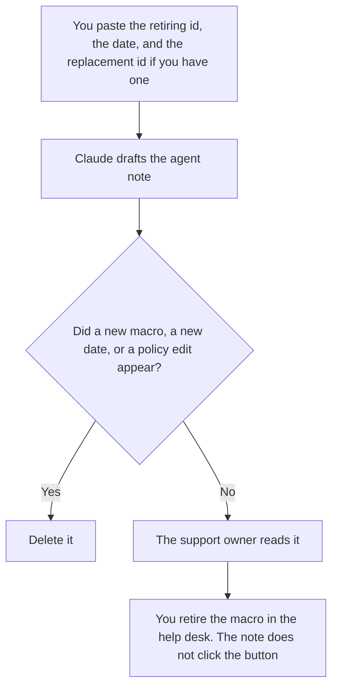

**A support macro retirement note written with AI tells agents which macro id stops on the date you named, which macro id replaces it, and what they must not paste after that date.** The model may format the note. It may not invent a replacement, rewrite the customer-facing policy, or pick a date. If the replacement is not chosen, the line says Replacement not chosen.

The library those macros live in is [how to write a support macro library with AI](/blog/how-to-write-a-support-macro-library-with-ai-2026/). Choosing a model to draft a macro in the first place is [ChatGPT vs Claude for support macros](/blog/chatgpt-vs-claude-for-support-macros-2026/). A flag that dies on a date, which is a cousin of this note, is [how to write a feature flag retirement note with AI](/blog/how-to-write-a-feature-flag-retirement-note-with-ai-2026/).

Claude's prices are from claude.com/pricing on October 24, 2026. Zendesk prices are from zendesk.com/pricing on October 24, 2026. Notion and Grammarly prices are from directory pages checked October 16, 2026. Published October 24, 2026. We did not score ticket deflection.

## What the note must name

| Line | Who owns it | The model may |
|---|---|---|
| The macro id that is retiring | The help desk export | Copy the id. It may not substitute the title |
| The last day it may be used | You | Copy the date. A blank stays Date missing |
| The replacement id, if one exists | You | Copy it. It may not suggest a "closest" macro |
| What agents should do with old drafts | You | Copy that instruction. It may not say "use your judgment" |
| What customers will still see | The approved article, if you paste it | Not soften a policy while retiring the shortcut |

Agents will follow the note that is easiest. If the note says the old macro is "discouraged" and the macro still fires, you have not retired it. The note and the help desk have to match on the day you named. A customer-facing article that still tells people to "use the refund macro" has to be updated by a person, from the article you already approved, not by a model that wants the email to sound modern.

## Where it is written

**The note, when the format matches the last retirement.** [Claude](/tools/claude/) Pro is $17 a month billed annually, $200 up front, or $20 monthly. The review is [Claude review](/blog/claude-review-2026/).

**The help desk the id lives in.** [Zendesk AI](/tools/zendesk-ai/) Support Team is $19 an agent a month paid yearly, and Suite Team is $55, on the October 24 pricing page. The note does not change the macro. A person does, in the product. The invoice is [Zendesk AI pricing explained](/blog/zendesk-ai-pricing-explained-2026/).

**The page agents will find.** [Notion AI](/tools/notion-ai/) Business is $20 a seat a month if the macro list lives beside the wiki. Plus at $10 is not the full AI tier on the October 16 card. The invoice is [Notion AI pricing explained](/blog/notion-ai-pricing-explained-2026/).

**A last pass.** [Grammarly](/tools/grammarly/) Pro is $12 a member a month billed annually, or $30 monthly. If it renames the macro id to a description, put the id back. The invoice is [Grammarly pricing explained](/blog/grammarly-pricing-explained-2026/).

A prompt that holds the line:

"Write an internal note that macro ID A retires on the date I pasted, and that agents must use macro ID B if I pasted one. If I did not paste a replacement, write Replacement not chosen. Do not change the customer-facing policy. Do not invent an id."

## What not to delegate

Do not ask which macros are unused. That is a report from the help desk, not a vibe. Do not paste a real customer's ticket into the example. Do not delete the macro in the product until the note and the replacement a person chose are in place. If there is no replacement, the note says so, and a person decides what agents should do instead.

## FAQ

### How is this different from a macro library?

The library is the set of macros you still want, with their text. This note is the end of one id. Updating the library without the note leaves agents with a shortcut that still inserts the old text. Retiring the shortcut without updating the library leaves a ghost entry.

### How is this different from a feature flag retirement?

A flag retirement tells builders a switch is going away. A macro retirement tells agents a reply shortcut is going away. The date discipline is similar. The audience is not. Do not send the flag template to the support floor.

### Can the model merge two macros?

It can show you both texts side by side if you paste them. It may not declare a merged macro and give it an id. A replacement id is one you already created in the help desk, or it is Replacement not chosen.

### Who turns the macro off?

The owner of the help desk configuration, on the date in the note. A published paragraph does not disable a macro. Check the id in the product after the change.

## Last verified

October 24, 2026 for Claude and Zendesk. October 16, 2026 for Notion and Grammarly. Published October 24, 2026.

**Sources:** [Claude pricing](https://claude.com/pricing), [Zendesk pricing](https://www.zendesk.com/pricing/), [Notion pricing](https://www.notion.com/pricing), [Grammarly plans](https://www.grammarly.com/plans).

*Published by Andrew for [AI Tools Optimizer](https://aitoolsoptimizer.com).*

[Zendesk AI](/tools/zendesk-ai/) is in the [customer support directory](/tools/category/customer-support/). Directory pages may use affiliate links. A purchase through them may earn us a commission at no extra cost to you.
