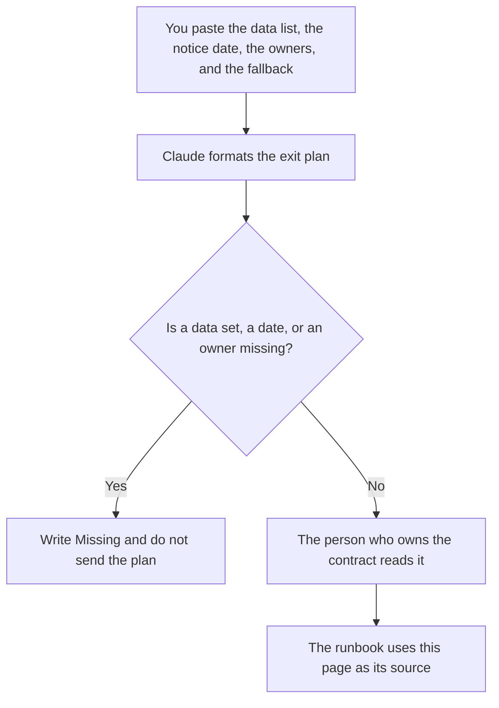

**A vendor exit plan written with AI is a page that says what data comes back, by which date, who owns each step, and what happens if the export fails.** The model may format rows you paste. It may not invent a contract clause, a retention promise, or a migration date. The risk note that should exist before you decide to leave is [how to write a dependency risk note with AI](/blog/how-to-write-a-dependency-risk-note-with-ai-2026/). The cutover itself is [how to write a migration runbook with AI](/blog/how-to-write-a-migration-runbook-with-ai-2026/).

How long the vendor may keep prompts and files after you leave is [what an AI data retention policy is](/blog/what-is-ai-data-retention-policy-2026/). The backout if the new tool fails in the first week is [how to create a rollback plan with AI](/blog/how-to-create-a-rollback-plan-with-ai-2026/).

Prices are US list prices excluding tax from directory pages checked October 16, 2026. Published October 24, 2026. We did not score vendors.

## What belongs on the plan

| Row | Who owns it | The model may |
|---|---|---|
| The data | The system owner | List the exports you named. It may not add a dataset |
| The date | The contract or the notice you already sent | Copy it. It may not pick a "safe" date |
| The owner | A person you named | Copy the name. If the name is missing, stop |
| The access | Who loses a login, and when | Format it. It may not leave a shared admin "for later" |
| The failure | What you do if the export is incomplete | Copy the fallback you wrote |

A plan that says "export everything and move on" is not a plan. Name the objects: prompts and logs, customer records, files, billing history, SSO apps, and the admin who can still sign in on the last day. If counsel has not read the termination clause, the date cell says Counsel missing.

## Where the plan is written

**The draft.** [Claude](/tools/claude/) Pro is $20 a month, or $17 billed annually, when the plan is long and should sit beside the contract notes you are allowed to paste. Paste clause text you are allowed to share. Do not paste a full agreement into a personal account your company forbids. The review is [Claude review](/blog/claude-review-2026/).

**The page procurement already uses.** [Notion AI](/tools/notion-ai/) Business is $20 a seat a month if that is the system of record. The chat is not the plan.

**The checklist in the repo.** [Cursor](/tools/cursor/) Plus is $8 a month, or $80 a year, when the exit includes scripts that pull an export. You review the diff. A generated script that prints secrets into a log is a defect. The ladder is [Cursor pricing explained](/blog/cursor-pricing-explained-2026/).

**A one-page version.** [ChatGPT](/tools/chatgpt/) Plus at $20 a month can format a short plan. Discard any row it adds because every exit "should include a press release."

A prompt that holds the line:

"Format an exit plan from the data sets, dates, owners, and fallback I pasted. Do not add a data set. Do not invent a notice period. If an owner is missing, write Owner missing and stop."

## What not to delegate

Do not ask the model whether you are allowed to leave. That is the contract and counsel. Do not announce the exit to customers from this page. Customer language is a separate note, after the plan has owners. Do not delete the only admin on the vendor side before the export is checked by a person.

## FAQ

### How is an exit plan different from a migration runbook?

The exit plan is what you must retrieve and who turns access off. The runbook is how the new system gets the data and how you back out. The runbook should point at this plan. If they name different dates, one of them is wrong.

### Can the model read the contract?

Only the clauses you paste and are allowed to paste. A summary that adds a termination right you cannot find in the paste is the sentence you delete. Counsel reads the real agreement.

### What if the vendor will not export?

That case is the fallback row, written before you give notice, not a surprise on the last day. The plan says who calls, what you can still download from the product, and what you will tell customers if a copy does not exist.

### Who signs the plan?

The owner of the vendor relationship and the owner of the data. A model does not sign. A page with no names is a draft.

## Last verified

October 16, 2026 for Claude, Notion AI, Cursor, and ChatGPT. Published October 24, 2026.

**Sources:** [Claude pricing](https://claude.com/pricing), [Notion pricing](https://www.notion.com/pricing), [Cursor pricing](https://cursor.com/help/account-and-billing/pricing), [ChatGPT pricing](https://chatgpt.com/pricing/).

*Published by Andrew for [AI Tools Optimizer](https://aitoolsoptimizer.com).*

[Claude](/tools/claude/) is in the [chatbots and assistants directory](/tools/category/chatbots-assistants/). Directory pages may use affiliate links. A purchase through them may earn us a commission at no extra cost to you.
