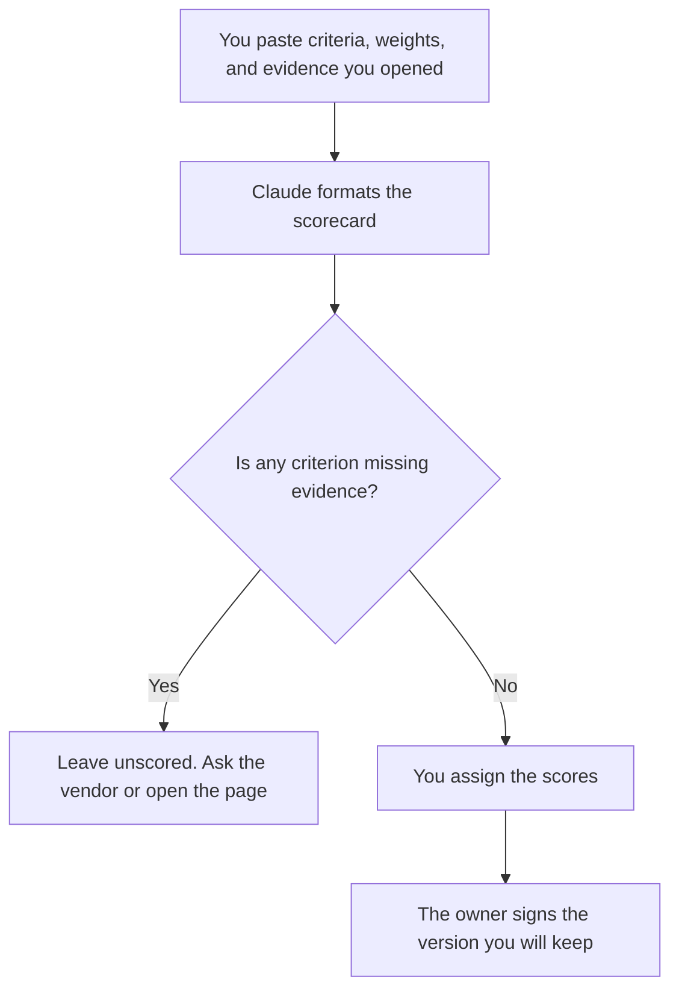

**A vendor scorecard written with AI is a table of criteria, weights, and evidence you already gathered.** The model may format the rows and quote the evidence under the criterion you named. It may not invent a price, a security claim, or a winner. A criterion with no evidence stays unscored.

The question list you send, and the habit of answering only what was asked, is [how to write an RFP response with AI](/blog/how-to-write-a-rfp-response-with-ai-2026/). The procurement shelf is [best AI tools for procurement teams](/blog/best-ai-tools-for-procurement-teams-2026/). Checking a public claim is [how to fact-check AI writing](/blog/how-to-fact-check-ai-writing-2026/). A fabricated certification is [what an AI hallucination is](/blog/what-is-ai-hallucination-2026/).

Prices are US list prices excluding tax from directory pages checked October 16, 2026. Published October 24, 2026. This page is not legal, security, or procurement advice. A score is not a contract.

## The columns that have to be real

| Column | Who owns it | The model may |
|---|---|---|
| Criterion | You. Price, support hours, data location, a control you require | Rename nothing. It may not add "innovation" |
| Weight | A number you paste | Copy it. It may not rebalance |
| Evidence | A quote, a link, a date, from a source you opened | Place it in the row. It may not upgrade a marketing line into a fact |
| Score | A number on the scale you defined, after you have the evidence | Leave it blank until you set it. It may not score from a vibe |
| Gap | What you still need to ask | List only holes you pointed at, or holes where evidence is Missing |
| Owner | The role who signs the scorecard | Leave Missing if unnamed |

A weighted total the model computed is a formula you should rebuild in the sheet. Do not paste the total into a decision doc until you have checked the arithmetic and the weights.

## Where the scorecard is built

**The draft.** [Claude](/tools/claude/) Pro is $20 a month, or $17 billed annually. Keep the RFP questions and the evidence notes in a Project. Free can format a short card. The review is [Claude review](/blog/claude-review-2026/).

**The page of record.** [Notion AI](/tools/notion-ai/) Business is $20 a seat a month. The signed scorecard lives there, or in the system your procurement team already uses. A chat thread is not the record. The invoice is [Notion AI pricing explained](/blog/notion-ai-pricing-explained-2026/). The record rule is [what a system of record for AI is](/blog/what-is-a-system-of-record-for-ai-2026/).

**A public page you still open.** [Perplexity](/tools/perplexity/) Pro is $17 a month billed annually when you need a link to a pricing or security page. Open the link and write the date. A snippet is not evidence. The scan habit is [Perplexity vs ChatGPT for competitor scans](/blog/perplexity-vs-chatgpt-for-competitor-scans-2026/). Freshness of that page is [what retrieval freshness is](/blog/what-is-retrieval-freshness-2026/).

**A second draft.** [ChatGPT](/tools/chatgpt/) Plus at $20 is enough to restate a scorecard you already scored, for an executive who wants a shorter page. It is the wrong tool to discover the vendor's price from memory.

A prompt that holds the line:

"Format a scorecard from the criteria, weights, and evidence I pasted. Do not add a criterion. Do not score a row. If evidence is missing, write Missing. Quote only text I included. Do not name a winner."

## What not to delegate

Do not ask which vendor to buy. Do not let the model fill a SOC report, an uptime percentage, or a price it "remembers." Do not paste a customer's data into the prompt so the model can "see if the vendor could handle it." The security review uses the evidence the vendor gave you, read by the person who owns that review.

The partner version of a one-page brief, when the vendor is also a partner, is [how to write a partner brief with AI](/blog/how-to-write-a-partner-brief-with-ai-2026/). Different document. Same rule: only the facts you have.

## FAQ

### Can AI weight the criteria?

It can format weights you typed. The weights are the decision. A model that sets them has chosen what your purchase optimizes. Type the numbers.

### What if two vendors document the same feature differently?

Put both quotes in the evidence column with dates. You score after you understand the difference. The model does not get to declare them equivalent.

### Should price be the heaviest weight?

That is your call. If price is a weight, the number comes from a quote or a page you opened, with the date. A list price and a negotiated price are different evidence. Label which one you used.

### Is a scorecard a contract?

No. It is a record of how you compared options on a date. The contract is the document legal signs. Do not paste scorecard prose into a contract without that review.

## Last verified

October 16, 2026 for Claude, Notion AI, Perplexity, and ChatGPT. Published October 24, 2026.

**Sources:** [Claude pricing](https://claude.com/pricing), [Notion pricing](https://www.notion.com/pricing), [Perplexity pricing](https://www.perplexity.ai/pro).

*Published by Andrew for [AI Tools Optimizer](https://aitoolsoptimizer.com).*

[Perplexity](/tools/perplexity/) is in the [research and search directory](/tools/category/research-search/). Directory pages may use affiliate links. A purchase through them may earn us a commission at no extra cost to you.
