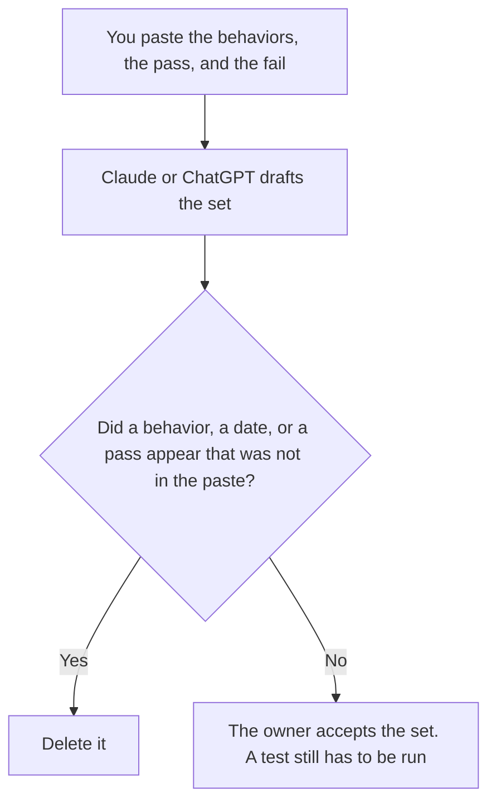

**An AI acceptance criteria set written with AI is a draft that restates the behaviors a person already required, in lines a later test can fail.** The model may number those lines. It may not add a behavior, a date, or a pass. The schedule those lines do not replace is [Notion AI vs Claude for project plans](/blog/notion-ai-vs-claude-for-project-plans-2026/). The user, the job, and the limit, which are not the pass lines, are [how to write an AI use case brief with AI](/blog/how-to-write-an-ai-use-case-brief-with-ai-2026/).

The number a metric must meet, once you have named a metric, is [what an AI eval pass threshold is](/blog/what-is-ai-eval-pass-threshold-2026/). The rule that can block a ship is [what an AI eval gate is](/blog/what-is-ai-eval-gate-2026/). A criteria set is not a gate. It is the lines the gate might later point at.

Claude's prices are the October 24, 2026 read of claude.com/pricing recorded in [Claude pricing explained](/blog/claude-pricing-explained-2026/). Notion is the October 16 directory card. ChatGPT's Plus price is the October 24 plan-page figure recorded in [ChatGPT pricing explained](/blog/chatgpt-pricing-explained-2026/). Cursor's Plus price is the October 24 help-center figure recorded in [Cursor pricing explained](/blog/cursor-pricing-explained-2026/). Published October 24, 2026. We did not score features. A formatted list is not acceptance.

## What the set is allowed to say

| Line | Who owns it | The model may |
|---|---|---|
| The behavior | You | Copy it. It may not add a behavior |
| The pass | You, or Pass not set | Copy the outcome you wrote. It may not invent a green |
| The fail | You, or Fail not set | Copy it. It may not soften a fail into a partial |
| Who accepts | You | Copy the name. It may not assign a committee |
| The test, if you named one | You, or Test not named | Link it. It may not write the assertion |

A line that says the feature "should feel fast" has added a criterion you did not write. If the pass is missing, the line says Pass not set. If a behavior was only discussed and not pasted, it stays out. Put proposals in a note labeled Not in the set.

The set does not contain the project plan's dates, and it does not contain the use-case brief's hoped-for return. A date in a criterion is a date you pasted. A test that weakens an assertion so the run goes green is a different failure, covered on [Cursor vs Claude Code for tests](/blog/cursor-vs-claude-code-for-tests-2026/).

## Where it is drafted

**The draft.** [Claude](/tools/claude/) Pro is $17 a month billed annually, $200 up front, or $20 monthly. Keep the pass sentence in a Project so a later edit does not soften it. The review is [Claude review](/blog/claude-review-2026/).

**The page the build will open.** [Notion AI](/tools/notion-ai/) Business is $20 a seat a month. Link the owner and the test, if you named one. Plus at $10 is not the full AI tier. The invoice is [Notion AI pricing explained](/blog/notion-ai-pricing-explained-2026/).

**One set from a paste.** [ChatGPT](/tools/chatgpt/) Plus is $20 a month. Discard a version that adds a behavior to make the list look complete. The ladder is [ChatGPT pricing explained](/blog/chatgpt-pricing-explained-2026/).

**The diff, if the lines live next to the test.** [Cursor](/tools/cursor/) Plus is $8 a month, or $80 a year. You review a diff that changes a pass line. The individual ladder is [Cursor pricing explained](/blog/cursor-pricing-explained-2026/).

A prompt that holds the line:

"Draft the acceptance criteria from the behaviors, the pass, and the fail I pasted. If a pass is missing, write Pass not set. Do not add a behavior. Do not mark the set accepted."

## What not to delegate

Do not ask which criteria a stakeholder "would expect." Do not turn a use-case brief into pass lines the brief never stated. Do not accept the set because every row has a verb. The owner named on the page accepts it. Pass not set stays unset until a person writes the outcome.

## FAQ

### How is this different from a project plan?

The plan is milestones, owners, and dates. The criteria set is the behaviors that count as done, and the pass and fail you wrote. A date can slip without a criterion changing. A criterion can fail on a date the plan still shows. Link them. Do not let a model reconcile them by inventing a status.

### How is this different from a use case brief?

The brief is the user, the job, the system, and the limit. The criteria set is how you will tell the job was done. A brief can be accepted while every pass line still says Pass not set. Do not promote a hoped-for return into a pass.

### How is this different from an eval pass threshold?

The threshold is the number, or the named outcome, a metric must meet. The criteria set can point at that threshold. It does not invent the number, and it does not block the ship. The gate does that, if you wrote a gate. A criteria line without a metric is still a line a person can test by hand.

### Who may accept the set?

The owner named on the page. A formatted list is not acceptance. A test you did not run is not a pass. A behavior that was not in the paste stays out.

## Last verified

October 24, 2026 for Claude, for ChatGPT's plan page, and for Cursor's help page, via the posts cited above. October 16, 2026 for Notion. Published October 24, 2026.

**Sources:** [Claude pricing](https://claude.com/pricing), [Notion pricing](https://www.notion.com/pricing), [ChatGPT and Codex pricing](https://learn.chatgpt.com/docs/pricing), [Cursor pricing](https://cursor.com/help/account-and-billing/pricing).

*Published by Andrew for [AI Tools Optimizer](https://aitoolsoptimizer.com).*

[Claude](/tools/claude/) is in the [chatbots and assistants directory](/tools/category/chatbots-assistants/). Directory pages may use affiliate links. A purchase through them may earn us a commission at no extra cost to you.
