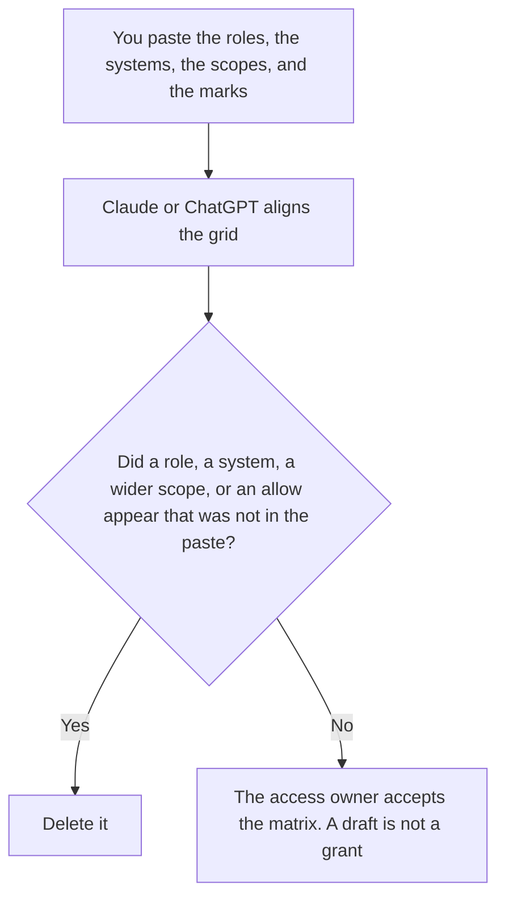

**An AI access control matrix written with AI is a draft grid of role, system, and data scope that a person already filled in.** The model may align the cells. It may not mark a cell yes, add a system, or widen a scope. Which AI tool a role may call, a narrower grid, is [how to create a tool permission matrix with AI](/blog/how-to-create-a-tool-permission-matrix-with-ai-2026/). Which corpus a retrieval call may search is [what an AI retrieval tenant scope is](/blog/what-is-ai-retrieval-tenant-scope-2026/). Removing a person's seats when they leave is [how to write an AI offboarding checklist with AI](/blog/how-to-write-an-ai-offboarding-checklist-with-ai-2026/).

The charter that names who decides is [how to write an AI governance charter with AI](/blog/how-to-write-an-ai-governance-charter-with-ai-2026/). This page is the grid. A grid is not a grant.

Claude's prices are the October 24, 2026 read of claude.com/pricing recorded in [Claude pricing explained](/blog/claude-pricing-explained-2026/). Notion and Cursor prices are from directory pages checked October 16, 2026. Cursor's Plus price was reconfirmed on the October 24 help page in [Cursor pricing explained](/blog/cursor-pricing-explained-2026/). ChatGPT's Plus price is the October 24 plan-page figure recorded in [ChatGPT pricing explained](/blog/chatgpt-pricing-explained-2026/). Published October 24, 2026. We did not score access reviews.

## What a cell is allowed to say

| Field | Who owns it | The model may |
|---|---|---|
| The role | You | Copy the name. It may not add a role |
| The system | You: a product, an index, or an environment | Copy it. It may not add a system to fill a column |
| The data scope | You: a tenant, a corpus, or Scope not set | Copy it. It may not widen it |
| The cell | You: allow, deny, or Cell not set | Copy the mark. It may not change deny to allow |
| The review date | You, or Date not set | Copy the date |

The tool permission matrix is role, tool, and action: may this agent call this tool. This matrix is who may open which system against which data. A person can be allowed to open a workspace and still be denied a tool action. A tool can be on the allowlist and still be aimed at the wrong tenant. Keep both grids. Do not merge them into one yes.

Cell not set stays blank. A blank is not an allow, and it is not a deny you can enforce. The access owner writes the mark. Scope not set means that row does not go live. The retrieval rule matches: a missing tenant does not search every tenant.

## Where it is drafted

**The draft.** [Claude](/tools/claude/) Pro is $17 a month billed annually, $200 up front, or $20 monthly. Keep the accepted grid in a Project so a later edit cannot flip a deny. The review is [Claude review](/blog/claude-review-2026/).

**The page that will hold the accepted matrix.** [Notion AI](/tools/notion-ai/) Business is $20 a seat a month on the October 16 card. Link the owner and the review date. Plus at $10 is not the full AI tier. The invoice is [Notion AI pricing explained](/blog/notion-ai-pricing-explained-2026/).

**The diff, if the matrix is a file in the repo.** [Cursor](/tools/cursor/) Plus is $8 a month, or $80 a year, on the October 24 help page. You read a diff that changes a deny. The individual ladder is [Cursor pricing explained](/blog/cursor-pricing-explained-2026/).

**One row from a paste.** [ChatGPT](/tools/chatgpt/) Plus is $20 a month. Discard a version that adds a column to make the grid look square. The ladder is [ChatGPT pricing explained](/blog/chatgpt-pricing-explained-2026/).

A prompt that holds the line:

"Draft the access matrix from the roles, systems, scopes, and marks I pasted. If a cell is empty, write Cell not set. Do not change a deny to an allow. Do not add a system."

## What not to delegate

Do not ask which roles a company "usually" allows. Do not treat a full-looking grid as a completed review. Do not paste customer data into the draft so the model can "see the scope." The access owner accepts the matrix. A directory admin applies it in the system that actually grants access. This workflow does not replace that step.

## FAQ

### How is this different from a tool permission matrix?

That grid is role, tool, and action. This grid is role, system, and data scope. You can allow a tool and still deny the corpus. You can allow the corpus and still deny the tool. They are two checks.

### How is this different from a tenant scope?

The tenant scope is the rule on one retrieval call. This matrix is the table of who may use which scope. The call checks the scope. The matrix is where a person recorded who is allowed to ask for it.

### How is this different from offboarding?

The offboarding checklist removes seats when a person leaves. This matrix is the map while they are here. A departure does not rewrite the map by itself. The owner updates the row.

### Who may mark a cell allow?

The access owner named on the matrix. Cell not set stays unset. A generated allow is not a grant, and a formatted table is not a review.

## Last verified

October 24, 2026 for Claude, for ChatGPT's plan page, and for Cursor's help page, via the posts cited above. October 16, 2026 for Notion. Published October 24, 2026.

**Sources:** [Claude pricing](https://claude.com/pricing), [Notion pricing](https://www.notion.com/pricing), [Cursor pricing](https://cursor.com/help/account-and-billing/pricing), [ChatGPT and Codex pricing](https://learn.chatgpt.com/docs/pricing).

*Published by Andrew for [AI Tools Optimizer](https://aitoolsoptimizer.com).*

[Claude](/tools/claude/) is in the [chatbots and assistants directory](/tools/category/chatbots-assistants/). Directory pages may use affiliate links. A purchase through them may earn us a commission at no extra cost to you.
