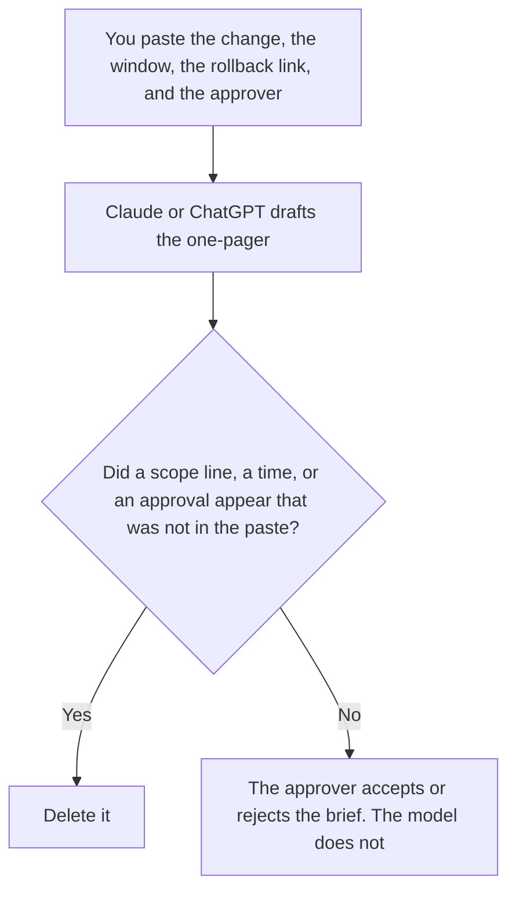

**An AI change advisory brief written with AI is a one-page draft of a change a person already defined: what will change, the window they set, the rollback they already wrote, and the approver they named.** The model may order those fields. It may not approve the change, move the window, or invent a residual risk.

The steps you will run if you undo it are [how to write an AI rollback runbook with AI](/blog/how-to-write-an-ai-rollback-runbook-with-ai-2026/). The note for people who are not on the call is [how to write an AI stakeholder brief with AI](/blog/how-to-write-an-ai-stakeholder-brief-with-ai-2026/). The person who schedules the release is on [best AI tools for release managers](/blog/best-ai-tools-for-release-managers-2026/).

Claude's prices are the October 24, 2026 read of claude.com/pricing recorded in [Claude pricing explained](/blog/claude-pricing-explained-2026/). Notion is the October 16 directory card. ChatGPT's Plus price is the October 24 plan-page figure recorded in [ChatGPT pricing explained](/blog/chatgpt-pricing-explained-2026/). Cursor's Plus price is the October 24 help-center figure recorded in [Cursor pricing explained](/blog/cursor-pricing-explained-2026/). Published October 24, 2026. We did not score releases. A formatted brief is not approval.

## What the brief is allowed to contain

| Field | Who owns it | The model may |
|---|---|---|
| What changes | You | Copy it. It may not widen the scope |
| The window | You, or Window not set | Copy the start and end. It may not pick a quieter hour |
| The rollback | You, as a link to a runbook you accepted, or Rollback not written | Link it. It may not draft new steps on this page |
| The approver | You, or Approver not set | Copy the name. It may not volunteer a committee |
| Residual risk | You, or Risk not set | Copy the words you wrote |

The stakeholder brief is what you tell people affected by a decision. The change advisory brief is what you put in front of the person who can allow the change. They can share sentences. They are not the same page. A stakeholder update that says the change is done has skipped the approver.

The rollback runbook is the steps. This brief links to it. If the runbook does not exist, the field says Rollback not written, and the brief is not ready. The model does not fill that hole with "revert the deploy" as if that were a procedure.

A status report can later say what happened in the window. It does not approve the window. That writing choice is [Gemini vs Claude for status reports](/blog/gemini-vs-claude-for-status-reports-2026/).

## Where the brief is drafted

**The one-pager.** [Claude](/tools/claude/) Pro is $17 a month billed annually, $200 up front, or $20 monthly. Keep the scope sentence in a Project so a later edit does not add a system. The review is [Claude review](/blog/claude-review-2026/).

**The page the approver opens.** [Notion AI](/tools/notion-ai/) Business is $20 a seat a month. The approver's name and the decision stay visible. Plus at $10 is not the full AI tier. The invoice is [Notion AI pricing explained](/blog/notion-ai-pricing-explained-2026/).

**One draft from a paste.** [ChatGPT](/tools/chatgpt/) Plus is $20 a month. Discard a version that writes Approved at the bottom. The ladder is [ChatGPT pricing explained](/blog/chatgpt-pricing-explained-2026/).

**The diff the change actually is.** [Cursor](/tools/cursor/) Plus is $8 a month, or $80 a year. The brief describes a diff a person can open. It does not replace the review. The individual ladder is [Cursor pricing explained](/blog/cursor-pricing-explained-2026/).

A prompt that holds the line:

"Draft the change advisory brief from the scope, window, rollback link, approver, and residual risk I pasted. If a field is missing, write the blank. Do not approve the change. Do not add a system to the scope."

## What not to delegate

Do not ask whether the change is safe. Do not let the draft move the window to "low traffic" unless you pasted those hours. Do not send the brief as approval because the table is full. The named approver accepts or rejects it.

## FAQ

### How is this different from a stakeholder brief?

The stakeholder brief explains a decision to people who need to know. The change advisory brief asks a named approver to allow a specific change, with a window and a rollback. You can send the stakeholder note after the approver decides. You do not send it instead.

### How is this different from a rollback runbook?

The runbook is the steps to undo the change. The brief points at those steps and states the window. A brief without a runbook says Rollback not written. It does not grow its own procedure.

### How is this different from a release manager's stack?

That page is the person who coordinates the release. This page is the one-pager they, or the change owner, put in front of an approver. The tools can overlap. The artifact is the brief, not the calendar.

### Who may approve?

The approver named on the brief. Approver not set means the brief is not ready. A model line that says "approved pending review" is not a decision. Window not set means you do not have a time.

## Last verified

October 24, 2026 for Claude, ChatGPT's plan page, and Cursor's help page, via the posts cited above. October 16, 2026 for Notion. Published October 24, 2026.

**Sources:** [Claude pricing](https://claude.com/pricing), [Notion pricing](https://www.notion.com/pricing), [ChatGPT and Codex pricing](https://learn.chatgpt.com/docs/pricing), [Cursor pricing](https://cursor.com/help/account-and-billing/pricing).

*Published by Andrew for [AI Tools Optimizer](https://aitoolsoptimizer.com).*

[Claude](/tools/claude/) is in the [chatbots and assistants directory](/tools/category/chatbots-assistants/). Directory pages may use affiliate links. A purchase through them may earn us a commission at no extra cost to you.
