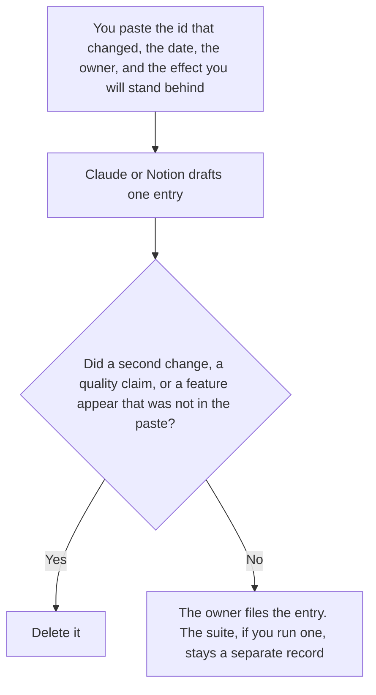

**An AI changelog entry written with AI is one record of a change to an AI system: the model id, the prompt id, or the retrieval source a person already changed, plus the date and the owner.** The model may format that entry. It may not decide the change was an improvement, invent a version, or describe a user-facing feature the change did not ship. A product changelog, from commits a user will see, is [how to write a changelog with AI](/blog/how-to-write-a-changelog-with-ai-2026/). A list of prompt versions in the library is [how to create a prompt library changelog with AI](/blog/how-to-create-a-prompt-library-changelog-with-ai-2026/). This page is one entry about the AI system itself.

The window before a model id goes away is [what an AI model deprecation window is](/blog/what-is-ai-model-deprecation-window-2026/). The notice you send when that window is real is [how to write a model deprecation notice with AI](/blog/how-to-write-a-model-deprecation-notice-with-ai-2026/). The cases you re-run after the change are [what an AI eval regression suite is](/blog/what-is-ai-eval-regression-suite-2026/).

Notion, ChatGPT, and Cursor prices are from the dates below. Claude's prices are from claude.com/pricing on October 24, 2026. Published October 24, 2026. We did not score the change. An entry is not a release approval.

## What the entry is allowed to say

| Field | Who owns it | The model may |
|---|---|---|
| What changed | You: model id, prompt id, or source | Copy it. It may not add a second change |
| Date | You | Copy it. It may not use "today" unless you wrote the date |
| Owner | You | Copy the name. It may not assign a team |
| What a person said the effect was | You, or Effect not recorded | Copy it. It may not write "more accurate" |
| User-facing or internal | You | Copy the label. It may not turn an internal prompt edit into a product feature |

An entry that says the new model is "better" has added a score. If you did not paste a result from a suite you accept, the effect line says Effect not recorded. Link the suite. Do not summarize it as a win. A prompt id and a model id that changed on the same day are two entries unless you wrote that they shipped together.

The product changelog is what a customer reads. This entry is what the team that runs the system reads. If a customer should hear about it, that is the product changelog or a deprecation notice, written from facts you paste there. Do not copy an internal retrieval change into customer release notes because the dates match.

## Where it is drafted

**The log.** [Notion AI](/tools/notion-ai/) Business is $20 a seat a month on the October 16 card. One entry per change, the date, and the owner. Plus at $10 is not the full AI tier. The invoice is [Notion AI pricing explained](/blog/notion-ai-pricing-explained-2026/).

**The sentence.** [Claude](/tools/claude/) Pro is $17 a month billed annually, $200 up front, or $20 monthly. The Project holds the id so a later edit does not rename it. The review is [Claude review](/blog/claude-review-2026/). The ladder is [Claude pricing explained](/blog/claude-pricing-explained-2026/).

**One entry from a short paste.** [ChatGPT](/tools/chatgpt/) Plus is $20 a month on the October 24 plan page. Discard a version that adds a benefit. The ladder is [ChatGPT pricing explained](/blog/chatgpt-pricing-explained-2026/).

**The diff, if the change is a commit.** [Cursor](/tools/cursor/) Plus is $8 a month, or $80 a year, on the October 24 help page recorded in [Cursor Business pricing explained](/blog/cursor-business-pricing-explained-2026/). The entry cites the commit you named. It does not invent a commit message.

A prompt that holds the line:

"Draft one changelog entry from the id, the date, the owner, and the effect I pasted. If the effect is missing, write Effect not recorded. Do not add a second change. Do not say the system is more accurate. Do not write customer release notes."

## What not to delegate

Do not ask whether the change "deserves" an entry. If a person changed a model, a prompt, or a retrieval source that production uses, the entry exists. Do not hide an internal change because it might worry a reader. Mark it internal if you wrote that label. The owner files it. A polished paragraph is not the record.

## FAQ

### How is this different from a product changelog?

That page turns commits into a list a user can read. This page is one entry about the AI system: a model id, a prompt id, or a retrieval source. A product changelog can omit an internal prompt edit. This log should not omit it if production calls that prompt. Use that page for the user-facing list. Use this page for the system entry.

### How is this different from a prompt library changelog?

The library changelog is every prompt version: the id, the date, the line that moved. This entry is one change, and it can be a model or a retrieval source, not only a prompt. A library log can be the source you paste. The entry does not replace the library log, and it does not retire the prompt. Retirement is [how to create a prompt retirement plan with AI](/blog/how-to-create-a-prompt-retirement-plan-with-ai-2026/).

### How is this different from a model deprecation notice?

The notice tells people a model id will stop being available, inside a window you already have. The changelog entry records that you changed ids, or that you started the window, on a date. The notice is for the readers who must move. The entry is the log line. Write the notice from the deprecation page when someone has to act.

### Who may file the entry?

The owner named on it. Effect not recorded stays not recorded. A second id stays out unless you paste it as its own entry or you wrote that they shipped together. The model does not file the entry by drafting it.

## Last verified

October 24, 2026 for Claude, for ChatGPT's plan page, and for Cursor's help page, via the posts cited above. October 16, 2026 for Notion. Published October 24, 2026.

**Sources:** [Notion pricing](https://www.notion.com/pricing), [Claude pricing](https://claude.com/pricing), [ChatGPT and Codex pricing](https://learn.chatgpt.com/docs/pricing), [Cursor pricing](https://cursor.com/help/account-and-billing/pricing).

*Published by Andrew for [AI Tools Optimizer](https://aitoolsoptimizer.com).*

[Claude](/tools/claude/) is in the [chatbots and assistants directory](/tools/category/chatbots-assistants/). Directory pages may use affiliate links. A purchase through them may earn us a commission at no extra cost to you.
