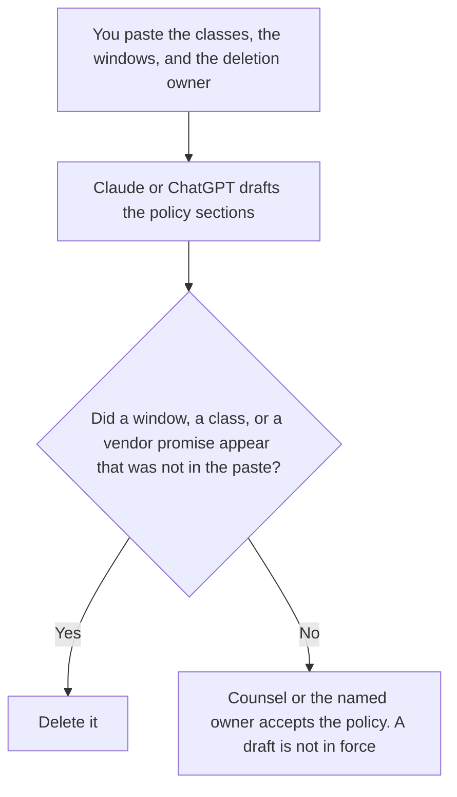

**An AI data retention policy written with AI is a draft that restates the data classes, the windows, and the deletion owner a person already set.** The model may number the sections. It may not invent a retention period, a vendor promise, or an exception. The definition of the document is [what an AI data retention policy is](/blog/what-is-ai-data-retention-policy-2026/). The customer-facing sentence, which is shorter and is not the policy, is [how to write a data retention notice with AI](/blog/how-to-write-a-data-retention-notice-with-ai-2026/).

The internal note that points at the policy is [how to write a data retention note for AI with AI](/blog/how-to-write-a-data-retention-note-for-ai-with-ai-2026/). Stripping identifiers before a prompt is kept is [what AI PII redaction is](/blog/what-is-ai-pii-redaction-2026/).

Claude's prices are the October 24, 2026 read of claude.com/pricing recorded in [Claude pricing explained](/blog/claude-pricing-explained-2026/). Notion and Perplexity prices are from the posts cited below. ChatGPT's Plus price is the October 24 plan-page figure recorded in [ChatGPT pricing explained](/blog/chatgpt-pricing-explained-2026/). Published October 24, 2026. We did not audit any vendor's logs. Counsel reads the contract. This page drafts the decisions you already made.

## What the draft is allowed to say

| Section | Who owns it | The model may |
|---|---|---|
| The data class | You: prompts, outputs, files, logs | Copy the class. It may not add a class |
| The window | You, or Window not set | Copy the period. It may not pick 30 days because that sounds familiar |
| Who deletes | You, or Owner not set | Copy the name |
| The vendor setting that is an input | You, with the date you read it | Quote it. It may not treat a setting as your policy |
| The exception | You, or Exception not set | Copy it. It may not create a legal hold |

A vendor toggle is an input. If the setting says chats are stored until you delete them, the policy can say that, with the date you read it. The policy can also say you delete sooner. The model does not get to "align" your window with a vendor default you did not paste. Window not set stays in the draft as a blank, not as a number.

The notice tells a customer what you will say in public. The note tells a teammate where the policy lives. This document is the policy: classes, windows, owner, exception. Do not paste the notice into the policy and call the work done.

## Where it is drafted

**The draft.** [Claude](/tools/claude/) Pro is $17 a month billed annually, $200 up front, or $20 monthly. Keep the accepted windows in a Project so a later edit does not shorten them. The review is [Claude review](/blog/claude-review-2026/).

**The page that will hold the accepted policy.** [Notion AI](/tools/notion-ai/) Business is $20 a seat a month on the October 16 card. Link the owner and the date. Plus at $10 is not the full AI tier. The invoice is [Notion AI pricing explained](/blog/notion-ai-pricing-explained-2026/).

**One section from a paste.** [ChatGPT](/tools/chatgpt/) Plus is $20 a month. Discard a version that adds a class to make the list look complete. The ladder is [ChatGPT pricing explained](/blog/chatgpt-pricing-explained-2026/).

**A public vendor page you still have to open.** [Perplexity](/tools/perplexity/) Pro is $17 a month billed annually on the October 24 read in [Perplexity pricing explained](/blog/perplexity-pricing-explained-2026/). A citation is not your retention window. The rule for shipping a claim is [what AI grounding citation-required is](/blog/what-is-ai-grounding-citation-required-2026/).

A prompt that holds the line:

"Draft the retention policy from the data classes, windows, deletion owner, and exceptions I pasted. If a window is missing, write Window not set. Do not invent a period. Do not describe a vendor setting I did not paste."

## What not to delegate

Do not ask how long a company "should" keep prompts. Do not turn a notice into the policy. Do not mark the draft accepted because every heading is filled. The owner named on the page accepts it. Counsel reviews the contract terms you pasted. This workflow does not replace that review.

## FAQ

### How is this different from the retention-policy explainer?

That page defines the document: how long prompts, outputs, files, and logs are kept, and who deletes them. This page is the draft you produce after those decisions exist. A definition is not a window. Window not set means the decision is still open.

### How is this different from the customer notice?

The notice is what you are willing to tell a customer, in fewer sentences. The policy is the internal rule, including classes the notice may not list. Write the policy from the decisions. Write the notice from the policy a person already accepted. Do not draft them as one blob.

### How is this different from the internal note?

The note points a teammate at the policy. It is not the policy. A note can say where the page lives. It cannot set a new window.

### Who may set a window?

The owner named on the page, with counsel when the contract is involved. A generated "30 days" is not a decision. A vendor default is not your policy until you adopt it in writing.

## Last verified

October 24, 2026 for Claude, for ChatGPT's plan page, and for Perplexity, via the posts cited above. October 16, 2026 for Notion. Published October 24, 2026.

**Sources:** [Claude pricing](https://claude.com/pricing), [Notion pricing](https://www.notion.com/pricing), [ChatGPT and Codex pricing](https://learn.chatgpt.com/docs/pricing), [Perplexity pricing](https://www.perplexity.ai/pro).

*Published by Andrew for [AI Tools Optimizer](https://aitoolsoptimizer.com).*

[Claude](/tools/claude/) is in the [chatbots and assistants directory](/tools/category/chatbots-assistants/). Directory pages may use affiliate links. A purchase through them may earn us a commission at no extra cost to you.
