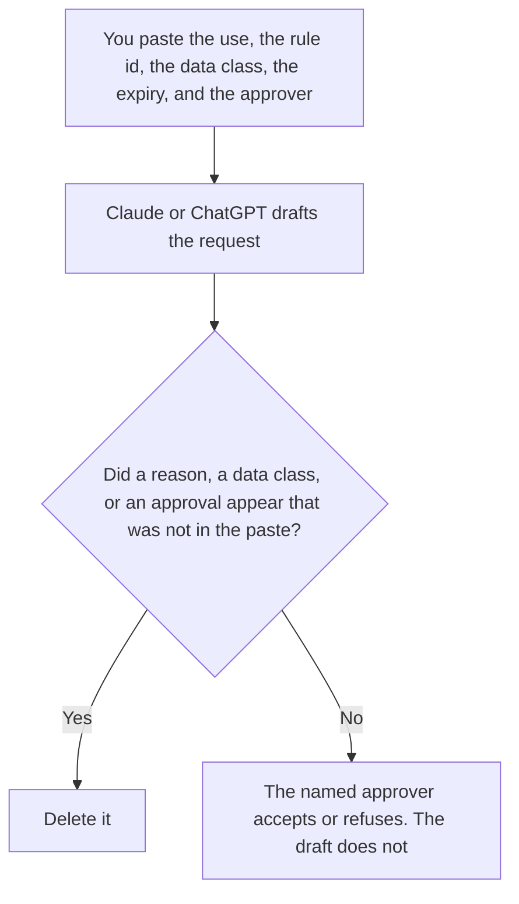

**An AI exception request written with AI is a draft that states a use outside the approved brief, the data class, the expiry, and the approver a person already named.** The model may order those fields. It may not invent a reason, a shorter expiry, or an approval. A request to waive a security control is [how to write a security exception request with AI](/blog/how-to-write-a-security-exception-request-with-ai-2026/). A request to raise a cap is [how to create a quota exception request with AI](/blog/how-to-create-a-quota-exception-request-with-ai-2026/).

The list of tools a workflow may call is [what an AI tool allowlist is](/blog/what-is-ai-tool-allowlist-2026/). This request is how a person asks to step outside a rule you already wrote. It is not how the rule gets quietly edited.

Claude's prices are the October 24, 2026 read of claude.com/pricing recorded in [Claude pricing explained](/blog/claude-pricing-explained-2026/). Notion and Grammarly prices are from directory pages checked October 16, 2026. ChatGPT's Plus price is the October 24 plan-page figure recorded in [ChatGPT vs Claude for stakeholder updates](/blog/chatgpt-vs-claude-for-stakeholder-updates-2026/). Published October 24, 2026. We did not score risk.

## What the request is allowed to say

| Field | Who owns it | The model may |
|---|---|---|
| The use | You | Copy the system and the job. It may not add a second job |
| The rule you are stepping outside | You | Copy the rule id. It may not say the rule does not apply |
| Data class | You | Copy it. It may not downgrade it |
| Expiry | You | Copy the date. It may not extend it |
| Approver | A person you named | Copy the name. It may not mark approved |

A request that says the use is "low risk" has added a judgment. If you do not have a written risk line, the cell says Risk line not set. Put arguments in a note labeled Not in the request. An expiry in the past is not a draft you "clean up." Say the date a person wrote, even if it is soon.

The allowlist still blocks the tool until the approver changes the row. A well-written request is not access.

## Where it is drafted

**The draft.** [Claude](/tools/claude/) Pro is $17 a month billed annually, $200 up front, or $20 monthly. The Project holds the field names so the next request matches this one. The review is [Claude review](/blog/claude-review-2026/).

**The file the approver opens.** [Notion AI](/tools/notion-ai/) Business is $20 a seat a month. Status stays Requested until a person changes it. The invoice is [Notion AI pricing explained](/blog/notion-ai-pricing-explained-2026/).

**One draft from a short paste.** [ChatGPT](/tools/chatgpt/) Plus is $20 a month. Discard a version that adds "approved by policy." The ladder is [ChatGPT pricing explained](/blog/chatgpt-pricing-explained-2026/).

**A clarity pass that must not touch the expiry.** [Grammarly](/tools/grammarly/) Pro is $12 a member a month billed annually, or $30 monthly. Compare the expiry and the data class before and after. The invoice is [Grammarly pricing explained](/blog/grammarly-pricing-explained-2026/).

A prompt that holds the line:

"Draft the AI exception request from the use, the rule id, the data class, the expiry, and the approver I pasted. Leave the status as Requested. If the expiry is missing, write Expiry not set. Do not mark approved. Do not add a reason."

## What not to delegate

Do not ask how to make the exception "sound safe." Do not paste customer data so the request "shows an example." Do not start the use because the draft is clear. The named approver decides. A missing expiry stays missing.

## FAQ

### How is this different from a security exception?

A security exception asks to waive a control: a configuration, a scan, a requirement your security process names. An AI exception asks to use a model or a tool outside the AI rule you already wrote, such as a system that is not on the allowlist for this data class. The same approver might see both. The forms are different so a waived control is not confused with a new model.

### How is this different from a quota exception?

A quota exception asks to raise a cap you already set: spend, tokens, or seats. An AI exception asks to do a use the rule did not allow, at any volume. Raising the cap does not approve a new data class. Write the form that matches the ask. Do not pick the shorter one.

### How is this different from editing the allowlist?

The allowlist is the rule. The request is a dated ask to step outside it. If the approver wants the use to become normal, they change the allowlist in a separate edit, with an owner. The request then expires. Do not leave a permanent exception in place of a rule change because the form was faster.

### Who may mark it approved?

The approver named on the request. The author of the draft is not the approver unless the row says so before the draft was written. Requested stays requested. An expiry is a date, not a suggestion.

## Last verified

October 24, 2026 for Claude and for ChatGPT's plan page, via the posts cited above. October 16, 2026 for Notion and Grammarly. Published October 24, 2026.

**Sources:** [Claude pricing](https://claude.com/pricing), [Notion pricing](https://www.notion.com/pricing), [ChatGPT and Codex pricing](https://learn.chatgpt.com/docs/pricing), [Grammarly pricing](https://www.grammarly.com/plans).

*Published by Andrew for [AI Tools Optimizer](https://aitoolsoptimizer.com).*

[Claude](/tools/claude/) is in the [chatbots and assistants directory](/tools/category/chatbots-assistants/). Directory pages may use affiliate links. A purchase through them may earn us a commission at no extra cost to you.
