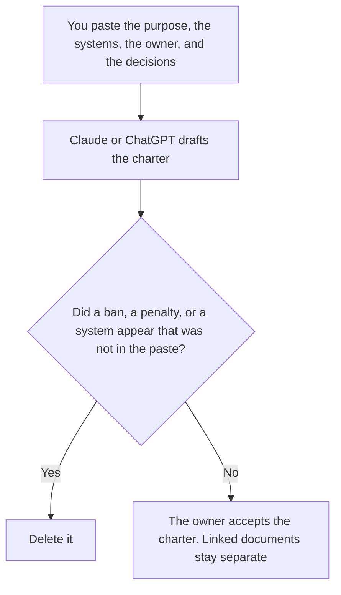

**An AI governance charter written with AI is a draft that restates the purpose, the systems in scope, the owner, and the decisions a person already made.** The model may order the sections. It may not invent a principle, a banned tool, a penalty, or a committee. The harms that remain, row by row, are [how to write an AI risk register with AI](/blog/how-to-write-an-ai-risk-register-with-ai-2026/). Who may call which tool is [how to create a tool permission matrix with AI](/blog/how-to-create-a-tool-permission-matrix-with-ai-2026/). This page is the charter: the document that names those other documents and who accepts them.

The path a prompt takes before it is allowed to change is [how to create a prompt approval workflow with AI](/blog/how-to-create-a-prompt-approval-workflow-with-ai-2026/). The class a new hire sits through is [how to write an AI training outline with AI](/blog/how-to-write-an-ai-training-outline-with-ai-2026/).

Claude's prices are the October 24, 2026 read of claude.com/pricing recorded in [Claude pricing explained](/blog/claude-pricing-explained-2026/). Notion and Grammarly prices are from directory pages checked October 16, 2026. ChatGPT's Plus price is the October 24 plan-page figure recorded in [ChatGPT pricing explained](/blog/chatgpt-pricing-explained-2026/). A live fetch of Grammarly's plans URL returned HTTP 401 on October 24, as the Business pricing article records. Published October 24, 2026. This page is not legal advice. We did not score governance. A charter is not a control.

## What the charter is allowed to say

| Section | Who owns it | The model may |
|---|---|---|
| Purpose | You | Copy the sentence. It may not add a value |
| Systems in scope | You | Copy the list. It may not add a vendor |
| Owner | You | Copy the name. It may not assign a committee |
| Decisions already made | You | Copy them. It may not invent a ban or a penalty |
| Documents it points at | You, or Document not named | Link them. It may not draft the risk register inside the charter |

A sentence that says "AI must be used responsibly" has added a principle you did not write. If the purpose is missing, the line says Purpose not set. If a system is not on the list, it is out of scope until a person adds it. Put proposals in a note labeled Not in the charter.

The charter points at the risk register, the permission matrix, and the approval workflow. It does not replace them. A charter that contains every risk row will go stale the first time a row changes. Link the row. Do not paste it as if the charter were the register.

## Where it is drafted

**The draft.** [Claude](/tools/claude/) Pro is $17 a month billed annually, $200 up front, or $20 monthly. Keep the purpose sentence in a Project so a later edit does not soften it. Team standard seats are $20 a seat a month billed annually, or $25 monthly, when the charter is a company record, as recorded in [Claude Team pricing explained](/blog/claude-team-pricing-explained-2026/). The review is [Claude review](/blog/claude-review-2026/).

**The file the company keeps.** [Notion AI](/tools/notion-ai/) Business is $20 a seat a month. Link the owner, the date, and the documents. Plus at $10 is not the full AI tier. The invoice is [Notion AI pricing explained](/blog/notion-ai-pricing-explained-2026/).

**One short charter from a paste.** [ChatGPT](/tools/chatgpt/) Plus is $20 a month. Discard a version that adds a banned-tool list. The ladder is [ChatGPT pricing explained](/blog/chatgpt-pricing-explained-2026/).

**A clarity pass that must not touch a decision.** [Grammarly](/tools/grammarly/) Pro is $12 a member a month billed annually, or $30 monthly, on the October 16 card. Compare every decision sentence before and after. The invoice is [Grammarly pricing explained](/blog/grammarly-pricing-explained-2026/).

A prompt that holds the line:

"Draft the charter from the purpose, the systems, the owner, and the decisions I pasted. If a system is not listed, leave it out. If a decision is missing, write Decision not recorded. Do not add a ban. Do not add a penalty."

## What not to delegate

Do not ask which principles a board "expects." Do not paste a vendor's policy and adopt it as yours. Do not publish the charter because the headings look complete. The owner named on the page accepts it. A missing decision stays missing until a person records one.

## FAQ

### How is this different from an AI risk register?

The register is one row per harm: the system, the harm, the owner, the control. The charter names who owns the register and which systems are in scope. It does not score a harm, and it does not list every row. Use the register for the harm. Use this page for the document that points at it.

### How is this different from a permission matrix?

The matrix says which role may use which tool, and whether the call reads or changes something. The charter can require that a matrix exist. It does not grant a permission by mentioning a tool. If the charter and the matrix disagree, a person fixes one of them. The draft does not merge them.

### How is this different from a training outline?

The outline is the class: what a person must be shown before they use a system. The charter is the decision that such a class exists, and who owns it. A slide in the class is not a charter amendment. Link the outline. Do not paste the lesson into the charter.

### Who may accept the charter?

The owner named on the page. A formatted document is not acceptance. Decision not recorded stays not recorded. A system that was not in the paste stays out of scope.

## Last verified

October 24, 2026 for Claude and for ChatGPT's plan page, via the posts cited above. October 16, 2026 for Notion and Grammarly. Published October 24, 2026. Grammarly's plans URL returned HTTP 401 on October 24.

**Sources:** [Claude pricing](https://claude.com/pricing), [Notion pricing](https://www.notion.com/pricing), [ChatGPT and Codex pricing](https://learn.chatgpt.com/docs/pricing), [Grammarly pricing](https://www.grammarly.com/plans).

*Published by Andrew for [AI Tools Optimizer](https://aitoolsoptimizer.com).*

[Claude](/tools/claude/) is in the [chatbots and assistants directory](/tools/category/chatbots-assistants/). Directory pages may use affiliate links. A purchase through them may earn us a commission at no extra cost to you.
