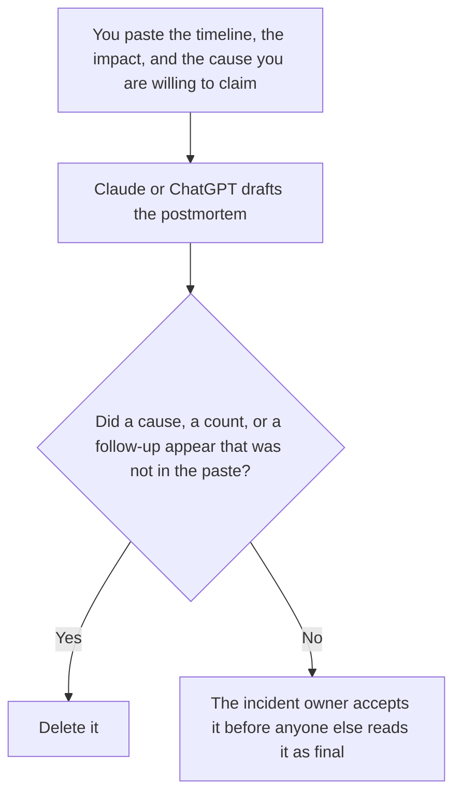

**An AI incident postmortem written with AI is a document that states the impact, the timeline you already accepted, what you are willing to call a cause, and the follow-ups a person already assigned.** The model may order those sections. It may not invent a root cause, a customer count, or a lesson that makes the team sound finished. The chronological list is [how to write an incident timeline with AI](/blog/how-to-write-an-incident-timeline-with-ai-2026/). The hour of the event is [what AI incident response is](/blog/what-is-ai-incident-response-2026/).

The customer-facing words, if you send them, are a different page. The internal note if you rolled back is [how to write a rollback comms note with AI](/blog/how-to-write-a-rollback-comms-note-with-ai-2026/).

Claude's prices are from claude.com/pricing on October 24, 2026. Notion, ChatGPT, and Cursor prices are from directory pages checked October 16, 2026. chatgpt.com/pricing returned HTTP 403 on October 24. Published October 24, 2026. We did not score incidents.

## What the postmortem contains

| Section | Who owns it | The model may |
|---|---|---|
| Impact | You, from the count you already have | Copy it. If the count is missing, write Impact not counted |
| Timeline | The timeline a person accepted | Paste it. It may not add a minute |
| Cause | Only what you are willing to claim | Copy the claim. If you wrote Cause unknown, it stays |
| Follow-ups | A person, with an owner and a date | Copy them. It may not add a task to look busy |

A postmortem that "finds" a cause the timeline does not support is a story. Label judgments as judgments. If two causes are still possible, the document says both are possible. Blameless is a rule about people. It is not a rule that the facts must be soft.

The customer note, if one goes out, uses the impact line from this document and no extra color. Do not paste the internal follow-up list into the customer email.

## Where it is written

**The draft.** [Claude](/tools/claude/) Pro is $17 a month billed annually, $200 up front, or $20 monthly. Keep the timeline in a Project so a later edit does not smooth a minute. The review is [Claude review](/blog/claude-review-2026/).

**The page the company keeps.** [Notion AI](/tools/notion-ai/) Business is $20 a seat a month. Link the timeline and the date the owner accepted the cause line. The invoice is [Notion AI pricing explained](/blog/notion-ai-pricing-explained-2026/).

**One draft from a short paste.** [ChatGPT](/tools/chatgpt/) Plus is $20 a month on the October 16 card. Discard a version that adds a lesson about "moving faster." The review is [ChatGPT review](/blog/chatgpt-review-2026/).

**A change that follows from a follow-up.** [Cursor](/tools/cursor/) Plus is $8 a month, or $80 a year. The postmortem does not merge the fix. The ladder is [Cursor pricing explained](/blog/cursor-pricing-explained-2026/).

A prompt that holds the line:

"Write the postmortem from the impact, the timeline, the cause line, and the follow-ups I pasted. If the cause line says unknown, keep it unknown. Do not add a customer count. Do not add a follow-up."

## What not to delegate

Do not ask what really happened. Do not ask who was at fault. Do not publish the document because the headings look complete. The incident owner accepts it. A follow-up with no owner is not a follow-up. Write Owner not set.

## FAQ

### How is this different from the timeline?

The timeline is times and events. The postmortem is what you are willing to conclude, and what you will change. The postmortem quotes the timeline. It does not replace it. If the timeline is still moving, you are not ready for this page.

### How is this different from the customer note?

The customer note is what customers need to do, or what you are telling them. The postmortem is internal unless you deliberately publish a version. The internal follow-ups stay internal. Start the customer words from the note you already use, not from this draft.

### Can the model suggest corrective actions?

It can format actions you pasted. A suggested action you did not paste is a proposal, and it does not go in the accepted list. Put Proposed, not accepted, in a separate section if you want to see it, and do not assign it an owner the model invented.

### Who may call the postmortem final?

The incident owner, after the cause line matches what the team is willing to defend. A shared link is not acceptance. A confident paragraph is not a cause.

## Last verified

October 24, 2026 for Claude. October 16, 2026 for Notion, ChatGPT, and Cursor. Published October 24, 2026.

**Sources:** [Claude pricing](https://claude.com/pricing), [Notion pricing](https://www.notion.com/pricing), [ChatGPT pricing](https://chatgpt.com/pricing/), [Cursor pricing](https://cursor.com/help/account-and-billing/pricing).

*Published by Andrew for [AI Tools Optimizer](https://aitoolsoptimizer.com).*

[Claude](/tools/claude/) is in the [chatbots and assistants directory](/tools/category/chatbots-assistants/). Directory pages may use affiliate links. A purchase through them may earn us a commission at no extra cost to you.
