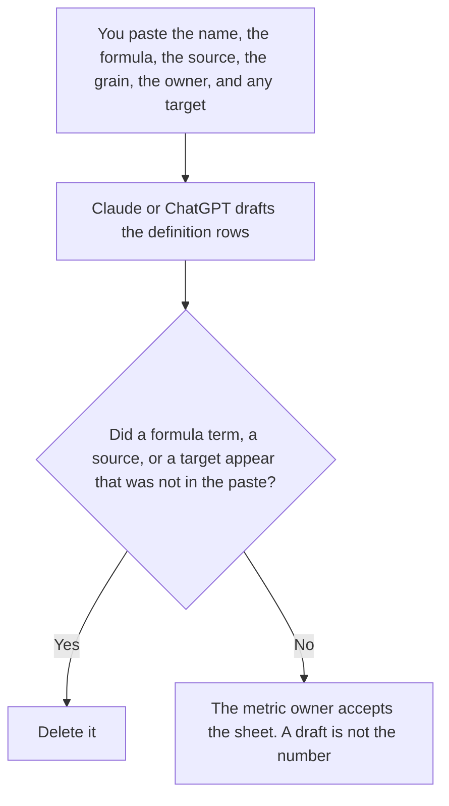

**An AI KPI definition sheet written with AI is a draft that restates the metric name, the formula, the source, the grain, and the owner a person already set.** The model may order the rows. It may not invent a target, a formula, or a source. The rows you fill after a run, which are not definitions, are [how to create an AI eval scorecard with AI](/blog/how-to-create-an-ai-eval-scorecard-with-ai-2026/). The line you already set for a pilot is [how to write an AI pilot scorecard with AI](/blog/how-to-write-an-ai-pilot-scorecard-with-ai-2026/). A label on one answer is [what an AI output confidence score is](/blog/what-is-ai-output-confidence-score-2026/).

The band that says what a label may trigger is [what an AI output confidence band is](/blog/what-is-ai-output-confidence-band-2026/). A definition is not a band, and a band is not a KPI.

Claude's prices are the October 24, 2026 read of claude.com/pricing recorded in [Claude pricing explained](/blog/claude-pricing-explained-2026/). Notion is the October 16 directory card. ChatGPT's Plus price is the October 24 plan-page figure recorded in [ChatGPT pricing explained](/blog/chatgpt-pricing-explained-2026/). Hex's prices are from Hex's pricing page read October 24, 2026, recorded in [Hex pricing explained](/blog/hex-pricing-explained-2026/): Professional is $36 an editor a month, Team is $75. Published October 24, 2026. We did not score a metric. A definition is not a result.

## What a row is allowed to say

| Field | Who owns it | The model may |
|---|---|---|
| The name | You | Copy it. It may not rename a metric to sound sharper |
| The formula, in words you wrote | You, or Formula not set | Copy it. It may not add a term |
| The source and the grain | You: which system, per what | Copy them. It may not pick a warehouse |
| The owner and the cadence | You, or Owner not set | Copy them |
| The target, if you have one | You, or Target not set | Copy it. It may not choose a goal |

Formula not set stays blank. A familiar ratio the model has seen in other companies is not your formula. Target not set stays blank. A round number is not a goal you agreed to. The sheet can define a metric you track without a target. Adding a target to make the row look managed is the failure this workflow is for.

The eval scorecard records what happened when you ran cases. The pilot scorecard records the line a pilot has to clear. This sheet says what the metric means before either of those numbers exists. Do not paste a score into the definition and call the definition done. Do not paste the definition into the scorecard as if the formula were a result.

Grain is part of the formula's meaning. "Per account per week" and "per account per day" are different metrics. If the paste does not say, the row says Grain not set. The model does not pick the one that makes a chart smoother.

## Where it is drafted

**The draft.** [Claude](/tools/claude/) Pro is $17 a month billed annually, $200 up front, or $20 monthly. Keep the accepted formulas in a Project so a later edit cannot drop a term. The review is [Claude review](/blog/claude-review-2026/).

**The page that holds the accepted sheet.** [Notion AI](/tools/notion-ai/) Business is $20 a seat a month on the October 16 card. Link the owner and the date. Plus at $10 is not the full AI tier. The invoice is [Notion AI pricing explained](/blog/notion-ai-pricing-explained-2026/).

**One metric from a paste.** [ChatGPT](/tools/chatgpt/) Plus is $20 a month. Discard a version that adds a benchmark. The ladder is [ChatGPT pricing explained](/blog/chatgpt-pricing-explained-2026/).

**The notebook, if the source is a query you already trust.** [Hex](/tools/hex/) Professional is $36 an editor a month. The definition still lives on the sheet. Hex does not become the owner of the formula because the query runs there. Team at $75 is the scheduled-run row on the October 24 pricing article. The analyst who writes the sentence under a chart is [best AI tools for data analysts](/blog/best-ai-tools-for-data-analysts-2026/).

A prompt that holds the line:

"Draft the KPI definition from the name, formula, source, grain, owner, cadence, and target I pasted. If a formula is missing, write Formula not set. If a target is missing, write Target not set. Do not invent a goal."

## What not to delegate

Do not ask what a team "should" measure. Do not turn a confidence label into a KPI. Do not mark the sheet accepted because every name is filled. The metric owner accepts the row. The number, when you publish one, comes from the source the row names.

## FAQ

### How is this different from an eval scorecard?

The scorecard is filled from a run: cases, scores you recorded, a date. The definition sheet says what a metric means before the run. A score without a definition is a number. A definition without a score is still a definition.

### How is this different from a pilot scorecard?

The pilot scorecard is the line a pilot has to clear, which you already set. This sheet can exist with Target not set. Do not copy a pilot line into the definition unless the metric owner pasted it as the target.

### How is this different from a confidence band?

A confidence band says what action a label on one answer may trigger. A KPI is a metric with a formula and a source. A high band is not a KPI result, and a KPI result is not a reason to move a band.

### Who may set a target?

The metric owner named on the row. Target not set stays unset. A generated "10 percent" is not a goal, and a smoother grain is not the grain you operate.

## Last verified

October 24, 2026 for Claude, for ChatGPT's plan page, and for Hex, via the posts cited above. October 16, 2026 for Notion. Published October 24, 2026.

**Sources:** [Claude pricing](https://claude.com/pricing), [Notion pricing](https://www.notion.com/pricing), [ChatGPT and Codex pricing](https://learn.chatgpt.com/docs/pricing), [Hex pricing](https://hex.tech/pricing/).

*Published by Andrew for [AI Tools Optimizer](https://aitoolsoptimizer.com).*

[Hex](/tools/hex/) is in the [data and analytics directory](/tools/category/data-analytics/). Directory pages may use affiliate links. A purchase through them may earn us a commission at no extra cost to you.
