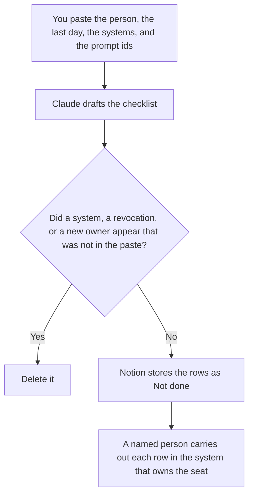

**An AI offboarding checklist written with AI is a draft for one departing person: the last day, the systems a human already listed, the prompts they own, and the agents they own.** Every action stays Not done until a person marks it. The model may order the rows. It may not revoke a seat, transfer a prompt, or invent a system. The sheet for many seats, on a cycle, is [how to create an AI access review with AI](/blog/how-to-create-an-ai-access-review-with-ai-2026/). The list for a new hire is [how to create an onboarding checklist with AI](/blog/how-to-create-an-onboarding-checklist-with-ai-2026/).

Leaving a vendor, which is not a person leaving, is [how to write an AI vendor exit plan with AI](/blog/how-to-write-an-ai-vendor-exit-plan-with-ai-2026/). Who owns a prompt after the move is [how to write a prompt ownership RACI with AI](/blog/how-to-write-a-prompt-ownership-raci-with-ai-2026/).

Claude's prices are the October 24, 2026 read of claude.com/pricing recorded in [Claude pricing explained](/blog/claude-pricing-explained-2026/). Notion, Zapier, and the access pattern are from directory pages checked October 16, 2026. A live fetch of Zapier's pricing page returned HTTP 401 on October 24, in the agent-budget article, so the Zapier figure stays on that record. ChatGPT's Plus price is the October 24 plan-page figure recorded in [ChatGPT vs Claude for stakeholder updates](/blog/chatgpt-vs-claude-for-stakeholder-updates-2026/). Published October 24, 2026. We did not score account hygiene.

## What the checklist is allowed to list

| Row | Who owns it | The model may |
|---|---|---|
| Person and last day | You | Copy them. It may not guess a last day |
| System | You, from the list you exported | Copy it. It may not add a tool they "might" have used |
| Prompt or agent they own | You, from the registry | Copy the id. It may not reassign the owner |
| Action | You, still Not done | Leave it. It may not mark removed |
| Who will do it | A person you named | Copy the name. It may not assign "IT" |

An access review looks across many people. This checklist is one person, on the way out. A vendor exit plan is the contract and the export, when you leave a product. Do not paste a vendor's data-processing addendum into a person's checklist and call it offboarding.

A prompt with no new owner stays on the old owner until the RACI names a person. The checklist can say Owner not reassigned. It cannot invent one.

## Where it is drafted

**The draft.** [Claude](/tools/claude/) Pro is $17 a month billed annually, $200 up front, or $20 monthly. The Project holds the column names so the next departure matches this one. The review is [Claude review](/blog/claude-review-2026/).

**The file the next admin opens.** [Notion AI](/tools/notion-ai/) Business is $20 a seat a month. Status stays Not done. The invoice is [Notion AI pricing explained](/blog/notion-ai-pricing-explained-2026/).

**A notice after a person marks a row done.** [Zapier](/tools/zapier/) Professional is $19.99 a month billed annually, with 750 tasks a month, on the October 16 card. The Zap tells someone. It does not disable the account. The invoice is [Zapier pricing explained](/blog/zapier-pricing-explained-2026/).

**One draft from a short paste.** [ChatGPT](/tools/chatgpt/) Plus is $20 a month. Discard a version that says the seats are closed. The ladder is [ChatGPT pricing explained](/blog/chatgpt-pricing-explained-2026/).

A prompt that holds the line:

"Draft the offboarding checklist from the person, the last day, the systems, and the prompt ids I pasted. Leave every action as Not done. If the new owner is missing, write Owner not reassigned. Do not add a system. Do not mark removed."

## What not to delegate

Do not paste passwords or recovery codes so a row "can be checked." Do not let a Zap disable an account because a model marked removed. Do not skip a prompt they own because the seat list looked complete. The named person changes the seat. Not done stays not done.

## FAQ

### How is this different from an access review?

The access review is the periodic sheet of who still has a seat, from an export. This checklist is one person's departure: last day, their systems, their prompts, their agents. The review can include them. It does not list the prompt handoff. If the export has no row for a system you expected, the checklist says the system was not on the export. It does not add it.

### How is this different from a vendor exit plan?

The vendor exit is how you leave a product: the export, the contract end, the replacement. Offboarding is a person leaving the company, or leaving the team that used the tool. You might do both in the same month. The documents stay separate so a contract date is not written onto a person's last day.

### How is this different from onboarding?

Onboarding grants access a person listed for a new hire. Offboarding removes or reassigns what this person had. Do not reverse an onboarding checklist and call the opposite done. Each row needs a human mark. A seat you grant and a seat you remove are different tickets.

### Who may mark a row done?

The person named on that row, after they changed the seat or reassigned the prompt in the system that owns it. A formatted checklist is not a revocation. Owner not reassigned stays until the RACI names someone.

## Last verified

October 24, 2026 for Claude and for ChatGPT's plan page, via the posts cited above. October 16, 2026 for Notion and Zapier. Published October 24, 2026. Zapier's pricing page returned HTTP 401 on October 24, as recorded in the agent-budget article.

**Sources:** [Claude pricing](https://claude.com/pricing), [Notion pricing](https://www.notion.com/pricing), [Zapier pricing guide](https://zapier.com/blog/zapier-pricing/), [ChatGPT and Codex pricing](https://learn.chatgpt.com/docs/pricing).

*Published by Andrew for [AI Tools Optimizer](https://aitoolsoptimizer.com).*

[Notion AI](/tools/notion-ai/) is in the [notes directory](/tools/category/productivity-notes/). Directory pages may use affiliate links. A purchase through them may earn us a commission at no extra cost to you.
