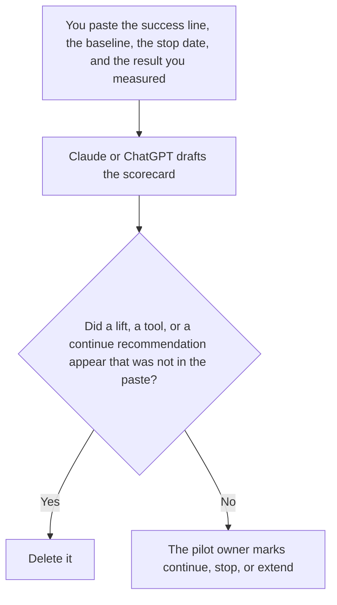

**An AI pilot scorecard written with AI is a draft that restates the success line, the baseline, the stop date, and the decision field a person already created.** The model may order those fields. It may not invent a lift, a time saved, or a recommendation to continue. The brief that should exist before a pilot starts is [how to write an AI use case brief with AI](/blog/how-to-write-an-ai-use-case-brief-with-ai-2026/). The plan for a rollout after a decision is [how to write an AI rollout plan with AI](/blog/how-to-write-an-ai-rollout-plan-with-ai-2026/).

The cases you score a model against, if the pilot is an eval, are [what an AI eval golden set is](/blog/what-is-ai-eval-golden-set-2026/). A scorecard is not that set. The set is the cases. The scorecard is the pilot's result against a line you wrote.

Claude's prices are the October 24, 2026 read of claude.com/pricing recorded in [Claude pricing explained](/blog/claude-pricing-explained-2026/). Notion and Grammarly prices are from directory pages checked October 16, 2026. ChatGPT's Plus price is the October 24 plan-page figure recorded in [ChatGPT vs Claude for stakeholder updates](/blog/chatgpt-vs-claude-for-stakeholder-updates-2026/). Published October 24, 2026. We did not score a pilot.

## What the scorecard is allowed to say

| Field | Who owns it | The model may |
|---|---|---|
| Pilot name | You | Copy it. It may not widen it to a second use |
| Success line | You | Copy it. It may not turn it into a percentage |
| Baseline | You, or the words Baseline not recorded | Copy the number you pasted. It may not estimate one |
| Stop date | You | Copy it. It may not move it |
| Decision | You, left blank until a person marks it | Leave it as Not decided |

A scorecard that says the pilot "likely saved time" has added a result. If you did not measure it, the result cell says Not measured. Put proposals in a note labeled Not on the scorecard. Extend is a decision a person writes, with a new stop date. The model does not extend the pilot by rewriting the date.

## Where it is drafted

**The draft.** [Claude](/tools/claude/) Pro is $17 a month billed annually, $200 up front, or $20 monthly. Keep the success line in a Project so a later edit does not soften it. The review is [Claude review](/blog/claude-review-2026/).

**The file the company keeps.** [Notion AI](/tools/notion-ai/) Business is $20 a seat a month. Link the owner, the stop date, and the decision. The invoice is [Notion AI pricing explained](/blog/notion-ai-pricing-explained-2026/).

**One draft from a short paste.** [ChatGPT](/tools/chatgpt/) Plus is $20 a month. Discard a version that adds a ROI. The ladder is [ChatGPT pricing explained](/blog/chatgpt-pricing-explained-2026/).

**A clarity pass that must not touch the success line.** [Grammarly](/tools/grammarly/) Pro is $12 a member a month billed annually, or $30 monthly, on the October 16 card. Compare the success line before and after. The invoice is [Grammarly pricing explained](/blog/grammarly-pricing-explained-2026/).

A prompt that holds the line:

"Draft the pilot scorecard from the success line, the baseline, the stop date, and the result I pasted. Leave the decision as Not decided. If the baseline is missing, write Baseline not recorded. Do not recommend continue."

## What not to delegate

Do not ask whether the pilot "worked." Do not paste a customer quote so the card "has a story." Do not continue the pilot because the table looks tidy. The pilot owner marks the decision. A missing baseline stays missing until a person records it.

## FAQ

### How is this different from a use case brief?

The brief says who the user is, what job is in scope, and the success line, before you build. The scorecard says what happened against that line, on the stop date. A scorecard without a brief invents the job at the end. Accept the brief first. Fill the result only with a measurement you have.

### How is this different from a rollout plan?

The rollout plan is how you will introduce something you decided to keep. The scorecard is the decision, still blank until a person marks it. Do not write the rollout in the same draft. If the decision is stop, there is no rollout.

### How is this different from a golden set?

The golden set is frozen cases you can rerun. The scorecard is one pilot's outcome against a success line. A pilot can cite a set version. It is not the set. A pass on a case is not a decision to continue the pilot.

### Who may mark continue, stop, or extend?

The pilot owner. A formatted card is not a decision. Extend needs a new stop date a person wrote. Not decided stays not decided.

## Last verified

October 24, 2026 for Claude and for ChatGPT's plan page, via the posts cited above. October 16, 2026 for Notion and Grammarly. Published October 24, 2026.

**Sources:** [Claude pricing](https://claude.com/pricing), [Notion pricing](https://www.notion.com/pricing), [ChatGPT and Codex pricing](https://learn.chatgpt.com/docs/pricing), [Grammarly pricing](https://www.grammarly.com/plans).

*Published by Andrew for [AI Tools Optimizer](https://aitoolsoptimizer.com).*

[Claude](/tools/claude/) is in the [chatbots and assistants directory](/tools/category/chatbots-assistants/). Directory pages may use affiliate links. A purchase through them may earn us a commission at no extra cost to you.
