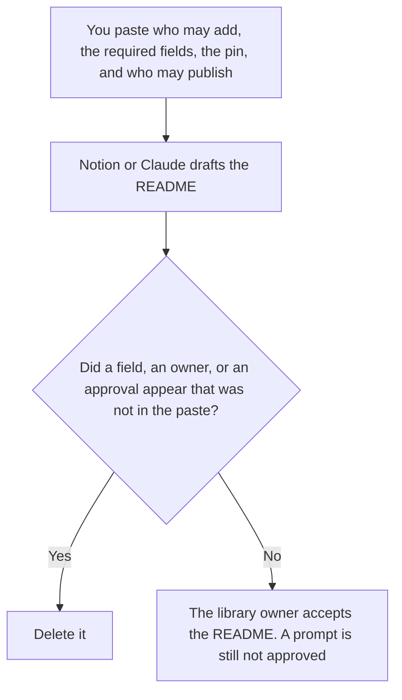

**An AI prompt library README written with AI is the front page of the library: who may add a prompt, what fields are required, where the version pin lives, and how a draft becomes the prompt people call.** The model may format those rules. It may not invent a required field, an owner, or a claim that a prompt is approved.

The thing the README points at is [what an AI prompt library is](/blog/what-is-ai-prompt-library-2026/). The history of changes, which is not the front page, is [how to create a prompt library changelog with AI](/blog/how-to-create-a-prompt-library-changelog-with-ai-2026/). The string that says which version a run used is [what an AI prompt version pin is](/blog/what-is-ai-prompt-version-pin-2026/).

Notion is the October 16, 2026 directory card. Claude's prices are the October 24 read of claude.com/pricing recorded in [Claude pricing explained](/blog/claude-pricing-explained-2026/). ChatGPT's Plus price is the October 24 plan-page figure recorded in [ChatGPT pricing explained](/blog/chatgpt-pricing-explained-2026/). Cursor's Plus price is the October 24 help-center figure recorded in [Cursor pricing explained](/blog/cursor-pricing-explained-2026/). Published October 24, 2026. We did not score prompts.

## What the README is allowed to require

| Rule | Who writes it | The model may |
|---|---|---|
| Who may add a prompt | You, or Owner not set | Copy the role. It may not say "anyone on the team" |
| Required fields | You | Copy them. It may not add a field to look thorough |
| Where the version pin is recorded | You, or Pin not set | Point at it. It may not invent a naming scheme |
| What "draft" means | You | Copy it. A draft is not approved |
| Who may publish | You | Copy the name |

The changelog records that version 3 changed a line on a date. The README tells a new author how to add version 4, and where the pin for a run must be written. A README that includes the whole history will go stale the next time someone ships a prompt. Link the changelog. Do not paste it.

A version pin is the string on a run. The README says where that string is stored and who may move it. It does not move it. If you have not decided, the line says Pin not set. The model does not pick "latest."

The cases you run before a prompt is the one people call are a different artifact. A small set you run first is [what an AI eval canary slice is](/blog/what-is-ai-eval-canary-slice-2026/). The README can link that slice. It cannot mark the slice passed.

## Where it is written

**The page new authors open.** [Notion AI](/tools/notion-ai/) Business is $20 a seat a month. The owner and the required fields live there. Plus at $10 is not the full AI tier. The invoice is [Notion AI pricing explained](/blog/notion-ai-pricing-explained-2026/).

**The rules, kept stable.** [Claude](/tools/claude/) Pro is $17 a month billed annually, $200 up front, or $20 monthly. A Project holds the sentence about who may publish, so a later edit does not widen it. The review is [Claude review](/blog/claude-review-2026/).

**One README from a paste.** [ChatGPT](/tools/chatgpt/) Plus is $20 a month. Discard a version that adds a code-style section you did not ask for. The ladder is [ChatGPT pricing explained](/blog/chatgpt-pricing-explained-2026/).

**The diff, if the library is a repo.** [Cursor](/tools/cursor/) Plus is $8 a month, or $80 a year. You review a README that tells people to skip the pin. The individual ladder is [Cursor pricing explained](/blog/cursor-pricing-explained-2026/).

A prompt that holds the line:

"Draft the prompt library README from the roles, required fields, pin location, and publish rule I pasted. If a rule is missing, write the blank. Do not add a field. Do not mark any prompt approved."

## What not to delegate

Do not ask what a good library README includes. Do not let the draft say every prompt in the folder is production. Do not hide the pin because it makes the page longer. The library owner accepts the README.

## FAQ

### How is this different from the changelog?

The changelog is the list of versions, dates, and lines that changed. The README is the rule for the next change. A version can ship without rewriting the README. A README can be accepted while the changelog is empty, if the library is new. Link them. Do not merge them.

### How is this different from the prompt library explainer?

That page says what a library is. This page is the front door you write after you have decided who may add a prompt. A definition does not name your owner.

### How is this different from a version pin?

The pin is the string on one run. The README says where that string must be written and who may change the pin people use. Writing the README does not pin a prompt. Pin not set stays unset.

### Who may publish a prompt?

The person the README names. A merged pull request is not approval unless the README says it is, and a person still accepts that rule. The model does not widen "library owner" to "anyone with the link."

## Last verified

October 16, 2026 for Notion. October 24, 2026 for Claude, ChatGPT's plan page, and Cursor's help page, via the posts cited above. Published October 24, 2026.

**Sources:** [Notion pricing](https://www.notion.com/pricing), [Claude pricing](https://claude.com/pricing), [ChatGPT and Codex pricing](https://learn.chatgpt.com/docs/pricing), [Cursor pricing](https://cursor.com/help/account-and-billing/pricing).

*Published by Andrew for [AI Tools Optimizer](https://aitoolsoptimizer.com).*

[Notion AI](/tools/notion-ai/) is in the [productivity directory](/tools/category/productivity-notes/). Directory pages may use affiliate links. A purchase through them may earn us a commission at no extra cost to you.
