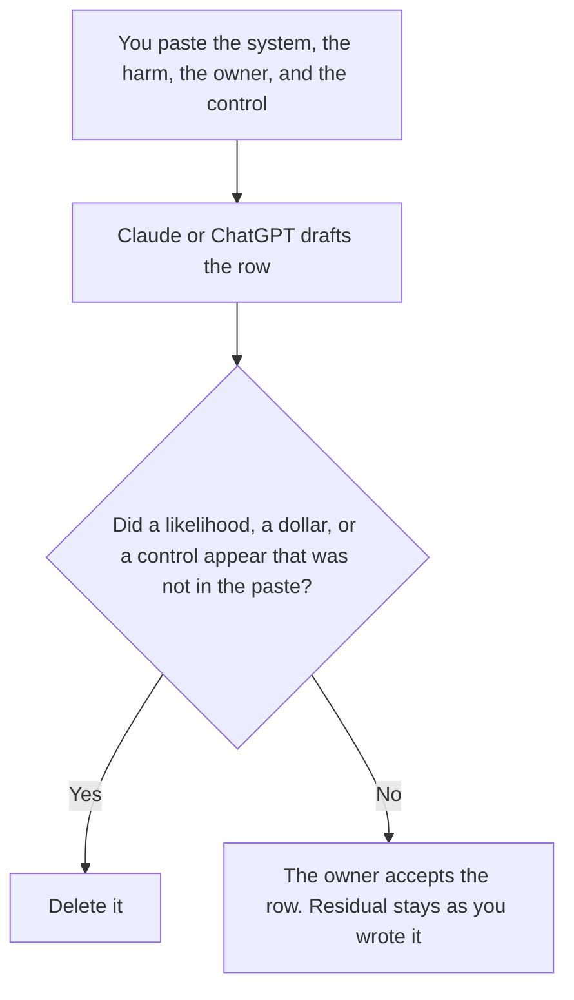

**An AI risk register written with AI is a draft that restates the system, the harm, the owner, and the control a person already named.** The model may order the rows. It may not invent a risk, a likelihood, a dollar impact, or a control. A general register, for risks that are not about an AI system, is [how to create a risk register with AI](/blog/how-to-create-a-risk-register-with-ai-2026/). This page is the AI system: the model, the data, the side effect, and what a person said is left over after the control.

The ask to step outside a rule is [how to write an AI exception request with AI](/blog/how-to-write-an-ai-exception-request-with-ai-2026/). A tool that changes something outside the chat is [what an AI tool side-effect label is](/blog/what-is-ai-tool-side-effect-label-2026/). A made-up impact is [what an AI hallucination is](/blog/what-is-ai-hallucination-2026/).

Claude's prices are the October 24, 2026 read of claude.com/pricing recorded in [Claude pricing explained](/blog/claude-pricing-explained-2026/). Notion and Grammarly prices are from directory pages checked October 16, 2026. ChatGPT's Plus price is the October 24 plan-page figure recorded in [ChatGPT pricing explained](/blog/chatgpt-pricing-explained-2026/). Published October 24, 2026. This page is not legal, security, or insurance advice. We did not score risk. A register is not a control.

## What the row is allowed to say

| Field | Who owns it | The model may |
|---|---|---|
| System | You | Copy the product and the surface. It may not widen it to every tool in the company |
| Harm | You | Copy the harm you wrote. It may not add a second harm |
| Owner | You | Copy the name. It may not assign a team |
| Control | You, or the words Control not recorded | Copy it. It may not invent a checklist |
| Residual | You, in words, or Residual not set | Copy it. It may not score it |

A row that says the risk is "low" has added a score. If you did not write a score, the cell says Score not set. This register does not need a score to exist. The general register page is where a person sets a score on purpose. Do not borrow that habit to let the model rate an AI harm.

If the side effect is "sends email" and you did not paste that, the row does not gain a side effect. Point at the label page and fill the field yourself. Put proposals in a note labeled Not on the register.

## Where it is drafted

**The draft.** [Claude](/tools/claude/) Pro is $17 a month billed annually, $200 up front, or $20 monthly. Keep the harm statement in a Project so a later edit does not soften it. The review is [Claude review](/blog/claude-review-2026/).

**The file the company keeps.** [Notion AI](/tools/notion-ai/) Business is $20 a seat a month. Link the system, the owner, and the date. The invoice is [Notion AI pricing explained](/blog/notion-ai-pricing-explained-2026/).

**One row from a short paste.** [ChatGPT](/tools/chatgpt/) Plus is $20 a month. Discard a version that adds a likelihood. The ladder is [ChatGPT pricing explained](/blog/chatgpt-pricing-explained-2026/).

**A clarity pass that must not touch the harm.** [Grammarly](/tools/grammarly/) Pro is $12 a member a month billed annually, or $30 monthly, on the October 16 card. Compare the harm sentence before and after. The invoice is [Grammarly pricing explained](/blog/grammarly-pricing-explained-2026/).

A prompt that holds the line:

"Draft the AI risk row from the system, the harm, the owner, and the control I pasted. If the control is missing, write Control not recorded. If the residual is missing, write Residual not set. Do not add a likelihood. Do not add a dollar impact."

## What not to delegate

Do not ask which risks are "material." Do not paste a vendor's security page and treat it as your control. Do not close a row because the table looks complete. The owner named on the row accepts it. A missing control stays missing until a person records one.

## FAQ

### How is this different from the general risk register?

That page is any risk you already named, with a score you set. This page is a risk of an AI system: the surface, the harm, the side effect, and the control. This page refuses a score the model invented. That page allows a score only when you set it. Use that page for a delivery risk. Use this page when the thing that can go wrong is a model, a retrieval index, or a tool call.

### How is this different from an exception request?

The exception asks to step outside a rule for a named use, with an expiry and an approver. The register records a harm that remains, whether or not an exception exists. An approved exception does not delete the row. Link the exception if you have one. Do not let the draft write the approval.

### How is this different from a side-effect label?

The label says whether a tool reads or changes something outside the chat. The register says what harm that change can cause, who owns it, and what control you already have. A label is not a risk row. A risk row that skips the label can still name the harm. Write the label on the tool. Write the harm on the register.

### Who may accept a row?

The owner named on the row. A formatted table is not acceptance. Residual not set stays not set. Score not set stays not set unless a person writes a score on purpose, on the general register's terms, and says they did.

## Last verified

October 24, 2026 for Claude and for ChatGPT's plan page, via the posts cited above. October 16, 2026 for Notion and Grammarly. Published October 24, 2026.

**Sources:** [Claude pricing](https://claude.com/pricing), [Notion pricing](https://www.notion.com/pricing), [ChatGPT and Codex pricing](https://learn.chatgpt.com/docs/pricing), [Grammarly pricing](https://www.grammarly.com/plans).

*Published by Andrew for [AI Tools Optimizer](https://aitoolsoptimizer.com).*

[Claude](/tools/claude/) is in the [chatbots and assistants directory](/tools/category/chatbots-assistants/). Directory pages may use affiliate links. A purchase through them may earn us a commission at no extra cost to you.
