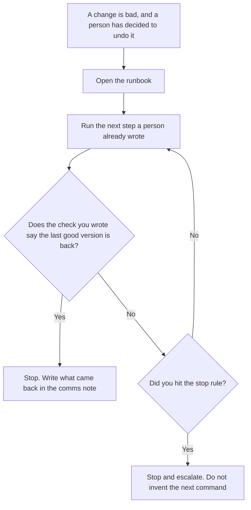

**An AI rollback runbook written with AI is the page you open while you undo a model change: the last good version, the steps in order, who runs each one, and the check that says that version is back.** The model may number steps you paste. It may not invent a command, a window, or a promise that the undo is instant. The decision of how you undo, written before the bad day, is [how to create a rollback plan with AI](/blog/how-to-create-a-rollback-plan-with-ai-2026/). The note you send after, about what came back, is [how to write a rollback comms note with AI](/blog/how-to-write-a-rollback-comms-note-with-ai-2026/).

The maintained page for the feature, with the owner and the flag, is [what an AI runbook is](/blog/what-is-an-ai-runbook-2026/). A move from one system to another is [how to write a migration runbook with AI](/blog/how-to-write-a-migration-runbook-with-ai-2026/). This page is the undo sequence for a prompt, a model, or a retrieval change. It is not the migration.

Claude's prices are the October 24, 2026 read of claude.com/pricing recorded in [Claude pricing explained](/blog/claude-pricing-explained-2026/). Notion is the October 16 directory card. Cursor's Plus price is the October 24 help-center figure recorded in [Cursor pricing explained](/blog/cursor-pricing-explained-2026/). ChatGPT's Plus price is the October 24 plan-page figure recorded in [ChatGPT pricing explained](/blog/chatgpt-pricing-explained-2026/). Published October 24, 2026. We did not score incidents. A runbook is not a drill you already passed.

## What the runbook is allowed to contain

| Block | Who owns it | The model may |
|---|---|---|
| Last good version | You: prompt id, model id, or flag | Copy it. It may not guess the previous id |
| Steps, in order | You | Number them. It may not add a command |
| Who runs the step | You | Copy the name. It may not assign on-call |
| The check | You, or Check not set | Copy it. It may not say the undo worked |
| When to stop | You | Copy the stop rule. It may not add a window |

A step that says "revert the deploy" has added a command you did not paste. If the last good version is missing, the line says Version not set, and you do not start. The plan can explain why this undo exists. The runbook is the sequence. If they disagree about who can abort, a person fixes one of them before anyone runs a step. The path during a bad day is [what AI incident response is](/blog/what-is-ai-incident-response-2026/). The runbook does not replace that path. It is the page the path opens for this change.

The small slice you might have shipped first is [what an AI canary deployment is](/blog/what-is-ai-canary-deployment-2026/). Rolling the canary back still uses steps you wrote. The model does not invent a percentage of traffic to restore.

## Where it is drafted

**The draft.** [Claude](/tools/claude/) Pro is $17 a month billed annually, $200 up front, or $20 monthly. Keep the last good version in a Project so a later edit does not replace it with "the previous one." The review is [Claude review](/blog/claude-review-2026/).

**The page on call will open.** [Notion AI](/tools/notion-ai/) Business is $20 a seat a month. Link the owner, the version, and the check. Plus at $10 is not the full AI tier. The invoice is [Notion AI pricing explained](/blog/notion-ai-pricing-explained-2026/).

**The diff, if a step is a command in a repo.** [Cursor](/tools/cursor/) Plus is $8 a month, or $80 a year. You review a diff that adds a command the runbook did not have. The individual ladder is [Cursor pricing explained](/blog/cursor-pricing-explained-2026/).

**One sequence from a paste.** [ChatGPT](/tools/chatgpt/) Plus is $20 a month. Discard a version that adds a maintenance window. The ladder is [ChatGPT pricing explained](/blog/chatgpt-pricing-explained-2026/).

A prompt that holds the line:

"Order the rollback steps I pasted. If the last good version is missing, write Version not set. If a check is missing, write Check not set. Do not add a command. Do not say the undo succeeded."

## What not to delegate

Do not ask the model for the command you forgot. Do not start because the headings look like a runbook. Do not tell customers the change is reverted until the check you wrote has passed. The person named on the step runs it. Check not set means you are not done.

## FAQ

### How is this different from a rollback plan?

The plan is the decision, written ahead of time: what shipped, what "bad" means, who decides, and the shape of the undo. The runbook is the sequence you follow while the undo is happening, with a check after the steps. A plan without steps is not something on-call can execute. A runbook that invents a new decision mid-incident is no longer the plan. Use the plan page for the decision. Use this page for the steps.

### How is this different from a rollback comms note?

The comms note says what came back and what did not, after you know. The runbook is how you get there. Do not draft the customer sentence until the check has passed. A sentence that promises an instant restore is a command you did not have.

### How is this different from a migration runbook?

The migration runbook moves from a system you named to a system you named: freeze, copy, check, cut over. This page puts a model change back to a version you named. A migration can include a backout. That backout still has to be steps you wrote. Do not reuse a cutover as if it were a prompt pin moving backward.

### Who may run a step?

The person named on that step. Version not set means do not start. A model that offers the next command is not the on-call. The check you wrote is the only "done."

## Last verified

October 24, 2026 for Claude, for Cursor's help page, and for ChatGPT's plan page, via the posts cited above. October 16, 2026 for Notion. Published October 24, 2026.

**Sources:** [Claude pricing](https://claude.com/pricing), [Notion pricing](https://www.notion.com/pricing), [Cursor pricing](https://cursor.com/help/account-and-billing/pricing), [ChatGPT and Codex pricing](https://learn.chatgpt.com/docs/pricing).

*Published by Andrew for [AI Tools Optimizer](https://aitoolsoptimizer.com).*

[Cursor](/tools/cursor/) is in the [coding directory](/tools/category/coding/). Directory pages may use affiliate links. A purchase through them may earn us a commission at no extra cost to you.
