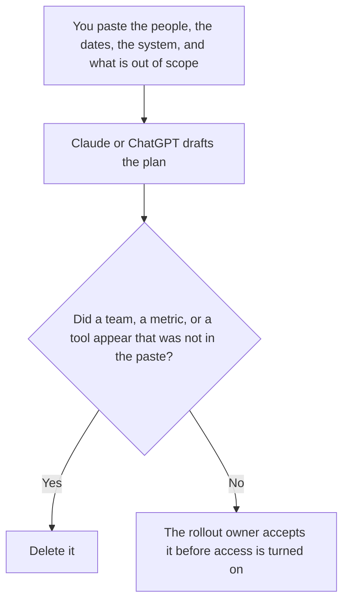

**An AI rollout plan written with AI names who gets access, on which date, to which system, and what is out of scope, using only the list a person already approved.** The model may order those sections. It may not add a team, invent a success metric, or decide the tool is ready. The slice inside one product, which is a flag and a cohort, is [how to create a feature flag rollout plan with AI](/blog/how-to-create-a-feature-flag-rollout-plan-with-ai-2026/). The page you write when you leave a vendor is [how to write an AI vendor exit plan with AI](/blog/how-to-write-an-ai-vendor-exit-plan-with-ai-2026/).

The switch itself, when the rollout is a flag, is [what AI feature flags are](/blog/what-is-ai-feature-flags-2026/). This page is the people plan. A flag plan can sit inside it. It does not replace the names.

Claude's prices are from claude.com/pricing on October 24, 2026. Notion and Cursor prices are from directory pages checked October 16, 2026. ChatGPT's Plus price is from learn.chatgpt.com/docs/pricing on October 24. Published October 24, 2026. We did not score adoption.

## What the plan contains

| Section | Who owns it | The model may |
|---|---|---|
| Who, by name or by a group you listed | You | Copy the list. If a group is missing, write Group not set |
| The date access starts, and the date you will review | You | Copy the dates. It may not move them up |
| The system and the tasks in scope | You | Copy them. It may not add a neighboring tool |
| Out of scope, and the rollback of access | You | Copy them. It may not call the rollout low risk |

A plan that says the rollout "will save time" has added a metric you did not approve. If the success line is blank, the plan says Success measure not set. It does not borrow one from a blog post.

## Where it is written

**The draft.** [Claude](/tools/claude/) Pro is $17 a month billed annually, $200 up front, or $20 monthly. Keep the group names in a Project so a later edit does not widen the list. The review is [Claude review](/blog/claude-review-2026/).

**The page the company keeps.** [Notion AI](/tools/notion-ai/) Business is $20 a seat a month. Link the date the owner accepted the scope. The invoice is [Notion AI pricing explained](/blog/notion-ai-pricing-explained-2026/).

**One draft from a short paste.** [ChatGPT](/tools/chatgpt/) Plus is $20 a month. Discard a version that adds a phase you did not name. The ladder is [ChatGPT pricing explained](/blog/chatgpt-pricing-explained-2026/).

**A change to the access config.** [Cursor](/tools/cursor/) Plus is $8 a month, or $80 a year. The plan does not merge the change. The ladder is [Cursor pricing explained](/blog/cursor-pricing-explained-2026/).

A prompt that holds the line:

"Write the rollout plan from the people, the dates, the system, and the out-of-scope list I pasted. If a date is missing, write Date not set. Do not add a team. Do not add a success metric."

## What not to delegate

Do not ask who should be included. Do not turn a pilot into "everyone" because the paragraph looks small. Do not send the plan because the dates are filled in. The rollout owner accepts it. A group with no named owner stays Group not set.

## FAQ

### How is this different from a feature-flag plan?

The flag plan is one flag, one cohort, one clock inside a product. This plan is who in the company gets access to an AI system, and what they may use it for. A flag can be one line inside this plan. The percent on the flag is still owned by the flag article. This page does not invent it.

### How is this different from a vendor exit plan?

The exit plan is how you leave. This plan is how you start, or how you widen access. They can name the same system. The dates mean opposite things. Do not paste the exit steps into the rollout and call them a phase.

### Can the model suggest a training step?

It can format a training step you pasted. A suggested workshop you did not paste belongs under Proposed, not accepted, with no date the model invented. The owner adds it, or it stays out.

### Who may turn access on?

The rollout owner, on the date in the plan. A formatted page is not a grant. A missing out-of-scope section is a reason to wait.

## Last verified

October 24, 2026 for Claude and for ChatGPT's plan page. October 16, 2026 for Notion and Cursor. Published October 24, 2026.

**Sources:** [Claude pricing](https://claude.com/pricing), [Notion pricing](https://www.notion.com/pricing), [ChatGPT and Codex pricing](https://learn.chatgpt.com/docs/pricing), [Cursor pricing](https://cursor.com/help/account-and-billing/pricing).

*Published by Andrew for [AI Tools Optimizer](https://aitoolsoptimizer.com).*

[Claude](/tools/claude/) is in the [chatbots and assistants directory](/tools/category/chatbots-assistants/). Directory pages may use affiliate links. A purchase through them may earn us a commission at no extra cost to you.
