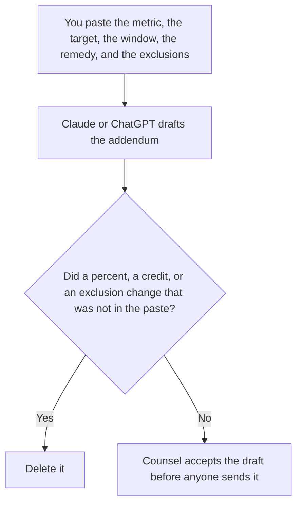

**An AI SLA addendum written with AI is a draft that states the metric, the target, the measurement window, and the remedy counsel already approved for an AI system.** The model may order those clauses in plain language. It may not invent a percentage, a credit, or a new response-time target. The note you write after a promise has already been missed is [how to create an SLA breach note with AI](/blog/how-to-create-a-sla-breach-note-with-ai-2026/). The habit of checking the live number is [what AI SLA monitoring is](/blog/what-is-ai-sla-monitoring-2026/).

The internal target you might track before it is a contract is [what an AI SLO is](/blog/what-is-ai-slo-2026/). An SLO is not an addendum. Counsel decides what becomes a promise to a customer.

This page is not legal advice. Claude's prices are from claude.com/pricing on October 24, 2026. Notion and Grammarly prices are from directory pages checked October 16, 2026. ChatGPT's Plus price is from learn.chatgpt.com/docs/pricing on October 24. Published October 24, 2026. We did not review a vendor contract.

## What the addendum is allowed to say

| Clause | Who owns it | The model may |
|---|---|---|
| The metric, named the way counsel named it | You | Copy the name. It may not swap in "accuracy" |
| The target and the window | You | Copy the numbers. It may not round them |
| The remedy, if one was approved | You | Copy it. If none was approved, write Remedy not set |
| What is excluded | You | Copy the exclusions. It may not delete one to sound stricter |

A draft that "strengthens" the target has amended the deal. If counsel has not approved a credit, the clause says Remedy not set. It does not propose one in the contract text. Put proposals in a separate note labeled Not in the draft.

## Where it is drafted

**The draft.** [Claude](/tools/claude/) Pro is $17 a month billed annually, $200 up front, or $20 monthly. Keep the approved numbers in a Project so a later edit does not tighten them. The review is [Claude review](/blog/claude-review-2026/).

**The file the company keeps.** [Notion AI](/tools/notion-ai/) Business is $20 a seat a month. Link the counsel date. The contract system, if you have one, remains the system of record. The invoice is [Notion AI pricing explained](/blog/notion-ai-pricing-explained-2026/).

**One draft from a short paste.** [ChatGPT](/tools/chatgpt/) Plus is $20 a month. Discard a version that adds a service level you did not paste. The ladder is [ChatGPT pricing explained](/blog/chatgpt-pricing-explained-2026/).

**A clarity pass that must not touch numbers.** [Grammarly](/tools/grammarly/) Pro is $12 a month billed annually, or $30 monthly, on the October 16 card. Compare the numbers before and after. The invoice is [Grammarly pricing explained](/blog/grammarly-pricing-explained-2026/).

A prompt that holds the line:

"Draft the SLA addendum from the metric, the target, the window, the remedy, and the exclusions I pasted. If the remedy is missing, write Remedy not set. Do not add a credit. Do not change a number."

## What not to delegate

Do not ask for a market-standard SLA. Do not paste another customer's contract into a personal account. Do not send the draft because it sounds professional. Counsel accepts it. A missing exclusion stays missing until a person writes it.

## FAQ

### How is this different from a breach note?

The breach note is what already missed, and who owns the next hour. The addendum is the promise, written before or as a change to the contract. A breach does not rewrite the addendum. If the target was wrong, counsel amends it. The incident channel does not.

### How is this different from an SLO?

An SLO is an internal target. An addendum is language a customer can hold you to, after counsel approves it. You can have an SLO that never becomes a contract. You should not paste an SLO into an addendum and call it agreed.

### How is this different from SLA monitoring?

Monitoring is how you watch the live number against the promise. The addendum is the promise's text. A dashboard does not amend the clause. If the metric on the dashboard uses a different name, say so. Do not silently align them in the draft.

### Who may send the addendum?

Counsel, or the person counsel names. A formatted draft is not an offer. A model that says the terms are reasonable has not reviewed your contract.

## Last verified

October 24, 2026 for Claude and for ChatGPT's plan page. October 16, 2026 for Notion and Grammarly. Published October 24, 2026.

**Sources:** [Claude pricing](https://claude.com/pricing), [Notion pricing](https://www.notion.com/pricing), [ChatGPT and Codex pricing](https://learn.chatgpt.com/docs/pricing), [Grammarly pricing](https://www.grammarly.com/plans).

*Published by Andrew for [AI Tools Optimizer](https://aitoolsoptimizer.com).*

[Claude](/tools/claude/) is in the [chatbots and assistants directory](/tools/category/chatbots-assistants/). Directory pages may use affiliate links. A purchase through them may earn us a commission at no extra cost to you.
