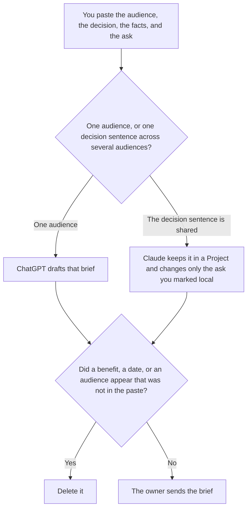

**An AI stakeholder brief written with AI is a short draft for a named audience: the decision a person already made, the facts they pasted, and the ask they already wrote.** The model may order those fields. It may not invent a benefit, a date, or a second ask. The user, the job, and the limit of a system, which are not this audience, are [how to write an AI use case brief with AI](/blog/how-to-write-an-ai-use-case-brief-with-ai-2026/). The recurring note after the brief exists is [ChatGPT vs Claude for stakeholder updates](/blog/chatgpt-vs-claude-for-stakeholder-updates-2026/).

The decision record itself is [ChatGPT vs Claude for decision memos](/blog/chatgpt-vs-claude-for-decision-memos-2026/). An internal fact with no ask is [Claude vs ChatGPT for internal announcements](/blog/claude-vs-chatgpt-for-internal-announcements-2026/).

Claude's prices are the October 24, 2026 read of claude.com/pricing recorded in [Claude pricing explained](/blog/claude-pricing-explained-2026/). ChatGPT's Plus price is the October 24 plan-page figure recorded in [ChatGPT pricing explained](/blog/chatgpt-pricing-explained-2026/). Notion and Grammarly prices are from directory pages checked October 16, 2026. A live fetch of Grammarly's plans URL returned HTTP 401 on October 24, as the Business pricing article records. Published October 24, 2026. We did not score briefs. A formatted page is not a decision.

## What the brief is allowed to say

| Field | Who owns it | The model may |
|---|---|---|
| Audience | You | Copy the name. It may not add a group |
| Decision | You, or Decision not set | Copy it. It may not soften it |
| Facts | You | Copy them. It may not add a benefit |
| Ask | You, or Ask not set | Copy it. It may not invent a second ask |
| Date you need an answer | You, or Date not set | Copy it. It may not pick a Friday |

A sentence that says the change will "save time" has added a benefit. If the decision is missing, the line says Decision not set, and you do not send the brief. If the ask is missing, the line says Ask not set. An announcement can ship with no ask. A stakeholder brief cannot pretend an ask exists. Put proposals in a note labeled Not in the brief.

The use-case brief can be accepted, and this brief can still be unsent. One describes the system. The other asks a named person for a decision or a response. Do not merge them into a page that both pitches a tool and requests budget.

## Where it is drafted

**One audience.** [ChatGPT](/tools/chatgpt/) Plus is $20 a month. Go is $8 a month on the October 24 plan page. Plus is the seat for a saved brief. The review is [ChatGPT review](/blog/chatgpt-review-2026/).

**One decision sentence, several audiences.** [Claude](/tools/claude/) Pro is $17 a month billed annually, $200 up front, or $20 monthly. The Project holds the decision. A local ask may change. The decision may not. Team standard seats are $20 a seat a month billed annually, or $25 monthly, when the brief is a company record, as recorded in [Claude Team pricing explained](/blog/claude-team-pricing-explained-2026/). The review is [Claude review](/blog/claude-review-2026/).

**The page the company keeps.** [Notion AI](/tools/notion-ai/) Business is $20 a seat a month. Link the audience, the date, and the owner. Plus at $10 is not the full AI tier. The invoice is [Notion AI pricing explained](/blog/notion-ai-pricing-explained-2026/).

**A clarity pass that must not move the ask.** [Grammarly](/tools/grammarly/) Pro is $12 a member a month billed annually, or $30 monthly, on the October 16 card. Compare the decision and the ask before and after. The invoice is [Grammarly pricing explained](/blog/grammarly-pricing-explained-2026/).

A prompt that holds the line:

"Draft the brief from the audience, the decision, the facts, and the ask I pasted. If the decision is missing, write Decision not set. If the ask is missing, write Ask not set. Do not add a benefit. Do not add an audience."

## What not to delegate

Do not ask what the audience "needs to hear." Do not add a benefit so the brief sounds easier to approve. Do not send it because the headings look complete. The owner who made the decision sends it. Decision not set stays unset.

## FAQ

### How is this different from a use case brief?

The use-case brief is the user, the job, the system, and the limit. The stakeholder brief is a named audience, a decision already made, and an ask. A use case can exist with no executive ask. A stakeholder brief that invents a return has left both pages. Link the use case if you have one. Do not paste it as if it were the ask.

### How is this different from a stakeholder update?

The update is the recurring note: what changed, what it means for that audience, and what you need from them, after a decision exists. The brief is the short document that puts the decision and the ask in front of them, often once. An update can point at the brief. It should not rewrite the decision while it recaps the week.

### How is this different from an internal announcement?

An announcement can be a fact with no ask: a time, a window, a desk. A stakeholder brief without an ask is not finished. Ask not set means you are not ready to send it. Do not turn a fact into a request for budget so the template looks full.

### Who may send the brief?

The owner of the decision. A shared decision sentence does not get two versions. A local ask stays the ask you marked local. A formatted page is not approval.

## Last verified

October 24, 2026 for Claude and for ChatGPT's plan page, via the posts cited above. October 16, 2026 for Notion and Grammarly. Published October 24, 2026. Grammarly's plans URL returned HTTP 401 on October 24.

**Sources:** [Claude pricing](https://claude.com/pricing), [ChatGPT and Codex pricing](https://learn.chatgpt.com/docs/pricing), [Notion pricing](https://www.notion.com/pricing), [Grammarly pricing](https://www.grammarly.com/plans).

*Published by Andrew for [AI Tools Optimizer](https://aitoolsoptimizer.com).*

[ChatGPT](/tools/chatgpt/) is in the [chatbots and assistants directory](/tools/category/chatbots-assistants/). Directory pages may use affiliate links. A purchase through them may earn us a commission at no extra cost to you.
