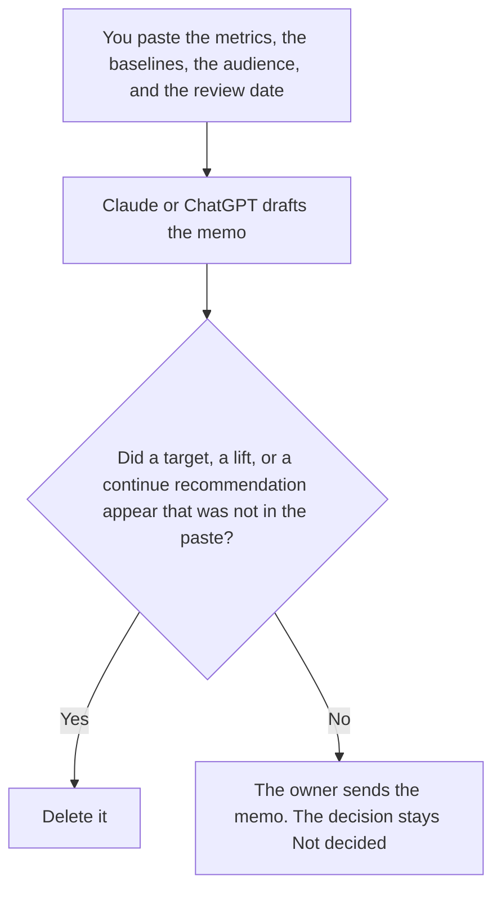

**An AI success metrics memo written with AI is a draft that restates the metrics, the baseline, the audience, and the review date a person already chose.** The model may order the paragraphs. It may not invent a target, a lift, or a recommendation to continue. The result of one pilot against a line you already set is [how to write an AI pilot scorecard with AI](/blog/how-to-write-an-ai-pilot-scorecard-with-ai-2026/). The brief that should exist before you build is [how to write an AI use case brief with AI](/blog/how-to-write-an-ai-use-case-brief-with-ai-2026/). This page is the memo that names which metrics the company will use. It is not the scorecard, and it is not the brief.

A number the model made up is [what an AI hallucination is](/blog/what-is-ai-hallucination-2026/).

Claude's prices are the October 24, 2026 read of claude.com/pricing recorded in [Claude pricing explained](/blog/claude-pricing-explained-2026/). Notion and Grammarly prices are from directory pages checked October 16, 2026. ChatGPT's Plus price is the October 24 plan-page figure recorded in [ChatGPT pricing explained](/blog/chatgpt-pricing-explained-2026/). Published October 24, 2026. We did not score a program. A memo is not a result.

## What the memo is allowed to say

| Field | Who owns it | The model may |
|---|---|---|
| Metric | You | Copy the name. It may not add a second metric |
| Baseline | You, or the words Baseline not recorded | Copy the number you pasted. It may not estimate one |
| Audience | You | Copy it. It may not widen the distribution |
| Review date | You | Copy it. It may not move it |
| Decision | You, left blank | Leave it as Not decided |

A memo that says the program "should save time" has added a metric. If you did not name time saved, it is not in the memo. If the baseline is missing, the cell says Baseline not recorded. The review date is when a person will look. It is not a promise that the number will improve by then.

The scorecard comes later, for one pilot, against one of these metrics. Do not paste a pilot result into this memo and call the metric chosen. Choosing the metric and recording the result are different files. Put proposals in a note labeled Not in the memo.

## Where it is drafted

**The draft.** [Claude](/tools/claude/) Pro is $17 a month billed annually, $200 up front, or $20 monthly. Keep the metric names in a Project so a later edit does not rename them. The review is [Claude review](/blog/claude-review-2026/).

**The file the company keeps.** [Notion AI](/tools/notion-ai/) Business is $20 a seat a month. Link the owner, the audience, and the review date. The invoice is [Notion AI pricing explained](/blog/notion-ai-pricing-explained-2026/).

**One memo from a short paste.** [ChatGPT](/tools/chatgpt/) Plus is $20 a month. Discard a version that adds a ROI. The ladder is [ChatGPT pricing explained](/blog/chatgpt-pricing-explained-2026/).

**A clarity pass that must not touch a number.** [Grammarly](/tools/grammarly/) Pro is $12 a member a month billed annually, or $30 monthly. Compare the baselines before and after. The invoice is [Grammarly pricing explained](/blog/grammarly-pricing-explained-2026/).

A prompt that holds the line:

"Draft the success metrics memo from the metrics, the baselines, the audience, and the review date I pasted. Leave the decision as Not decided. If a baseline is missing, write Baseline not recorded. Do not add a metric. Do not recommend continue."

## What not to delegate

Do not ask which metrics will "look good to leadership." Do not convert a baseline into a target. Do not send the memo to a wider audience than the one you pasted. The owner sends it. Not decided stays not decided until a person writes a decision on a scorecard, not in this draft.

## FAQ

### How is this different from a pilot scorecard?

The scorecard records what happened on one pilot against a success line, with a decision a person marks. The memo names the metrics, the baselines, and who will read them, before that result exists. A scorecard can cite this memo. It should not add a metric the memo does not have. Write the memo first. Fill the scorecard only with a measurement you have.

### How is this different from a use case brief?

The brief says who the user is, what job is in scope, and the success line, before you build. The memo is the short list of metrics the company agreed to watch, and the audience for that list. A brief can point at one metric. The memo is where that metric's baseline and review date live if you put them there. Do not hide a new use case inside the memo.

### Can the model suggest a better metric?

Not in the memo. A suggestion goes in a note labeled Not in the memo. The memo contains the metrics you already chose. If you adopt a new one, you add the name and the baseline yourself, then the draft may include it. A blank baseline is not a reason for the model to supply one.

### Who may send the memo?

The owner named on it, to the audience named on it. A formatted page is not a send. Adding an executive the audience line did not include is a new version a person has to accept. The decision line stays Not decided.

## Last verified

October 24, 2026 for Claude and for ChatGPT's plan page, via the posts cited above. October 16, 2026 for Notion and Grammarly. Published October 24, 2026.

**Sources:** [Claude pricing](https://claude.com/pricing), [Notion pricing](https://www.notion.com/pricing), [ChatGPT and Codex pricing](https://learn.chatgpt.com/docs/pricing), [Grammarly pricing](https://www.grammarly.com/plans).

*Published by Andrew for [AI Tools Optimizer](https://aitoolsoptimizer.com).*

[Notion AI](/tools/notion-ai/) is in the [notes directory](/tools/category/productivity-notes/). Directory pages may use affiliate links. A purchase through them may earn us a commission at no extra cost to you.
