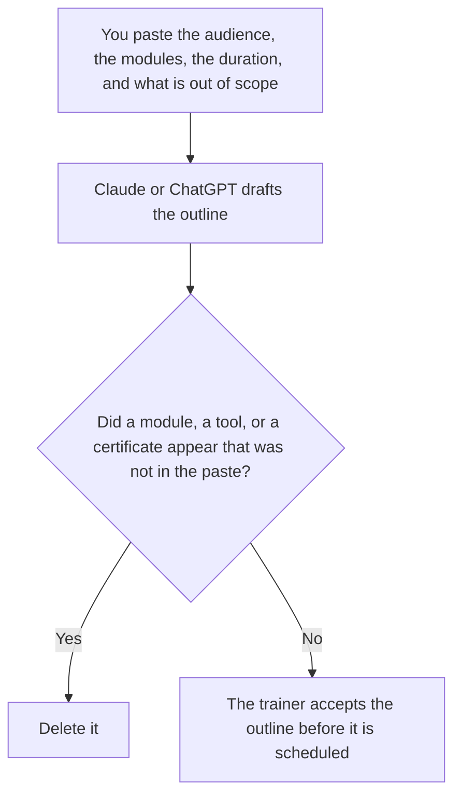

**An AI training outline written with AI is a draft that orders the audience, the modules, and the duration a person already listed.** The model may sequence those modules. It may not add a module, a certification, a tool, or a learning objective. The rules for how prompts at this company are written are [how to create a prompt style guide with AI](/blog/how-to-create-a-prompt-style-guide-with-ai-2026/). The seats and prompts to remove when someone leaves are [how to write an AI offboarding checklist with AI](/blog/how-to-write-an-ai-offboarding-checklist-with-ai-2026/). Training is for people who will use the tools. Offboarding is for people who will stop.

A temperature rule the class must follow is [what an AI prompt temperature policy is](/blog/what-is-ai-prompt-temperature-policy-2026/). The outline can name that policy as required reading. It cannot invent the setting.

Claude's prices are the October 24, 2026 read of claude.com/pricing recorded in [Claude pricing explained](/blog/claude-pricing-explained-2026/). Notion and Grammarly prices are from directory pages checked October 16, 2026. ChatGPT's Plus price is the October 24 plan-page figure recorded in [ChatGPT pricing explained](/blog/chatgpt-pricing-explained-2026/). Published October 24, 2026. We did not score courses. An outline is not a completion record.

## What the outline is allowed to say

| Field | Who owns it | The model may |
|---|---|---|
| Audience | You | Copy it. It may not widen "support leads" to "everyone" |
| Modules | You | Order the ones you listed. It may not add one |
| Duration | You | Copy it. It may not split it into equal blocks you did not ask for |
| Out of scope | You, or the words Out of scope not set | Copy it. It may not shrink it |
| Practice | You, if you named one | Copy it. It may not invent an exercise that uses live customer data |

An outline that promises a certificate has added a credential. If you did not paste one, the line says Certificate not offered. A module that says "advanced prompting" when your list said "the three prompts this team may use" has widened the class. Put extra ideas in a note labeled Not in this session.

The duration is the one you set. If a module has no minutes, the cell says Time not set. The model does not steal minutes from another module to make the total match.

## Where it is drafted

**The draft.** [Claude](/tools/claude/) Pro is $17 a month billed annually, $200 up front, or $20 monthly. Keep the module list in a Project so a later session does not grow it. The review is [Claude review](/blog/claude-review-2026/).

**The file the trainers share.** [Notion AI](/tools/notion-ai/) Business is $20 a seat a month. Link the audience, the owner, and the date. The invoice is [Notion AI pricing explained](/blog/notion-ai-pricing-explained-2026/).

**One outline from a short paste.** [ChatGPT](/tools/chatgpt/) Plus is $20 a month. Go is $8 a month. Plus is the seat for a saved outline. Discard a version that adds a module. The ladder is [ChatGPT pricing explained](/blog/chatgpt-pricing-explained-2026/).

**A clarity pass that must not add a learning goal.** [Grammarly](/tools/grammarly/) Pro is $12 a member a month billed annually, or $30 monthly. Compare the module titles before and after. The invoice is [Grammarly pricing explained](/blog/grammarly-pricing-explained-2026/).

A prompt that holds the line:

"Draft the training outline from the audience, the modules, and the duration I pasted. If a module has no time, write Time not set. Do not add a module. Do not add a certificate. Do not add a tool."

## What not to delegate

Do not ask what the team "should really learn." Do not paste customer tickets into a practice exercise unless the outline already says that data is allowed, and a person has cleared it. Do not schedule the class because the outline looks full. The trainer owns the outline. Out of scope stays out of scope.

## FAQ

### How is this different from a prompt style guide?

The style guide is the writing rules for prompts. The outline is a class: who attends, which modules run, how long it is. The class can assign the style guide as reading. The outline does not replace the guide, and the guide does not list a duration. A prompt that matches the guide is not proof someone attended.

### How is this different from an offboarding checklist?

Offboarding lists the seats and prompts to remove when a person leaves. Training lists what a person who stays will be shown. Do not put "revoke access" in the outline. Do not put a module in the offboarding list. The same tools can appear in both only when a person named them in each file.

### Can the model suggest a module if I ask?

Not in the outline. A suggestion belongs in a note labeled Not in this session. The outline contains the modules you already listed. If you want a new module, you add it yourself, with a duration, and then the draft may include it. A brainstorm is not the file you send to the trainer's calendar.

### Who may publish the outline?

The trainer, or the person that trainer names. A formatted page is not a scheduled class. Certificate not offered stays until a person who can grant one writes that they will.

## Last verified

October 24, 2026 for Claude and for ChatGPT's plan page, via the posts cited above. October 16, 2026 for Notion and Grammarly. Published October 24, 2026.

**Sources:** [Claude pricing](https://claude.com/pricing), [Notion pricing](https://www.notion.com/pricing), [ChatGPT and Codex pricing](https://learn.chatgpt.com/docs/pricing), [Grammarly pricing](https://www.grammarly.com/plans).

*Published by Andrew for [AI Tools Optimizer](https://aitoolsoptimizer.com).*

[Claude](/tools/claude/) is in the [chatbots and assistants directory](/tools/category/chatbots-assistants/). Directory pages may use affiliate links. A purchase through them may earn us a commission at no extra cost to you.
