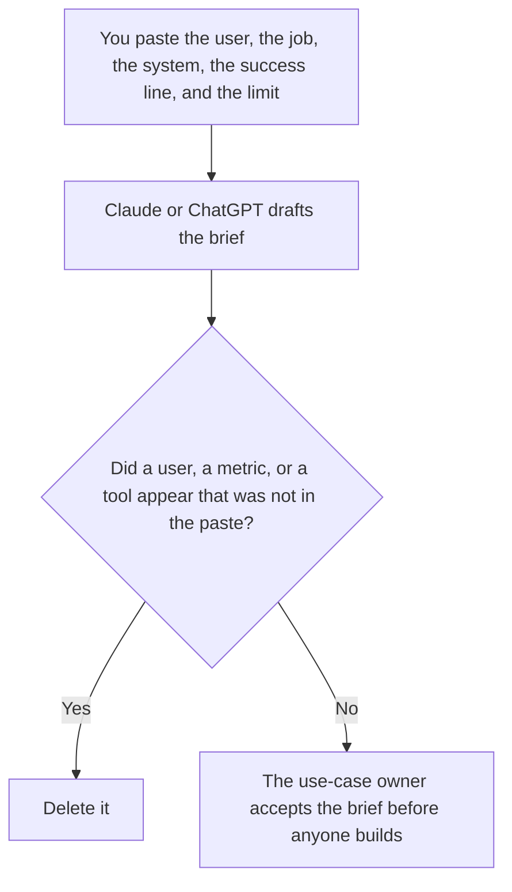

**An AI use case brief written with AI is a draft that states the user, the job, the system, the success line, and the limit a person already wrote.** The model may order those fields in plain language. It may not invent a return, a time saved, or a user you did not name. The plan that comes after a brief is accepted is [how to write an AI rollout plan with AI](/blog/how-to-write-an-ai-rollout-plan-with-ai-2026/). The decision record, if the brief becomes a choice, is [ChatGPT vs Claude for decision memos](/blog/chatgpt-vs-claude-for-decision-memos-2026/).

The list of prompts that may run, once the brief is real, is [what an AI prompt registry is](/blog/what-is-ai-prompt-registry-2026/). A brief is not permission to run.

Claude's prices are from claude.com/pricing on October 24, 2026. Notion and Grammarly prices are from directory pages checked October 16, 2026. ChatGPT's Plus price is from learn.chatgpt.com/docs/pricing on October 24. Published October 24, 2026. We did not score use cases.

## What the brief is allowed to say

| Field | Who owns it | The model may |
|---|---|---|
| The user | You | Copy the role. It may not widen it to "everyone" |
| The job | You | Copy the job. It may not add a second job |
| The system | You | Copy the name. It may not swap in a tool |
| The success line | You | Copy it. It may not turn it into a percentage |
| Out of scope | You | Copy the limits. If none were written, write Limit not set |

A brief that "estimates impact" has added a number. If you do not have a baseline, the success line says Baseline not recorded. It does not propose one in the brief. Put proposals in a note labeled Not in the brief.

## Where it is drafted

**The draft.** [Claude](/tools/claude/) Pro is $17 a month billed annually, $200 up front, or $20 monthly. Keep the approved fields in a Project so a later edit does not widen the user. The review is [Claude review](/blog/claude-review-2026/).

**The file the company keeps.** [Notion AI](/tools/notion-ai/) Business is $20 a seat a month. Link the owner and the date. The invoice is [Notion AI pricing explained](/blog/notion-ai-pricing-explained-2026/).

**One draft from a short paste.** [ChatGPT](/tools/chatgpt/) Plus is $20 a month. Discard a version that adds a ROI. The ladder is [ChatGPT pricing explained](/blog/chatgpt-pricing-explained-2026/).

**A clarity pass that must not touch the success line.** [Grammarly](/tools/grammarly/) Pro is $12 a member a month billed annually, or $30 monthly, on the October 16 card. Compare the success line before and after. The invoice is [Grammarly pricing explained](/blog/grammarly-pricing-explained-2026/).

A prompt that holds the line:

"Draft the use case brief from the user, the job, the system, the success line, and the limit I pasted. If the success line is missing, write Success line not set. Do not add a metric. Do not add a tool. Do not widen the user."

## What not to delegate

Do not ask which use case is worth funding. Do not paste a customer list so the brief "has a market." Do not start a build because the brief sounds specific. The use-case owner accepts it. A missing limit stays missing until a person writes it.

## FAQ

### How is this different from a rollout plan?

The brief says who the user is, what job is in scope, and how you will know it worked, in words you already have. The rollout plan says how you will introduce it. A plan without a brief invents the user on the way. A brief without a plan is not a launch. Accept the brief first.

### How is this different from a decision memo?

The memo records a decision a person made. The brief asks for a decision by stating the case. If the decision is already made, you are past this page. Do not let the brief "recommend" a path you did not choose.

### How is this different from a prompt?

The prompt is the text a model will run. The brief is why that prompt should exist, and what it must not do. A prompt can be registered later. The brief does not register it. The registry is a separate row, with an owner.

### Who may call the brief accepted?

The use-case owner. A formatted page is not acceptance. A model that says the case is strong has not measured it. If there is no baseline, say so in the success line.

## Last verified

October 24, 2026 for Claude and for ChatGPT's plan page. October 16, 2026 for Notion and Grammarly. Published October 24, 2026.

**Sources:** [Claude pricing](https://claude.com/pricing), [Notion pricing](https://www.notion.com/pricing), [ChatGPT and Codex pricing](https://learn.chatgpt.com/docs/pricing), [Grammarly pricing](https://www.grammarly.com/plans).

*Published by Andrew for [AI Tools Optimizer](https://aitoolsoptimizer.com).*

[Claude](/tools/claude/) is in the [chatbots and assistants directory](/tools/category/chatbots-assistants/). Directory pages may use affiliate links. A purchase through them may earn us a commission at no extra cost to you.
