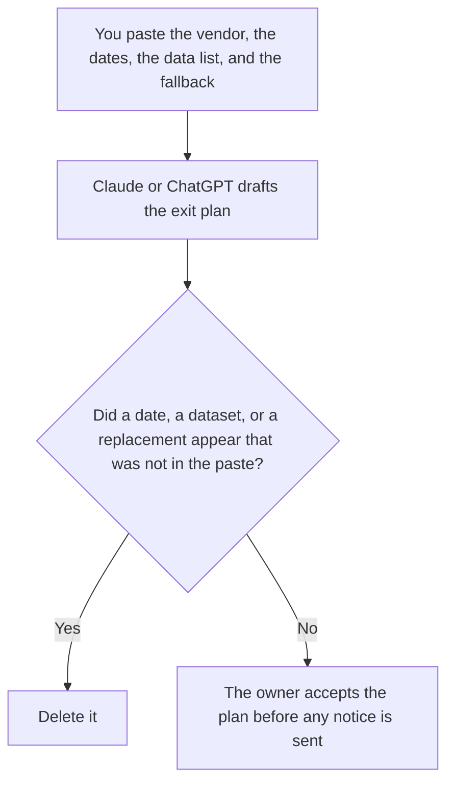

**An AI vendor exit plan written with AI names the vendor, the date a person already took from the contract, the data you already listed, and the fallback you already chose.** The model may format that plan. It may not invent a notice period, an export that does not exist, or a replacement product. A feature you are turning off inside your own product is [how to write a feature sunset plan with AI](/blog/how-to-write-a-feature-sunset-plan-with-ai-2026/). The sheet you used to compare vendors before this one is [how to write a vendor scorecard with AI](/blog/how-to-write-a-vendor-scorecard-with-ai-2026/).

The system that must stay true while you leave is [what a system of record for AI is](/blog/what-is-a-system-of-record-for-ai-2026/).

Claude's prices are from claude.com/pricing on October 24, 2026. Notion, ChatGPT, and Cursor prices are from directory pages checked October 16, 2026. chatgpt.com/pricing returned HTTP 403 on October 24. Published October 24, 2026. We did not score vendors.

## What the plan contains

| Row | Who owns it | The model may |
|---|---|---|
| Vendor and what you use them for | You | Copy it. It may not widen the scope |
| Notice date and contract date | The contract, read by a person | Copy both. It may not assume the notice is flexible |
| Data you must take with you | A list you wrote | Copy the list. It may not add a dataset |
| Fallback | A person | Copy it. If it is blank, write Fallback not chosen |
| What you will tell customers | Only if you pasted it | Leave it blank if you did not |

The plan is not the notice to the vendor. Counsel or the owner sends that, from the contract. The plan is also not a reason to scrape, export, or retain data the contract forbids. If the contract is silent, the row says Unconfirmed. A model that says "you can export everything" has guessed.

If customers see the vendor's name in your product, the customer line has to match this plan's date. If they do not, keep the plan internal.

## Where it is written

**The draft.** [Claude](/tools/claude/) Pro is $17 a month billed annually, $200 up front, or $20 monthly. Keep the dates in a Project so a later edit does not "helpfully" extend them. The review is [Claude review](/blog/claude-review-2026/).

**The page procurement will reread.** [Notion AI](/tools/notion-ai/) Business is $20 a seat a month. Link the contract date and the person who read it. The invoice is [Notion AI pricing explained](/blog/notion-ai-pricing-explained-2026/).

**One plan from a short paste.** [ChatGPT](/tools/chatgpt/) Plus is $20 a month on the October 16 card. Discard a version that recommends a replacement vendor. The review is [ChatGPT review](/blog/chatgpt-review-2026/).

**A config you will change later.** [Cursor](/tools/cursor/) Plus is $8 a month, or $80 a year. The plan does not edit production. The ladder is [Cursor pricing explained](/blog/cursor-pricing-explained-2026/).

A prompt that holds the line:

"Write a vendor exit plan from the vendor, the dates, the data list, and the fallback I pasted. If the fallback is missing, write Fallback not chosen. Do not add a dataset. Do not name a replacement product."

## What not to delegate

Do not ask how to get data out if the contract does not say. Do not ask the model to pick the next vendor. Do not send a termination note from the chat. The owner, or counsel, sends it. A finished document is not a notice.

## FAQ

### How is this different from a feature sunset plan?

A sunset plan is your feature, your date, your users. An exit plan is a vendor you pay, their contract, and the data that has to move. A feature can depend on a vendor. The dates still belong on both documents, and they have to match where customers see one change.

### How is this different from a vendor scorecard?

The scorecard is how you compared options. The exit plan is how you leave one you already use. A low score is not an exit. An exit still needs a fallback a person chose. If the fallback is blank, you do not have a plan. You have a wish.

### Can the model list the data we should export?

Only the data you pasted. A guessed export list will miss the thing you needed and include a thing you are not allowed to take. Paste the list a person made from the contract and the product admin screen, and date that list.

### Who may send the notice to the vendor?

The owner named on the plan, under the contract a person read. The model does not send email. A share link of the plan is not notice.

## Last verified

October 24, 2026 for Claude. October 16, 2026 for Notion, ChatGPT, and Cursor. Published October 24, 2026.

**Sources:** [Claude pricing](https://claude.com/pricing), [Notion pricing](https://www.notion.com/pricing), [ChatGPT pricing](https://chatgpt.com/pricing/), [Cursor pricing](https://cursor.com/help/account-and-billing/pricing).

*Published by Andrew for [AI Tools Optimizer](https://aitoolsoptimizer.com).*

[Notion AI](/tools/notion-ai/) is in the [productivity and notes directory](/tools/category/productivity-notes/). Directory pages may use affiliate links. A purchase through them may earn us a commission at no extra cost to you.
