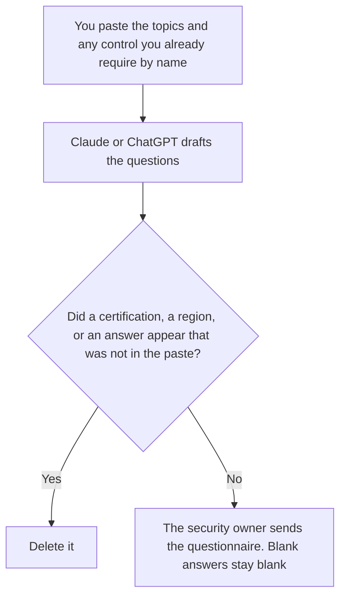

**An AI vendor security questionnaire written with AI is a list of questions you will send, drawn from topics a person already decided to ask.** The model may number the questions and keep the wording plain. It may not invent a certification you require, draft the vendor's answers, or turn a topic you did not list into a demand. The other direction, where you answer a questionnaire about your own controls, is [how to write a security questionnaire response with AI](/blog/how-to-write-a-security-questionnaire-response-with-ai-2026/). This page is the buyer's question list.

The plan if you later leave the vendor is [how to write an AI vendor exit plan with AI](/blog/how-to-write-an-ai-vendor-exit-plan-with-ai-2026/). The internal page that names your checks is [what an AI guardrail policy is](/blog/what-is-ai-guardrail-policy-2026/). The person who releases the file is [what human-in-the-loop AI is](/blog/what-is-human-in-the-loop-ai-2026/).

Claude's prices are the October 24, 2026 read of claude.com/pricing recorded in [Claude pricing explained](/blog/claude-pricing-explained-2026/). Notion and Grammarly prices are from directory pages checked October 16, 2026. ChatGPT's Plus price is the October 24 plan-page figure recorded in [ChatGPT pricing explained](/blog/chatgpt-pricing-explained-2026/). Published October 24, 2026. This is not legal advice, not a penetration test, and not a way to pass or fail a vendor. We did not score any vendor's security.

## What the question list is allowed to contain

| Topic you already listed | The question may | The question may not |
|---|---|---|
| Training on your data | Ask whether customer content is used to train models, and where that is stated | Demand a certification you did not name |
| Retention | Ask how long prompts and outputs are kept, in their words | Fill in a number they have not published |
| Subprocessors | Ask for the list they will attach | Invent a subprocessor |
| Where the service runs | Ask which regions they offer | Pin a region they did not list |
| A topic you did not list | Stay off the form | Appear because it "usually" matters |

A question that says "confirm you are SOC 2 Type II" has added a certification if you did not write that name. If you require it, you paste the name. If you do not, the question asks what they can show, and the answer cell stays blank until they reply. The model does not complete their column. An answer you guessed is not evidence.

When the vendor replies, a person records what they sent. Unknown stays unknown. A missing attachment stays missing. This workflow does not tell you to soften a gap in their reply or in yours. The response article is the one for your own answers, and it has the same rule: evidence, or Unknown.

## Where it is drafted

**The draft.** [Claude](/tools/claude/) Pro is $17 a month billed annually, $200 up front, or $20 monthly. Keep the required certifications, if you have any, in a Project so a later edit does not add one. The review is [Claude review](/blog/claude-review-2026/).

**The file you send from.** [Notion AI](/tools/notion-ai/) Business is $20 a seat a month. One row per question, the topic, and an empty answer cell. Plus at $10 is not the full AI tier. The invoice is [Notion AI pricing explained](/blog/notion-ai-pricing-explained-2026/).

**One short list from a paste.** [ChatGPT](/tools/chatgpt/) Plus is $20 a month. Discard a version that fills the answer column. The ladder is [ChatGPT pricing explained](/blog/chatgpt-pricing-explained-2026/).

**A clarity pass that must not add a requirement.** [Grammarly](/tools/grammarly/) Pro is $12 a member a month billed annually, or $30 monthly, on the October 16 card. Compare the topics before and after. The invoice is [Grammarly pricing explained](/blog/grammarly-pricing-explained-2026/). A live fetch of the plans URL returned HTTP 401 on October 24.

A prompt that holds the line:

"Draft questions only from the topics I pasted. If I named a required certification, ask about that name. If I did not, do not add one. Leave every answer cell blank. Do not describe the vendor's controls."

## What not to delegate

Do not ask for a "complete" AI security questionnaire from a template the model remembers. Do not paste a vendor's marketing page and treat it as their answer. Do not send the form because it looks long. The security owner sends it. An empty answer cell stays empty until the vendor writes in it.

## FAQ

### How is this different from a security questionnaire response?

The response article is you answering questions about your own controls, from evidence you have. This article is you writing the questions you send to an AI vendor. You do not draft their answers here. They do not draft your controls there. If you are the vendor filling a customer's form, use the response page.

### How is this different from a vendor exit plan?

The exit plan is how you leave: data return, notice, the system of record. The questionnaire is what you ask before you buy, or at renewal. An exit plan does not replace a question you forgot to ask. A questionnaire does not extract you from the contract. Link them when both exist.

### How is this different from a guardrail policy?

The guardrail policy is your internal rule for your own systems. The questionnaire asks a vendor about theirs. Your policy can name a topic you will ask. It is not the vendor's answer. Do not paste your policy into their answer cell.

### Who may send the questionnaire?

The security owner. A question that adds a certification is not sent. An answer cell the model filled is cleared. The vendor's reply is evidence only after a person files what the vendor actually sent.

## Last verified

October 24, 2026 for Claude and for ChatGPT's plan page, via the posts cited above. October 16, 2026 for Notion and Grammarly. Published October 24, 2026. Grammarly's plans URL returned HTTP 401 on October 24.

**Sources:** [Claude pricing](https://claude.com/pricing), [Notion pricing](https://www.notion.com/pricing), [ChatGPT and Codex pricing](https://learn.chatgpt.com/docs/pricing), [Grammarly pricing](https://www.grammarly.com/plans).

*Published by Andrew for [AI Tools Optimizer](https://aitoolsoptimizer.com).*

[Claude](/tools/claude/) is in the [chatbots and assistants directory](/tools/category/chatbots-assistants/). Directory pages may use affiliate links. A purchase through them may earn us a commission at no extra cost to you.
