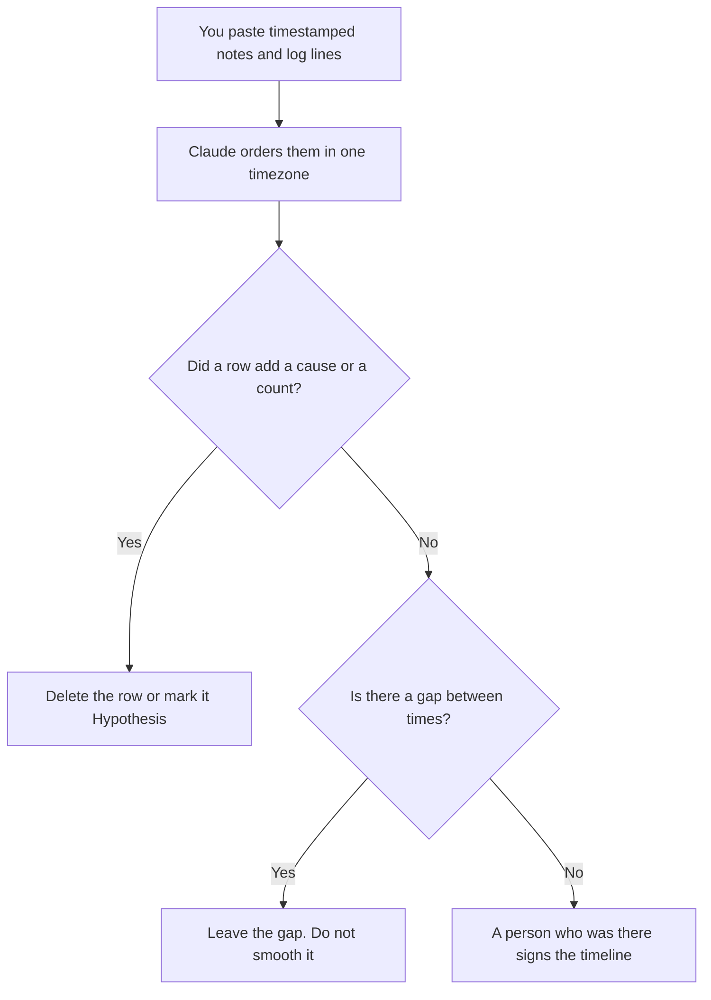

**An incident timeline written with AI is a chronological list of times, events, and owners taken from notes and logs you paste, with an explicit line for what you are not claiming yet.** The model may order those rows. It may not invent a root cause, a customer count, or a minute that is not in the paste. The page the on-call opens during the event is [what an AI runbook is](/blog/what-is-an-ai-runbook-2026/). The hour that follows a bad production change is [what AI incident response is](/blog/what-is-ai-incident-response-2026/). This page is the timeline you can hand someone the next morning.

The customer note, after the facts are stable, is [how to write a customer apology email with AI](/blog/how-to-write-a-customer-apology-email-with-ai-2026/). The version you had placed on the path is [what an AI canary deployment is](/blog/what-is-ai-canary-deployment-2026/).

Prices are US list prices excluding tax from directory pages checked October 16, 2026. A live fetch of vendor pricing pages returned HTTP 401 on October 24, 2026, so this page stays on the directory record. Published October 24, 2026. We did not score incident write-ups. The directory does not list an incident-tool fee on this page, so this page does not invent one.

## What fits on the timeline

| Row | Who owns it | The model may |
|---|---|---|
| Clock | The timezone you name, and times copied from the log | Sort them. It may not round them |
| Event | A sentence that matches a log line or a note | Shorten it. It may not add a cause |
| Source | The log, the ticket, or the person who typed the note | Copy the id. It may not cite "monitoring" |
| Owner | A name that was on the note | Copy it. It may not assign a team |
| Impact | Only a count or a list you pasted | Place it. It may not estimate who was affected |
| Unknown | A gap between two times | Write Gap. It may not fill the gap with a guess |

A hypothesis can sit under the timeline. It cannot sit in the timeline as if it were a log line. Label it Hypothesis, name who holds it, and keep it out of the customer note until a person promotes it. The fields you require if a system will parse the timeline are [what an AI output schema is](/blog/what-is-ai-output-schema-2026/).

## Where the timeline is written

**The draft.** [Claude](/tools/claude/) Pro is $20 a month, or $17 billed annually, when the logs are long and the Project should hold the format. Free can order one paste. The review is [Claude review](/blog/claude-review-2026/).

**The record.** [Notion AI](/tools/notion-ai/) Business is $20 a seat a month if this timeline is the page the review meeting opens. Plus at $10 is not the full AI seat. The page needs the incident commander as owner either way.

**A second ordering.** [ChatGPT](/tools/chatgpt/) Plus at $20 a month can sort a short card of bullets. Discard any root cause it adds because the story "needed a why." The review is [ChatGPT review](/blog/chatgpt-review-2026/).

A prompt that holds the line:

"Build a timeline from the lines I pasted. Keep the timezone I named. One row per event, with time, source, and owner. Do not add a root cause, a customer count, or a time I did not supply. If two lines disagree, write Conflict and keep both."

## What not to delegate

Do not ask the model what really happened. Do not backfill a gap so the chart looks continuous. Do not paste secrets, tokens, or customer payloads into the chat to make the timeline "more precise." Redact first. Do not send the timeline to customers. The apology email is a different artifact, written after a person has marked which rows are public.

## FAQ

### How is this different from the incident-response page?

That page is the system: the flag, the runbook, and the note you write while it is happening. This page is the chronological artifact. You can have a calm response and a sloppy timeline. The timeline is what a review will trust later, so the times have to be copyable.

### Can the model pick the severity?

No. Severity is a label your policy already defines. Paste it if you want it in the header. A sentence that calls the incident "major" because many log lines were pasted is the sentence to delete.

### What if the logs are in two timezones?

Say both, and convert only with the offset you supply. If you do not know the offset, keep the original stamps and write Timezone unconfirmed. A converted time the model guessed will be the time everyone quotes.

### Who signs it?

The incident commander named on the page, after the people who were in the events have had a chance to correct their rows. A model signature is not a sign-off.

## Last verified

October 16, 2026 for Claude, Notion AI, and ChatGPT. Published October 24, 2026. Live pricing fetches returned HTTP 401 that day.

**Sources:** [Claude pricing](https://claude.com/pricing), [Notion pricing](https://www.notion.com/pricing), [ChatGPT pricing](https://chatgpt.com/pricing/).

*Published by Andrew for [AI Tools Optimizer](https://aitoolsoptimizer.com).*

[Claude](/tools/claude/) is in the [writing directory](/tools/category/writing/). Directory pages may use affiliate links. A purchase through them may earn us a commission at no extra cost to you.
