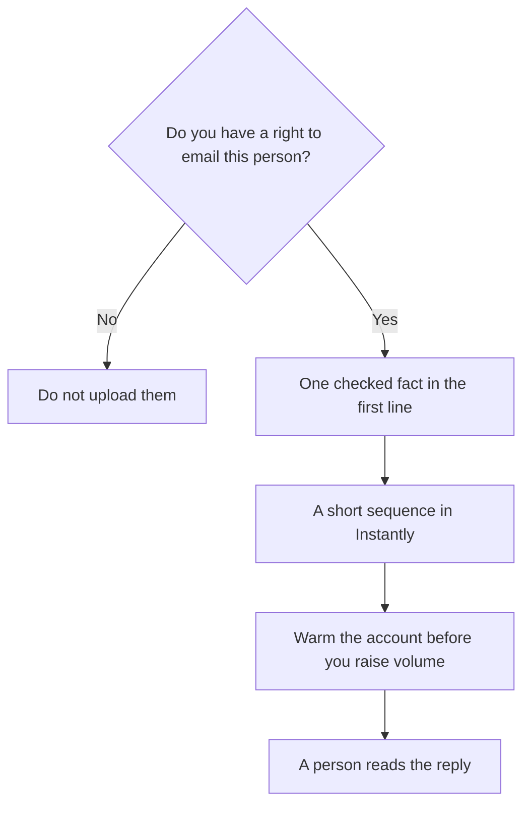

**Write the email from one fact you checked, send it only to people you have a right to contact, and let Instantly handle the sequence and the warmup.** The tool does not create permission to email a stranger. A scraped personal inbox is not a plan. The copy is short because the reader decides in a few lines, and because a model will pad a cold email until it sounds like every other cold email.

Prices below were read from Instantly's pricing page on October 24, 2026, and recorded in [Instantly review](/blog/instantly-review-2026/). They are US list prices. This page does not measure inbox placement. The sales stack around the sender is [best AI tools for sales teams](/blog/best-ai-tools-for-sales-teams-2026/).

## Buy the tab you mean

| What you are buying | Monthly price | Volume on the card |
|---|---|---|
| Outreach Growth | $47 ($37.60 per month on the yearly card) | 5,000 emails, 1,000 uploaded contacts, unlimited accounts and warmup |
| Outreach Hypergrowth | $97 ($77.60 yearly equivalent) | 125,000 emails, 25,000 contacts |
| Outreach Light Speed | $358 ($286.30 yearly equivalent) | 500,000 emails, 100,000 contacts, plus SISR |
| Starter bundle | $94 ($85 yearly) | Growth-level sending plus 1,500 credits and the lead database |
| Credits-only Growth | $47 | Credits and the lead database, not the outreach sender |

If a quote says "$47," ask whether it is outreach Growth or credits Growth. They are different products at the same sticker. The October 24 review is the place those tabs are written out.

## Step 1: The list is the constraint

Upload contacts you may email: inbound leads, people who asked to hear from you, or a business list your counsel is comfortable with. This article is not legal advice. Regions differ. Instantly will send what you upload.

[Apollo](/tools/apollo-io/) is the other quote when you need a contact database and a dialer. Basic is $49 a seat a month billed annually, and the directory page calls that introductory pricing. [Clay](/tools/clay/) is the workflow quote, from $167 a month billed annually for Launch. Use one list source. Do not pay Instantly credits and an Apollo seat to store the same names twice unless you know which system is the record.

A public page about the company, checked before you write, can come from [Perplexity](/tools/perplexity/). Open the link. Pro is $17 a month billed annually. The steps are [how to use Perplexity for market research](/blog/how-to-use-perplexity-for-market-research-2026/). Do not infer personal traits. Do not invent a detail about their business to sound researched.

## Step 2: Write three lines, then stop

Use [Claude](/tools/claude/) or [ChatGPT](/tools/chatgpt/) only after you have the fact. Claude Pro is $20 a month, or $17 billed annually. ChatGPT Plus is $20. Paste the fact and the offer. Ask for a first line that uses only that fact, a second line that says why you are writing, and a single ask. Delete any sentence the model added about "synergy," a fake compliment, or a number that was not in your notes.

The editing standard is [how to write a blog post with Claude](/blog/how-to-write-a-blog-post-with-claude-2026/). A cold email is the same rule at a shorter length. You sign it. The model does not.

Keep the sequence to a first note and one or two follow-ups. Each follow-up should add a reason to reply, not a restatement. Stop when they say no, or when they do not reply. Unlimited accounts on Growth are not a reason to send the fourth bump.

## Step 3: Accounts, warmup, and the first send

Instantly's outreach plans include unlimited email accounts and unlimited warmup. Connect a domain you control and can afford to damage. Warm it before the first real campaign. The directory verdict is that this is the reason people pick Instantly over per-inbox fees. Warmup does not repair a list you should not have emailed.

Start inside Growth's 5,000 emails and 1,000 contacts. Move to Hypergrowth when that cap is the blocker you can show, not when the pricing page looks like a bigger plan. Light Speed's private infrastructure is a volume decision. Read the card.

Put replies in the Unibox and answer the real ones yourself. An AI Reply Agent shows up on the Scale bundle, at $194 a month or $175 on the yearly card, not on outreach Growth. Do not assume Growth writes your replies. A wrong auto-reply to a prospect is worse than a slow human one.

If the company already lives in [HubSpot](/tools/hubspot/), the CRM stays the record of the conversation. HubSpot's Starter price on the directory page was a limited-time offer, from $7 or $10 a seat. Confirm the current quote. Instantly is the sender. It is not a second CRM.

## What this workflow will not do

- It will not make a cold email welcome. Relevance and permission do that.
- It will not prove deliverability. We did not measure placement.
- It will not replace a product a person asked for. If they opted in, you are writing a different email, and you should say so.

Recruiters using the same sender for candidates should read [best AI tools for recruiters](/blog/best-ai-tools-for-recruiters-2026/). A candidate list and a sales list do not belong in one sequence by default.

## FAQ

### How much does Instantly cost to start?

Outreach Growth is $47 a month, or $37.60 a month on the yearly card as printed October 24, 2026, for 5,000 emails and 1,000 uploaded contacts. The Starter bundle is $94 a month if you also want credits.

### Does Instantly charge per inbox?

Outreach plans include unlimited email accounts and unlimited warmup. You still pay for the volume tier.

### Can AI write the whole campaign?

It can draft from a fact you supply. You delete anything you cannot defend. Turn on an automated reply agent only on a plan that includes it, and read the replies.

### Is there a free plan?

The directory does not list a permanent free outreach plan. Price Growth, or do not upload a list.

## Last verified

October 24, 2026 for Instantly's outreach and bundle prices, via [Instantly review](/blog/instantly-review-2026/). October 16, 2026 for Apollo, Clay, Claude, ChatGPT, Perplexity, and HubSpot figures. Published October 24, 2026.

**Sources:** [Instantly pricing](https://instantly.ai/pricing), [Apollo pricing](https://www.apollo.io/pricing), [Claude pricing](https://claude.com/pricing).

*Published by Andrew for [AI Tools Optimizer](https://aitoolsoptimizer.com).*

[Instantly](/tools/instantly/) is in the [sales directory](/tools/category/sales/). Directory pages may use affiliate links. A purchase through them may earn us a commission at no extra cost to you.
