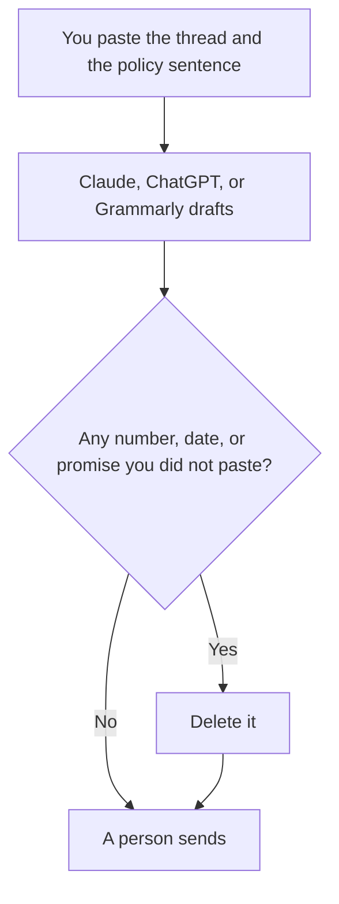

**A customer email written with AI is a draft in a voice you specified, using only facts you pasted, sent by a person.** The model can shorten a thread and match a tone. It cannot know your refund rule, your legal position, or what the account is actually billed. If the fact is not in the prompt, it does not go in the email. If the sentence promises money or a date, you typed that promise or you delete it.

The voice note is [how to create a brand voice with AI](/blog/how-to-create-a-brand-voice-with-ai-2026/). The check is [how to fact-check AI writing](/blog/how-to-fact-check-ai-writing-2026/). The send button is [what human-in-the-loop AI is](/blog/what-is-human-in-the-loop-ai-2026/).

Prices are US list prices excluding tax from directory pages checked October 16, 2026. Published October 24, 2026. We did not score email performance.

## What the model may touch

| Line | Who owns it | The model may |
|---|---|---|
| The customer's words | You paste the thread | Quote them. It may not invent a complaint |
| The policy | You paste the sentence from the help center | Apply that sentence. It may not invent a friendlier policy |
| The offer or the refund | You, a number you would defend | Format it. A blank is better than a guess |
| The tone | You, from a voice note | Match it without adding cheer that hides a no |
| The next step | You | One ask, with an owner |
| The send | A person | Never |

This is for mail you are allowed to send: a support reply, a success check-in, a follow-up to a conversation you had. It is not a way to invent a relationship, hide who is writing, or scrape a list of people who did not ask to hear from you. If you do not have the thread, you do not have the email.

## Where the draft happens

**A careful reply on a long thread.** [Claude](/tools/claude/) Pro is $20 a month, or $17 billed annually. Put the voice note and the policies you quote often into a Project. Free includes up to five Projects. Ask for a reply that quotes the policy and flags anything missing. The long-thread habit is related to [Claude vs ChatGPT for summaries](/blog/claude-vs-chatgpt-for-summaries-2026/), except here the output is a reply, not minutes.

**The shared inbox's writing seat.** [ChatGPT](/tools/chatgpt/) Plus is $20. A Project can hold the macros you actually use. A custom GPT is not a place to hide a refund policy the wiki does not contain. The split is [ChatGPT Projects vs custom GPTs](/blog/chatgpt-projects-vs-custom-gpts-2026/). The writing comparison, if the draft should live in the wiki instead, is [ChatGPT vs Notion AI for writing](/blog/chatgpt-vs-notion-ai-for-writing-2026/).

**The proofread in the box you already type in.** [Grammarly](/tools/grammarly/) is $12 a member a month billed annually, or $30 monthly. It edits. It does not know the account. The comparison is [Grammarly vs ChatGPT for editing](/blog/grammarly-vs-chatgpt-for-editing-2026/).

**The page the policy lives on.** [Notion AI](/tools/notion-ai/) Business is $20 a seat. The email should link to a page, not restate a policy from memory. The wiki workflow is [how to build an internal wiki with AI](/blog/how-to-build-an-internal-wiki-with-ai-2026/).

A prompt that holds the line:

"Draft a reply to the thread below. Use only the policy sentence I pasted. If the customer asked for something the policy does not cover, say you will check, and do not invent an exception. Keep it under 150 words. List any fact you were tempted to add."

## Bots are a different send button

A site bot that answers from articles is not this workflow. [Chatbase](/tools/chatbase/) bills message credits. Hobby is $32 a month billed yearly. [Intercom Fin](/tools/intercom-fin/) bills outcomes, $49 including 50, then $0.99. People confuse "the AI replies" with "I sent an email." The meters are [Chatbase vs Intercom Fin pricing](/blog/chatbase-vs-intercom-fin-pricing-2026/). The team stack is [best AI tools for support teams](/blog/best-ai-tools-for-support-teams-2026/) and [best AI tools for customer success](/blog/best-ai-tools-for-customer-success-2026/).

Sales mail has the same fact rule and a higher temptation to inflate. The sales stack is [best AI tools for sales teams](/blog/best-ai-tools-for-sales-teams-2026/). A follow-up after a call should use the notes, with consent, from [how to summarize meetings with AI](/blog/how-to-summarize-meetings-with-ai-2026/). The agenda that call should have had is [how to create meeting agendas with AI](/blog/how-to-create-meeting-agendas-with-ai-2026/).

If a sentence would be uncomfortable to say on a call with the customer, it does not go in the email. Cheerful wording does not make a no into a yes.

## FAQ

### Can AI send the email if I trust the draft?

Not in this workflow. A person sends. The cost of a wrong promise is a refund, a broken trust, or a complaint. The draft is cheap. The send is the control.

### How do we keep the voice without sounding fake?

Keep a short voice note: sentences you use, sentences you refuse, and how you say no. Paste it. A model that adds "I completely understand" to a denial is matching a template, not your team. Edit that line every time until the note forbids it.

### What about translations?

Paste the policy in the language you can check, or have a person who reads that language approve it. A fluent error is still an error. Do not ship a refund amount you cannot read.

### Should every reply mention AI?

Follow the rule your company already published. The model does not get to decide the disclosure. If you have no rule, decide one before you scale the draft.

## Last verified

October 16, 2026 for Claude, ChatGPT, Grammarly, Notion, Chatbase, and Fin prices named above. Published October 24, 2026.

**Sources:** [Claude pricing](https://claude.com/pricing), [ChatGPT pricing](https://chatgpt.com/pricing), [Grammarly](https://www.grammarly.com/premium).

*Published by Andrew for [AI Tools Optimizer](https://aitoolsoptimizer.com).*

[Grammarly](/tools/grammarly/) is in the [writing directory](/tools/category/writing/). Directory pages may use affiliate links. A purchase through them may earn us a commission at no extra cost to you.
