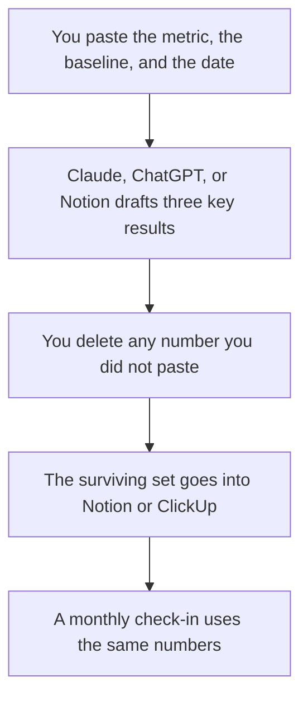

**An OKR written with AI is a format wrapped around a target a person already chose.** The model can turn "cut paid onboarding time" into an objective and a key result with a date. It cannot know the number. A key result with a target the model invented is a slogan. Publish the number you would defend in the staff meeting, then let the draft tighten the sentence.

The planning stack next to this is [best AI tools for product managers](/blog/best-ai-tools-for-product-managers-2026/). A spec that should feed the objective is [how to draft a product spec with AI](/blog/how-to-draft-a-product-spec-with-ai-2026/). The claim check is [how to fact-check AI writing](/blog/how-to-fact-check-ai-writing-2026/).

Prices are US list prices excluding tax from directory pages checked October 16, 2026. Published October 24, 2026. We did not score OKR quality.

## What the model may touch

| Line | Who owns the substance | The model may |
|---|---|---|
| Objective | You. One outcome, not a task list | Cut the jargon |
| Key result | You. A number, a unit, and a date | Refuse to ship if any of the three is missing |
| Baseline | You, from the dashboard | Format it. It may not look up a metric you did not paste |
| Non-goal | You | Keep a tempting project out of the objective |
| Owner | You | Name the person you named. It may not assign a team |
| Check-in | You | A monthly question, not a new target |

If the dashboard is not in the prompt, the model will still produce a percentage. Delete it. That percentage is [a hallucination](/blog/what-is-ai-hallucination-2026/) with a quarterly consequence.

## Where the draft happens

**A long pass on the wording.** [Claude](/tools/claude/) Pro is $20 a month, or $17 billed annually. Put last quarter's OKRs and this quarter's metric table in a Project. Free includes up to five Projects. Ask for three candidate key results that use only the numbers in the table, and for a section titled "numbers not in the source." The container is [Claude Projects vs ChatGPT Projects](/blog/claude-projects-vs-chatgpt-projects-2026/).

**The team's default chat.** [ChatGPT](/tools/chatgpt/) Plus at $20 lists projects. Use a Project for the quarter. Do not use a custom GPT as the source of the targets. The split is [ChatGPT Projects vs custom GPTs](/blog/chatgpt-projects-vs-custom-gpts-2026/).

**The page people will comment on.** [Notion AI](/tools/notion-ai/) Business is $20 per seat per month. The OKR should live where the team already writes. A chat transcript will not be the check-in. The comparison is [Notion AI vs ChatGPT for notes](/blog/notion-ai-vs-chatgpt-for-notes-2026/). Notion's card is [Notion AI pricing explained](/blog/notion-ai-pricing-explained-2026/).

**The tracker, if that is the system of record.** [ClickUp Brain](/tools/clickup-brain/) is an add-on from $9 per user per month on top of a ClickUp plan. Unlimited is $7 per user yearly. The wiki and the tasks should not diverge. If the number lives in ClickUp, generate the sentence there or paste the approved sentence in. Do not keep a second set in a chatbot.

**The meeting where the number was argued.** [Granola](/tools/granola/) Business is $14 per user per month. Basic keeps 30 days. Paste the decision lines, not the whole transcript. A side comment about a stretch goal will become a key result if you ask the model to "pull the OKRs."

A prompt that holds the line:

"Metric table is below. Draft one objective and three key results. Every number must appear in the table. If a key result needs a number the table does not have, write 'missing target' and stop. List non-goals I should confirm."

One OKR you already liked, pasted above the table, is [what few-shot prompting is](/blog/what-is-few-shot-prompting-2026/).

## The check before anyone sees it

Read each key result out loud and answer three questions. Can someone measure it without asking you what you meant? Does the date fall inside the quarter? Did you, not the model, choose the target? If any answer is no, it is a task or a theme, and it does not belong in the set.

Three to five key results is a writing constraint, not a law. The model will fill five slots if you ask for five. Ask for the ones the table supports. A release that should move one of those numbers is [how to write release notes with AI](/blog/how-to-write-release-notes-with-ai-2026/). The note is not the OKR. The metric is.

## FAQ

### Can AI set the targets?

It can propose a target, and you should treat the proposal as a brainstorm. The published number is a management decision. If you did not bring a baseline, you are not ready for the draft.

### How many OKRs should a team have?

Few enough that a monthly check-in fits in the meeting you already have. The model will not stop at a sensible count unless you tell it the count. Start from the staff meeting's length, not from a template that wants five objectives.

### Should each person have their own set?

Only if a person owns a number. A copied company OKR on every profile is a formatting exercise. Generate the company set once, in the wiki, and link it.

### Where should the score live?

Next to the metric, updated by the person who owns the dashboard. Do not ask the chatbot to "score the quarter" from memory. Paste the close numbers, then ask for a paragraph. Memory is the wrong store for a KPI. That distinction is [what AI memory is](/blog/what-is-ai-memory-2026/).

## Last verified

October 16, 2026 for Claude, ChatGPT, Notion, and ClickUp prices. October 24, 2026 for Granola Business at $14 as used in the Granola pricing articles. Published October 24, 2026.

**Sources:** [Notion AI](https://www.notion.com/product/ai), [Claude pricing](https://claude.com/pricing), [ClickUp Brain pricing](https://clickup.com/brain/pricing).

*Published by Andrew for [AI Tools Optimizer](https://aitoolsoptimizer.com).*

[Notion AI](/tools/notion-ai/) is in the [productivity directory](/tools/category/productivity-notes/). Directory pages may use affiliate links. A purchase through them may earn us a commission at no extra cost to you.
