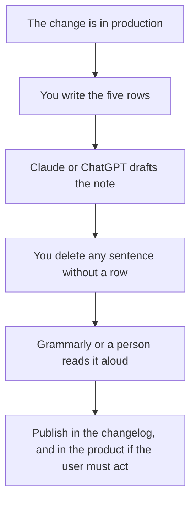

**Release notes written with AI are a translation of changes you already shipped, into sentences a user can act on.** The model formats the list. It does not know what shipped. A note that starts from a prompt that says "write exciting release notes" will invent a feature.

The voice on the paragraph is [how to create a brand voice with AI](/blog/how-to-create-a-brand-voice-with-ai-2026/). The claim check is [how to fact-check AI writing](/blog/how-to-fact-check-ai-writing-2026/). If the same headings repeat every week, put them in a custom GPT. That choice is [ChatGPT Projects vs custom GPTs](/blog/chatgpt-projects-vs-custom-gpts-2026/).

Prices are US list prices excluding tax from directory pages checked October 16, 2026. Published October 24, 2026. We did not score prose.

## What you paste before you prompt

| Row | Who fills it | Done when |
|---|---|---|
| What changed | You, from the ticket or the pull request | One sentence a teammate would recognize |
| Who it is for | You | An admin, an end user, or both. Split them if the actions differ |
| What the user should do | You | "Nothing," or one step |
| What it does not do | You | The limitation support will be asked about |
| Date and version | You | A number you can find again |
| The paragraph | The model | Every claim maps to a row above |

## Which tool does which pass

**The draft.** [Claude](/tools/claude/) Pro is $20 a month, or $17 billed annually. [ChatGPT](/tools/chatgpt/) Plus is $20. Paste the rows and ask for two lengths: a changelog bullet, and a three-sentence note for the email. The longer writing path is [how to write a blog post with Claude](/blog/how-to-write-a-blog-post-with-claude-2026/). Release notes should stay shorter than a post. If a sentence needs a fact you do not have, the model should leave the heading "source needed" and stop.

Put the last three notes you were proud of in a Project so the next draft matches the headings. Claude's free plan includes up to five Projects on the October 16 directory note. ChatGPT lists projects on Plus. The container comparison is [Claude Projects vs ChatGPT Projects](/blog/claude-projects-vs-chatgpt-projects-2026/).

**The archive.** [Notion AI](/tools/notion-ai/) Business at $20 per seat per month is the right home if the changelog already lives in Notion. The model can draft inside the page. The page is still the record. The seat is [Notion AI pricing explained](/blog/notion-ai-pricing-explained-2026/).

**The line edit.** [Grammarly](/tools/grammarly/) Pro is $12 per member per month billed annually, or $30 month to month, on the October 16 card. Use it on the paragraph a user will see. It will not know that "faster" is a claim you cannot support. The editing split is [Grammarly vs ChatGPT for editing](/blog/grammarly-vs-chatgpt-for-editing-2026/).

A prompt that works:

"Here are the rows: change, audience, action, limitation, version. Write a changelog bullet and a short email. Use only the rows. If a row says the user does nothing, say that. Do not add a benefit that is not in the rows."

That is [what prompt engineering is](/blog/what-is-prompt-engineering-2026/), applied to a note. One finished example in the project is [what few-shot prompting is](/blog/what-is-few-shot-prompting-2026/).

## What to leave out

Internal ticket IDs, unless your readers are the people who file them. Performance adjectives you did not measure. A feature that is behind a flag for one design partner. The model will promote it if you paste the branch name and forget to say "not shipped."

Support should see the limitation row before the email goes out. A note that creates tickets is a failed note. The queue those tickets land in is [best AI tools for support teams](/blog/best-ai-tools-for-support-teams-2026/).

## FAQ

### Can I generate the notes from git commits?

You can paste commit subjects as the "what changed" row. Subjects are a bad final note. Rewrite the row in user language first, then let the model format it. A commit that says "fix stuff" will become a confident paragraph about the wrong fix.

### Should every fix get a note?

User-visible changes get a note. Internal refactors get a line in the engineering log. Ask the model to sort your rows into those two piles, then check the sort. Publishing nothing is better than publishing a guess.

### Who approves the note?

The person who owns the change. A writer can tighten the sentence. The owner confirms the limitation and the version.

### Where should the note live?

Wherever users already look: the changelog page, the in-product modal, or the email. Pick one primary place. The model can draft the shorter cut for the second place from the same rows.

## Last verified

October 16, 2026 for Claude, ChatGPT, Notion, and Grammarly prices. Published October 24, 2026.

**Sources:** [Claude pricing](https://claude.com/pricing), [ChatGPT pricing](https://chatgpt.com/pricing), [Grammarly pricing](https://www.grammarly.com/plans).

*Published by Andrew for [AI Tools Optimizer](https://aitoolsoptimizer.com).*

[Grammarly](/tools/grammarly/) is in the [writing directory](/tools/category/writing/). [Claude](/tools/claude/) is in the [assistants directory](/tools/category/chatbots-assistants/). Directory pages may use affiliate links. A purchase through them may earn us a commission at no extra cost to you.
