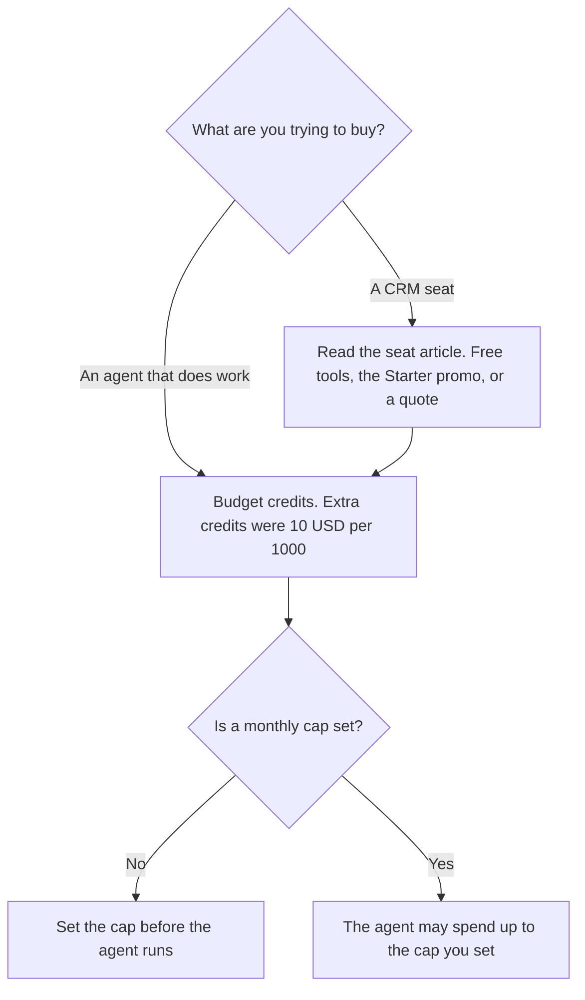

**HubSpot's AI, called Breeze on the directory card, does not have a separate list price on the check from October 16, 2026.** The card says plans include some HubSpot Credits, and additional credits were listed at $10 per 1,000. The seat ladder, including the free CRM and the Starter promo, is [HubSpot pricing explained](/blog/hubspot-pricing-explained-2026/). This page is the AI meter. A Starter price is not a Breeze price.

A fetch of the credits page and the public pricing HTML returned HTTP 401 on October 24, 2026. The figures stay on the October 16 directory record. Published October 24, 2026. We did not score agents, deflection, or pipeline. If your checkout shows a different credit price, the checkout wins.

## What was printed for AI

| Item | What the October 16 card recorded | How to treat it |
|---|---|---|
| Breeze Assistant | Included in the description of HubSpot's AI. No dollar of its own | A drafting surface. Not a seat price |
| Customer, prospecting, and data agents | Named as agents that use your CRM data | They spend credits. They do not have a per-agent sticker on the card |
| Included credits | Plans include some | The card does not print how many each edition includes |
| Extra credits | $10 per 1,000 | Packs or pay-as-you-go. This is the overage unit we can cite |
| Spend controls | A monthly cap and feature-level limits | Turn them on before an agent sends mail or edits fields |

Breeze on the tool page is an assistant plus agents: a customer agent, a prospecting agent, and a data agent. The card says you can cap monthly usage and set feature-level limits. The cap is the control. The $10 per 1,000 line is the pack price we can cite. It is not a forecast of how many credits one email uses. The card does not print a credit cost per action. Do not invent one.

## What not to treat as the AI price

**Starter at $7 or $10 a seat.** That figure was a limited-time offer, up to 65 percent off, on the October 16 card, and the public pricing HTML we fetched on October 24 did not include the table. It is a seat promo. It is not Breeze. The seat article explains why Professional and Enterprise stay as quotes. This page does not fill those quotes in with a credit pack.

**A chat subscription.** [Claude](/tools/claude/) Pro is $17 a month billed annually, or $20 monthly. A person can draft a follow-up in Claude. That does not include HubSpot Credits, and it does not write the CRM unless you connected it on purpose. The review is [Claude review](/blog/claude-review-2026/).

**A page in the wiki.** [Notion AI](/tools/notion-ai/) Business is $20 a seat a month. A call note stored in Notion is not a Breeze credit. The invoice is [Notion AI pricing explained](/blog/notion-ai-pricing-explained-2026/).

**A Zap that copies a field.** [Zapier](/tools/zapier/) Professional is $19.99 a month billed annually for 750 tasks, on the October 16 card. Tasks are Zapier's meter. Credits are HubSpot's. A workflow that uses both pays both. The task article is [Zapier pricing explained](/blog/zapier-pricing-explained-2026/).

## How to budget the credit line

Write two lines under the seat quote: included credits, which the card says exist and does not count, and extra credits at $10 per 1,000 only if your account still shows that pack price. Set the monthly cap in the product to a number you can lose. Feature-level limits are how you keep a prospecting agent from spending the cap the customer agent needed.

One thousand extra credits at the recorded pack price cost $10, before tax. Ten thousand cost $100. That arithmetic is the pack. It is not a map of how many customer replies you will get. If the pack price in checkout is different, delete these multiples.

The directory's warning that Professional and Enterprise get expensive is about seats, and it is qualitative. It is not a Breeze number. Ask for the seat quote and the included-credit count in the same conversation. Write down both. A quote that names the seat and skips the credits is unfinished.

## FAQ

### How much does HubSpot AI cost?

There is no separate Breeze sticker on the October 16 card. Plans include some credits. Additional credits were listed at $10 per 1,000. Seat prices, including a Starter promo that may have expired, are the other article. Professional and Enterprise remain quotes.

### Is Breeze included with the free CRM?

The card says the free CRM and free tools are real, and that plans include some credits. It does not print a free-tier credit count, and it does not say every agent is included on free. Turn on a cap before you enable an agent. If the product says an agent requires a paid edition, that gate wins over this paragraph.

### Do credits replace the seat?

No. The seat and the credits are both costs. A promo seat with an uncapped agent can cost more than the seat. Set the cap. Do not subtract $10 per 1,000 from the seat and call the difference the AI discount. They are different lines.

### Why will you not list a price per email or per agent?

The card does not print one. Inventing a credit cost per prospecting action would be worse than saying the meter is credits and the pack we saw was $10 per 1,000. Read the usage screen for the action you will turn on.

## Last verified

October 16, 2026, from the HubSpot directory card. Fetches of the credits page and the pricing HTML returned HTTP 401 on October 24, 2026. Claude's $17 annual figure is from the October 24 pricing article. Notion and Zapier are the October 16 cards. Published October 24, 2026.

**Sources:** [HubSpot pricing](https://www.hubspot.com/pricing), [HubSpot Credits](https://www.hubspot.com/products/artificial-intelligence/credits), [HubSpot AI](https://www.hubspot.com/products/artificial-intelligence).

*Published by Andrew for [AI Tools Optimizer](https://aitoolsoptimizer.com).*

[HubSpot](/tools/hubspot/) is in the [marketing directory](/tools/category/marketing-seo/). Directory pages may use affiliate links. A purchase through them may earn us a commission at no extra cost to you.
