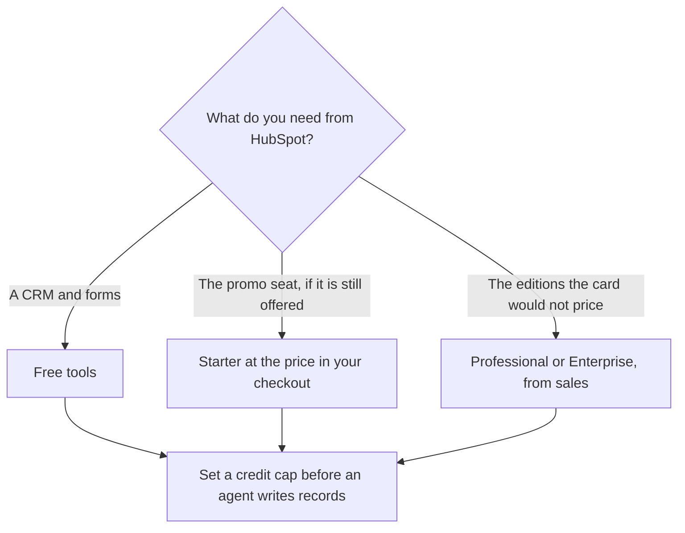

**HubSpot has a free CRM. Starter was listed at $7 or $10 a seat a month as a limited-time offer, up to 65 percent off, when the directory was checked on October 16, 2026. Professional and Enterprise do not have a single public sticker on that card. They are sales-led.** Extra HubSpot Credits were listed at $10 per 1,000. If you need a Professional number for a budget, get it from a quote. This page will not invent one.

The demand program that often lands in this CRM is [best AI tools for demand gen](/blog/best-ai-tools-for-demand-gen-2026/). The database seat next to it is [Apollo.io pricing explained](/blog/apollo-io-pricing-explained-2026/). Conversation intelligence, which is also a quote, is [Gong pricing explained](/blog/gong-pricing-explained-2026/).

A fetch of the public HTML at hubspot.com/pricing on October 24, 2026 did not include the price table. A scrape attempt returned HTTP 401. The figures below stay on the October 16 directory record. Published October 24, 2026. We did not score pipeline or support deflection.

## What was actually printed

| Option | Price the directory recorded | How to treat it |
|---|---|---|
| Free tools | $0 | A real free CRM and builders. Start here if you need a system of record |
| Starter Customer Platform | $7 or $10 a seat a month, depending on plan | Labeled limited-time, up to 65 percent off. Confirm the button. It is not a permanent list price |
| Professional | No single dollar on the card | Sales-led. "See the pricing page" was the instruction |
| Enterprise | No single dollar on the card | Sales-led. Same instruction |
| HubSpot Credits | $10 per 1,000 | Plans include some credits. Packs or pay-as-you-go are extra |

Breeze is HubSpot's AI on the tool page: an assistant, plus agents such as a customer agent, a prospecting agent, and a data agent. Credits meter that work. The card says you can cap monthly usage and set feature-level limits. Turn the cap on before the agent sends mail or edits fields. A credit price of $10 per 1,000 is the overage unit we can cite. It is not the whole subscription.

## What not to compare it with

**[Apollo.io](/tools/apollo-io/) Basic is $49 a seat a month billed annually.** That is a contact database and sequences, with credits that expire. It is not a substitute price for HubSpot Professional. Free Apollo is 900 credits a seat a year. Use Apollo when the list is the job. Use HubSpot when the record of the deal is the job. Buying both means two meters. The sales shelf is [best AI tools for sales teams](/blog/best-ai-tools-for-sales-teams-2026/).

**[Gong](/tools/gong/)** is custom: per-user licenses plus a platform fee. There is no public dollar to subtract from a HubSpot quote. Do not let a spreadsheet imply you know Gong's price because you know HubSpot's promo.

**[Clay](/tools/clay/) Launch starts at $167 a month billed annually** when enrichment has to cross providers. Clay's free tier is 500 actions and 100 data credits a month. Clay writes a table. HubSpot should stay the system of record unless you have decided otherwise on purpose. The ops page for that table is [best AI tools for RevOps](/blog/best-ai-tools-for-revops-2026/).

A field an agent fills still needs a person when the field is a stage, a forecast category, or a promise to a customer. That habit is [what human-in-the-loop AI is](/blog/what-is-human-in-the-loop-ai-2026/). An invented fact in a CRM note is [what an AI hallucination is](/blog/what-is-ai-hallucination-2026/).

## How to budget without a fake sticker

Write three lines: free tools you will use, the Starter number you saw in your own checkout today, and "Professional or Enterprise: quote." Add a credit cap in dollars, using $10 per 1,000 only as the recorded pack price, and only if your checkout still shows it. If the promo is gone, delete the $7 and the $10. Leaving a dead promo in a board deck is how a budget lies.

The directory's verdict that Professional and Enterprise get expensive is a qualitative warning from the tool page, not a number. Treat it as a reason to ask for the quote before you design a process that needs those editions.

## FAQ

### Is HubSpot free?

The free CRM and free tools are real, on the card. Free is not the same as Starter, and it is not Professional. AI agents can spend credits. Cap them.

### Is Starter $7?

It was advertised at $7 or $10 a seat a month, as a limited-time offer up to 65 percent off, on October 16, 2026. The public pricing HTML we fetched on October 24 did not include the table. Use the price in your account today.

### Why will you not list Professional?

The directory did not record a dollar, and we did not get a price table from the live page. Inventing a Professional price would be worse than saying it is a quote. Ask HubSpot.

### Do credits roll into the seat price?

Plans include some credits. Additional credits were listed at $10 per 1,000. The seat and the credits are both costs. Set the cap so an agent cannot spend past the number you approved.

## Last verified

October 16, 2026, from the HubSpot directory card. Public HTML of the pricing page on October 24, 2026 did not include the sticker. Published October 24, 2026.

**Sources:** [HubSpot pricing](https://www.hubspot.com/pricing), [HubSpot Credits](https://www.hubspot.com/pricing/hubspot-credits), [Apollo.io pricing](https://www.apollo.io/pricing).

*Published by Andrew for [AI Tools Optimizer](https://aitoolsoptimizer.com).*

[HubSpot](/tools/hubspot/) is in the [sales directory](/tools/category/sales/). Directory pages may use affiliate links. A purchase through them may earn us a commission at no extra cost to you.
