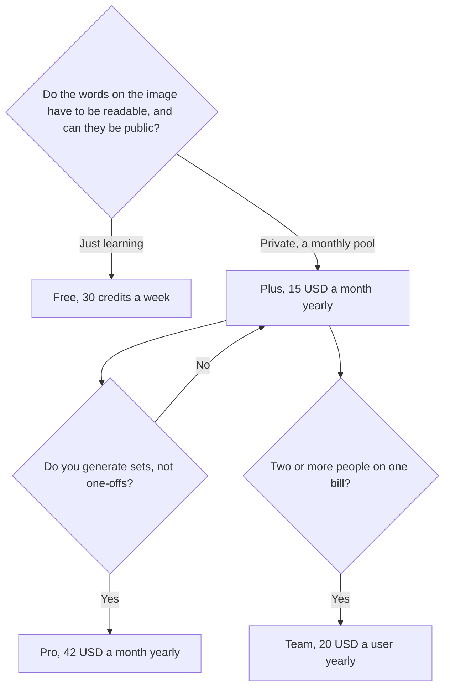

**Ideogram pricing is a credit pool, with a slower unlimited queue after the credits run out on paid plans.** Free is 30 credits a week. Plus is $20 a month, or $15 a month billed yearly ($180), for 2,400 credits. Pro is $60 a month, or $42 a month billed yearly ($504), for 7,500 credits, batch generation, and a larger queue. Team is $30 a user a month, or $20 yearly, for 3,600 credits a user, with a two-user minimum. Enterprise is custom.

The product page is [Ideogram review](/blog/ideogram-review-2026/). The neighbor that is also a credit pool, with different numbers, is [Leonardo vs Ideogram](/blog/leonardo-vs-ideogram-2026/). The shelf is [best AI image generators](/blog/best-ai-image-generators-2026/).

Prices are USD before tax from Ideogram's plans document, checked October 16, 2026. Ideogram's own "last verified" line on that page was October 15, 2026. Published October 24, 2026. We did not score text rendering. Credit costs vary by model. Read the button before a batch.

## The plans

| Plan | Monthly | Yearly | Credits | The line you crossed for |
|---|---|---|---|---|
| Free | $0 | $0 | 30 a week | The product. Images are not private |
| Plus | $20 | $15 a month, $180 a year | 2,400 a month | Private generation and quality export |
| Pro | $60 | $42 a month, $504 a year | 7,500 a month | Batch generation and a larger queue |
| Team | $30 a user | $20 a user a month, $240 a year | 3,600 a user a month | A shared bill. Minimum two users |
| Enterprise | Custom | Custom | Custom | A contract, not a toggle |

Yearly plans still receive credits monthly. The legacy Basic plan is no longer sold, on the directory page. Monthly credits do not roll over.

Plus, Pro, and Team can keep generating with Ideogram models in a slower queue after credits run out. That valve does not cover everything. Custom and partner models, reference images, edits, and upscales still need credits. If the work is an upscale, price the credits, not the "unlimited" sentence.

## What a credit is not

An Ideogram credit is not a chat token, not a Firefly credit, and not a FLUX cent. [What AI tokens are](/blog/what-are-ai-tokens-explained-2026/) is the chat meaning. Generate one keeper, note what the button charged, and divide the plan by that. The directory does not record a single "one image equals one credit" rule, because the cost depends on the model. The button is the quote.

The directory says personal accounts can fund a pay-as-you-go wallet without a subscription, including for the API. It does not record a per-credit wallet price. This page will not invent one. If you are building an app, read the current API card before you promise a unit cost.

Private generation starts at Plus. Free images are not private. If a client name would be a problem on a public grid, Free is the wrong plan even when 30 credits would have covered the count.

## Ideogram next to a different meter

[Midjourney](/tools/midjourney/) Basic is $10 a month, or $8 billed annually, and there is no free plan. Standard at $30, or $24 annually, is where unlimited Relax images start. Midjourney is the look. Ideogram is the poster where the words have to be letters. The clock is [Midjourney pricing explained](/blog/midjourney-pricing-explained-2026/). The chat alternative, which is a third product, is [Midjourney vs ChatGPT Images](/blog/midjourney-vs-chatgpt-images-2026/).

[FLUX](/tools/flux/) is pay as you go. FLUX 3 Klein is $0.008 at 768×768. There is no weekly free pool. Use FLUX when you do not want a seat. The card is [FLUX pricing explained](/blog/flux-pricing-explained-2026/).

[Adobe Firefly](/tools/adobe-firefly/) Standard is $9.99 for 2,000 credits, and paid plans include unlimited standard images. Those credits are a premium meter. The card is [Adobe Firefly pricing explained](/blog/adobe-firefly-pricing-explained-2026/).

[Leonardo](/tools/leonardo-ai/) Essential is $12 a month for 8,500 fast tokens. A Leonardo token is not an Ideogram credit. The comparison is [Leonardo vs Ideogram](/blog/leonardo-vs-ideogram-2026/). The three-way with Firefly is [FLUX vs Ideogram vs Firefly](/blog/flux-vs-ideogram-vs-firefly-2026/).

## FAQ

### Is Ideogram free?

Yes. Thirty credits a week, and the images are not private. When they run out, you wait for the next week or you upgrade.

### Does Plus include unlimited generation?

It includes a slower queue for Ideogram models after the 2,400 credits. Edits, upscales, reference images, and partner or custom models still spend credits. "Unlimited" is that queue, not every button in the app.

### Is the yearly price the one to quote?

Plus yearly is $15 a month, $180 for the year, against $20 month to month. Pro yearly is $42 a month, $504 for the year, against $60. Quote the toggle you will click. Team yearly is $20 a user, and the minimum is two users, so the smallest Team bill is two of those seats.

### When is Pro worth it?

When you are generating sets. Batch generation and 7,500 credits are the Pro line. A weekly thumbnail can stay on Plus, or on Free if it can be public. Do not buy Pro for a quality adjective. This page did not measure one.

## Last verified

October 16, 2026 for Ideogram, Midjourney, FLUX, Firefly, and Leonardo prices named above. Published October 24, 2026.

**Sources:** [Ideogram plans](https://docs.ideogram.ai/plans-and-billing/available-plans), [Midjourney plans](https://docs.midjourney.com/hc/en-us/articles/27870484040333-Comparing-Midjourney-Plans), [Adobe Firefly plans](https://www.adobe.com/products/firefly/plans.html).

*Published by Andrew for [AI Tools Optimizer](https://aitoolsoptimizer.com).*

[Ideogram](/tools/ideogram/) is in the [image generation directory](/tools/category/image-generation/). Directory pages may use affiliate links. A purchase through them may earn us a commission at no extra cost to you.
