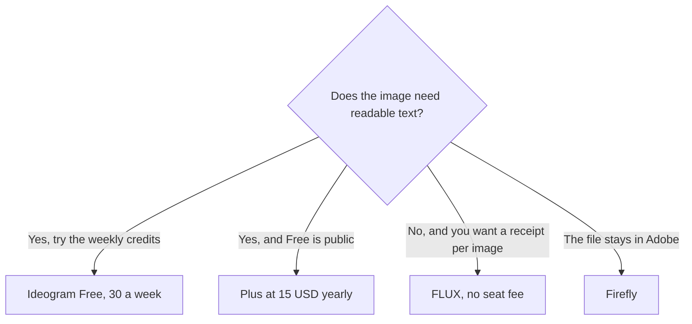

**[Ideogram](/tools/ideogram/) is an image generator sold for pictures that contain readable text: posters, thumbnails, ads, and logo concepts.** Plus is $20 a month, or $15 a month on a $180 year, with 2,400 credits a month. Free is 30 credits a week, and only if you sign in with Google, Apple, or Microsoft.

Prices are from Ideogram's plans document, which says it was last verified October 15, 2026. We re-read that page on October 24, 2026. Prices are US dollars, before tax. We did not score spelling accuracy against FLUX. The image shelf is [best AI image generators](/blog/best-ai-image-generators-2026/).

## The plans

| Plan | Monthly | Yearly | Credits |
|---|---|---|---|
| Free | $0 | $0 | 30 a week, for Google, Apple, or Microsoft sign-in. Email-and-password accounts do not get the weekly credits |
| Plus | $20 | $15/month ($180/year) | 2,400 a month. Private generation and quality export |
| Pro | $60 | $42/month ($504/year) | 7,500 a month. Batch generation and a larger queue |
| Team | $30 per user | $20 per user ($240/year) | 3,600 per user a month. Minimum 2 users |
| Enterprise | Custom | Custom | Custom |

The invoice is [Ideogram pricing explained](/blog/ideogram-pricing-explained-2026/).

Yearly plans still receive credits each month, not as a lump. Unused monthly credits do not roll over. The old Basic plan, at $8 a month or $7 billed yearly, is no longer sold. People who already have it keep 960 credits a month.

On Free, generations are public. Plus and above keep new images private until you publish them. After monthly credits run out, Plus, Pro, and Team can keep using Ideogram models in a slower queue. Custom models, partner models, reference images, edits, and upscales still need credits. The run button shows the cost before you start. There is no single "one credit equals one image" rate for every model and every edit.

## What to measure before you call Plus plenty

If a straight generation is about one credit, 2,400 covers a heavy month. Edits and upscales spend more, and the docs say the cost depends on model, quality, size, and count. Generate one real poster, including the edit, and read the credit cost before you assume Plus is "unlimited social graphics." Free's 30 a week is about 120 a month if you use all four weeks. That can cover a light calendar. It will not cover a launch week.

Pay as you go is a wallet without a monthly allowance. Buying credits does not change your tier. Auto recharge is a separate switch.

[FLUX](/tools/flux/) is the no-subscription path, from $0.008 a Klein image, in the [FLUX review](/blog/flux-review-2026/). [Adobe Firefly](/tools/adobe-firefly/) is the Adobe path, in the [Firefly review](/blog/adobe-firefly-review-2026/). [Midjourney](/tools/midjourney/) is the artistic subscription in the image guide. Ideogram is the one to open when the headline has to be spelled correctly. It is a second bill if you only needed a texture with no words.

Five Team users on the yearly price are $100 a month, with 3,600 credits each. That is a different invoice from five people sharing one FLUX account.

## Who should pay

**Use Free** if you can sign in with Google, Apple, or Microsoft and you can accept public images. **Pay for Plus yearly** when privacy and the monthly pool are the blocker. **Pay for Pro** when batch generation is the workflow. **Pay for Team** when two or more people need their own credits and one bill. **Skip Ideogram** for a handful of images with no type. FLUX is the smaller receipt.

## FAQ

### Is Ideogram free?

Yes, with 30 credits a week if you sign in with Google, Apple, or Microsoft. Email-and-password accounts do not get that weekly grant. Free images are public.

### How much is Ideogram Plus?

$20 a month, or $180 a year ($15 a month), with 2,400 credits a month. Credits reset monthly and do not roll over.

### What happened to the Basic plan?

Ideogram no longer sells it. Existing subscribers keep it, with 960 credits a month.

## Last verified

October 24, 2026, against Ideogram's plans document (Ideogram's own "last verified" line on that page is October 15, 2026). Credit costs vary by model. Read the button before a batch.

**Sources:** [Ideogram plans and credits](https://docs.ideogram.ai/plans-and-billing/available-plans), [Ideogram pricing](https://ideogram.ai/pricing).

[Ideogram](/tools/ideogram/) is in the [image generation directory](/tools/category/image-generation/). Directory pages may use affiliate links. A purchase through them may earn us a commission at no extra cost to you.
