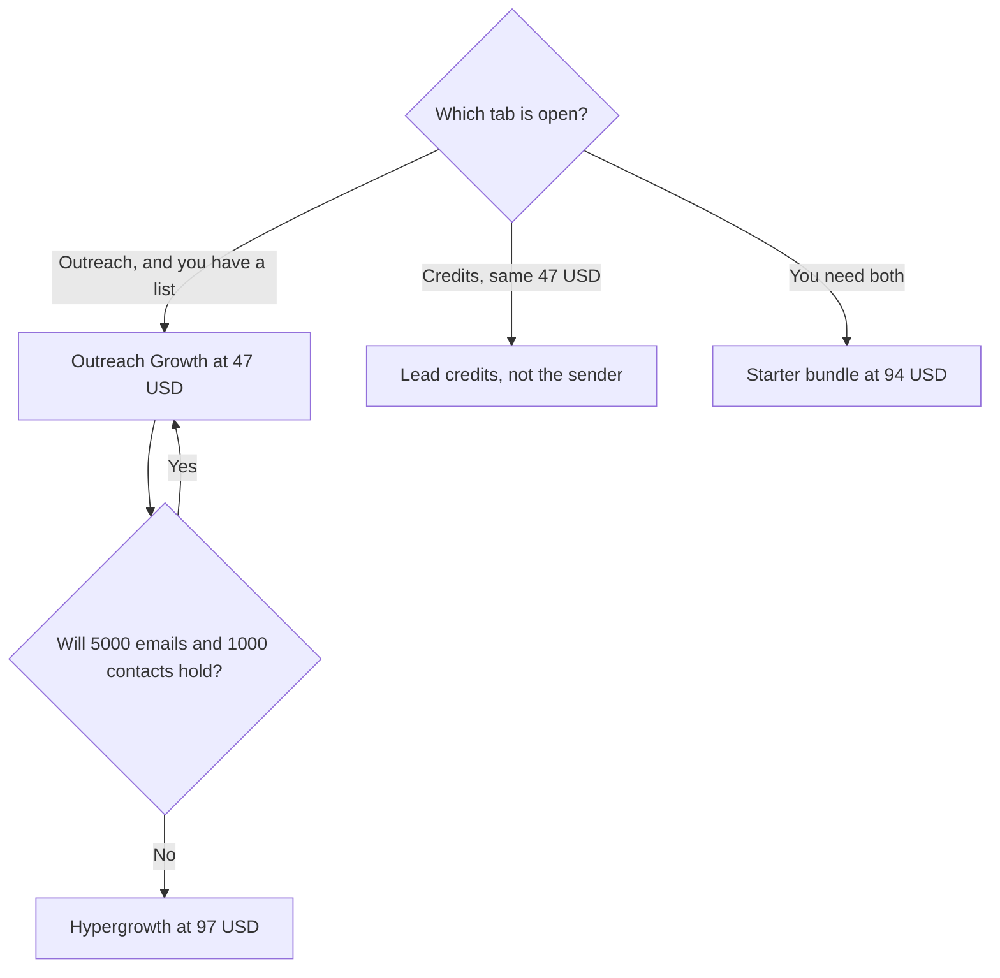

**Instantly's $47 price is two products.** Outreach Growth is $47 a month for sending: 5,000 emails, 1,000 uploaded contacts, unlimited email accounts, and unlimited warmup. A credits Growth plan is also $47 a month, for credits and the lead database, not for that sender. Quote the tab. The bundles are a third invoice.

Prices below were read from instantly.ai/pricing on October 24, 2026. The page has Bundles, Outreach, Credits, and VIP, and a monthly/yearly control. The product page is [Instantly review](/blog/instantly-review-2026/). A sequence you can defend is [how to write cold emails with Instantly](/blog/how-to-write-cold-emails-with-instantly-2026/).

## Outreach, the sending tab

| Outreach plan | Monthly | Yearly, per month, as printed | Volume on the card |
|---|---|---|---|
| Growth | $47 | $37.60 | 5,000 emails, 1,000 uploaded contacts, unlimited accounts and warmup |
| Hypergrowth | $97 | $77.60 | 125,000 emails, 25,000 contacts |
| Light Speed | $358 | $286.30 | 500,000 emails, 100,000 contacts, plus SISR |
| Enterprise | Custom | Custom | Higher volume and a private deliverability network |

## Bundles and the other $47

| What the tab says | Monthly | Yearly, per month | What you are actually buying |
|---|---|---|---|
| Credits Growth | $47 | Read the yearly control on that tab | Credits and the lead database. Not the outreach sender |
| Starter bundle | $94 | $85 | 5,000 emails, 1,000 contacts, 1,500 Instantly credits, the lead database |
| Scale bundle | $194 | $175 | 100,000 emails, 25,000 contacts, 5,000 credits, AI Reply Agent |
| Agency bundle | $555 | $500 | 500,000 emails, 100,000 contacts, 10,000 credits, SISR |
| VIP | Custom | Custom | Setup, quoted |

The yearly bundle cards say they save 10%. Outreach yearly prices above are the printed per-month figures, not a discount we calculated. VIP is custom. There is no permanent free sending plan on the cards we read. A "no credit card" line on a signup block is not a published free send cap.

## Unlimited accounts, capped volume

Instantly's FAQ says you can connect and warm as many mailboxes as you need on one subscription. The cap is emails sent and contacts uploaded. Seats are not the meter. That is why a team compares it with a per-seat tool. It is also why deliverability is the risk on Growth: Light Speed and the Agency bundle are the tiers that include SISR, described as dedicated server and IP rotation. Growth does not include that line.

Hypergrowth is the volume jump, from 5,000 emails and 1,000 contacts to 125,000 emails and 25,000 contacts, at $97 a month. The contact cap moves 25 times. The price does not. Buy Hypergrowth when the cap is the blocker you have already hit, not when the name sounds like a plan you should grow into.

The lead database is Instantly's own, advertised at 450 million B2B contacts, with waterfall enrichment. [Apollo.io](/tools/apollo-io/) Basic is $49 per seat per month billed annually, and it is the other database-and-sequence quote. [Clay](/tools/clay/) Launch starts at $167 a month billed annually when you build the list across providers. [HubSpot](/tools/hubspot/) has a free CRM, with Starter Customer Platform shown at $7 or $10 a seat on a promotional offer. Pick the system of record before you stack all three. The sales stack is [best AI tools for sales teams](/blog/best-ai-tools-for-sales-teams-2026/).

A sequencer does not create a lawful basis to email someone. Your list and your region's rules do that. The tool will send what you load, inside the contact cap.

## A one-month reading of the bill

Outreach Growth monthly is $47. Outreach Growth yearly is $37.60 a month as printed, which is $451.20 if you multiply by 12. Use the checkout total if it differs from that multiplication. Starter bundle yearly at $85 is $1,020 a year for sending plus 1,500 credits. Buy the bundle when you will spend the credits. Buy outreach Growth when the list already exists and the credits tab is a distraction.

Scale bundle at $194 monthly is a different volume tier from Hypergrowth, and it adds the AI Reply Agent and 5,000 credits. Read that card on its own. It is not "Hypergrowth plus a mailbox."

## FAQ

### How much does Instantly cost to send cold email?

Outreach Growth is $47 a month, or $37.60 a month billed yearly, for 5,000 emails and 1,000 uploaded contacts, with unlimited email accounts and warmup. Hypergrowth is $97. Light Speed is $358.

### Why do two plans both say $47?

One is outreach Growth, the sender. One is credits Growth, the lead-database credit plan. The Starter bundle, at $94, is the card that combines a small send cap with credits. Ask which tab the quote came from.

### Does Instantly charge per seat?

The outreach cards we read do not price per seat. They price emails and uploaded contacts. A teammate still needs permission to the workspace. The meter on the invoice is volume.

### Is there a free plan?

The pricing cards we read are paid. Enterprise and VIP are custom. Confirm what a brand-new account can send before you plan a campaign on a signup button.

## Last verified

October 24, 2026, from Instantly's pricing page. The page is tabbed. Recheck the tab and the yearly control before you send a client a number.

**Sources:** [Instantly pricing](https://instantly.ai/pricing), [Instantly](https://instantly.ai).

*Published by Andrew for [AI Tools Optimizer](https://aitoolsoptimizer.com).*

[Instantly](/tools/instantly/) is in the [sales directory](/tools/category/sales/). Directory pages may use affiliate links. A purchase through them may earn us a commission at no extra cost to you.
