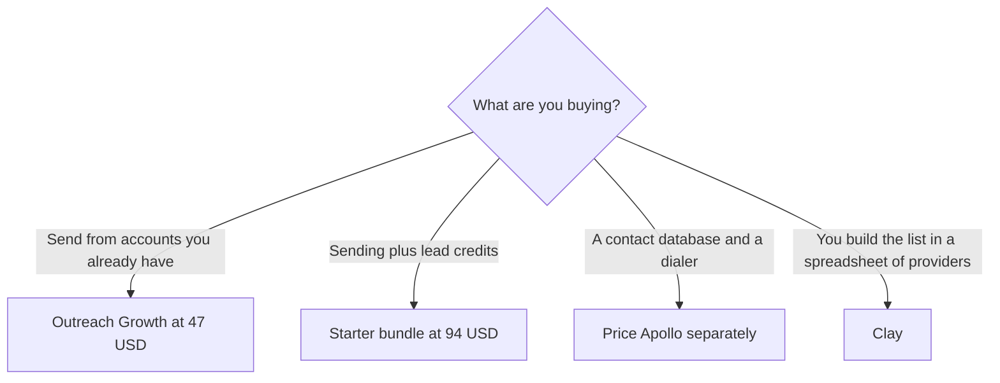

**[Instantly](/tools/instantly/) is a cold-email platform that prices sending volume, not seats.** The outreach Growth plan is $47 a month for 5,000 emails and 1,000 uploaded contacts, with unlimited email accounts and unlimited warmup. The page also sells bundles and a separate credit plan. Those are different invoices. Quote the tab you mean.

Prices below were read from instantly.ai/pricing on October 24, 2026. The page has Bundles, Outreach, Credits, and VIP, and a monthly/yearly control. We did not measure inbox placement. A sequencer does not supply a lawful basis to email a stranger. That is your list and your region's rules.

## Outreach, the sending plans

| Outreach plan | Monthly | Yearly, per month, as printed | Volume on the card |
|---|---|---|---|
| Growth | $47 | $37.60 | 5,000 emails, 1,000 uploaded contacts, unlimited accounts and warmup |
| Hypergrowth | $97 | $77.60 | 125,000 emails, 25,000 contacts |
| Light Speed | $358 | $286.30 | 500,000 emails, 100,000 contacts, plus SISR private server and IP rotation |
| Enterprise | Custom | Custom | Higher volume and a private deliverability network |

The invoice is [Instantly pricing explained](/blog/instantly-pricing-explained-2026/).

## Bundles, which add credits

| Bundle | Monthly | Yearly, per month | What it adds to sending |
|---|---|---|---|
| Starter | $94 | $85 | 5,000 emails, 1,000 contacts, 1,500 Instantly credits, the lead database |
| Scale | $194 | $175 | 100,000 emails, 25,000 contacts, 5,000 credits, AI Reply Agent |
| Agency | $555 | $500 | 500,000 emails, 100,000 contacts, 10,000 credits, SISR |

The yearly bundle cards say they save 10%. A credits-only Growth plan is also $47 a month, for credits and the lead database, not for the outreach sender. VIP setup is custom. If a quote says "$47," ask whether it is outreach Growth or credits Growth.

## What unlimited accounts means

Instantly's FAQ says you can connect and warm as many mailboxes as you need on one subscription. The cap is emails sent and contacts uploaded, not seats and not inboxes. That is the reason a team compares it with a per-seat sequencer. It is also the reason deliverability is the product risk. Light Speed and the Agency bundle are the tiers that include SISR, which Instantly describes as dedicated server and IP rotation. Growth does not include that line. Do not buy Growth and expect the Agency infrastructure.

The lead database is Instantly's own, advertised at 450 million B2B contacts, with waterfall email enrichment. [Apollo.io](/tools/apollo-io/) is the other database-and-sequence quote in the directory. [Clay](/tools/clay/) is the spreadsheet that calls many providers. [HubSpot](/tools/hubspot/) is the CRM those rows often land in. Buying all three because each demo looked complete is how outbound stacks get expensive. Pick the system of record first. Connecting a sequencer to a CRM is the same class of glue as [Zapier vs Make vs n8n](/blog/zapier-vs-make-vs-n8n/). A follow-up email that is not a cold sequence, and the consent check around it, is the sales workflow in [best AI tools for real estate agents](/blog/best-ai-tools-for-real-estate-agents-2026/). Stacking seats you will not open is the rule in [which AI subscription is worth paying for](/blog/which-ai-subscription-is-worth-paying-for/).

There is no permanent free sending plan on the cards we read. "No credit card" appears on a get-started block. That is not a published free tier with a send cap. Confirm what a new account can send before you plan a campaign on it.

## Who should pay

**Pay for outreach Growth** when you have a list, you will send inside 5,000 emails a month, and you want unlimited mailboxes without a seat fee. **Move to Hypergrowth** when the contact or send cap is the blocker. **Buy Light Speed or Agency** when private infrastructure is the requirement, not when the name sounds faster. **Buy a bundle** only if you will use the credits. **Skip Instantly** if you do not have a compliant list. The tool will not create one for you by existing.

## FAQ

### How much does Instantly cost?

Outreach Growth is $47 a month, or $37.60 a month billed yearly, for 5,000 emails and 1,000 contacts. Hypergrowth is $97. Light Speed is $358. Bundles start at $94 a month.

### Does Growth charge per seat?

The outreach cards do not price per seat. They price emails and uploaded contacts, and they list unlimited email accounts and warmup. Read the plan name. The credits tab is a different $47.

### Is there a free plan?

The pricing cards we read are paid. Enterprise and VIP are custom. Do not treat a signup button as a free sending allowance.

## Last verified

October 24, 2026, from Instantly's pricing page. The page is tabbed, and yearly prices are a separate control. Recheck the tab before you send a client a number.

**Sources:** [Instantly pricing](https://instantly.ai/pricing), [Instantly](https://instantly.ai).

[Instantly](/tools/instantly/) is in the [sales directory](/tools/category/sales/). Directory pages may use affiliate links. A purchase through them may earn us a commission at no extra cost to you.
