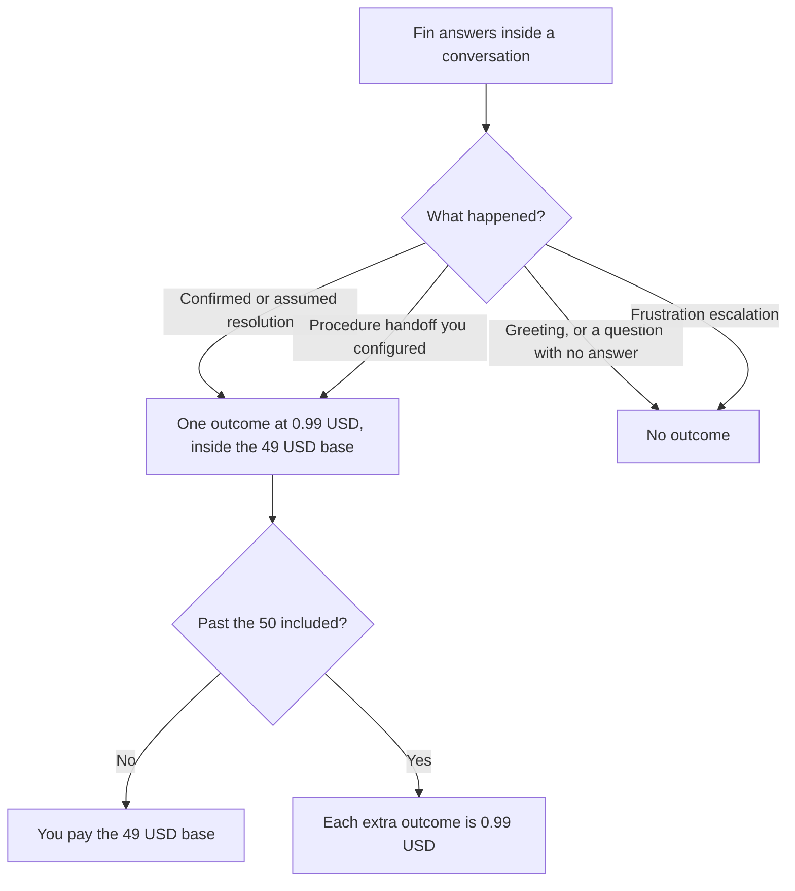

**Fin is $0.99 per outcome, billed inside a $49 a month base plan that includes 50 resolutions.** Extra outcomes are $0.99 each. You are charged at most once per conversation. Unused included resolutions do not roll over. Fin's help center also says minimum resolution commitments apply, and it does not print the commitment size in the section we read, so the contract is the place that number lives.

The side-by-side with another bot's meter is [Chatbase vs Intercom Fin pricing](/blog/chatbase-vs-intercom-fin-pricing-2026/). The product page is [Intercom Fin review](/blog/intercom-fin-review-2026/). The articles the bot should answer from are [how to build a help center with AI](/blog/how-to-build-a-help-center-with-ai-2026/).

Prices are US dollars from Fin's outcomes help center, fetched October 24, 2026. Published October 24, 2026. We did not score resolution rate. A vendor's resolution percentage is their metric. This page does not repeat one as a measurement.

## What an outcome is

| Event | Billed? | The rule we read |
|---|---|---|
| Customer confirms the answer, or leaves without asking for more | Yes, one outcome | A resolution. An assumed resolution is when the customer disengages for 24 hours after Fin's last answer |
| Fin finishes a Procedure you configured to end in a handoff | Yes, one outcome | A Procedure handoff. Still once per conversation, even if several Procedures ran |
| Fin only says hello, or its last message was a clarifying question and the customer never answered | No | Not an answer, so not a resolution |
| Fin escalates because it detects frustration | No, on the help center's frustration example | That escalation is not billed |
| The customer comes back to the same conversation for more help | The earlier resolution is deducted | Even across billing periods, on the page we read |
| 5 resolutions in a month | $49 | Inside the included 50 |
| 100 resolutions in a month | $99.50 | 50 included, plus 50 at $0.99 |

You can set usage reminders and hard limits. The hard limit applies to resolutions and Procedure handoffs. Pause Fin in Deploy and it stops replying, so new outcomes stop. If you do not use the 50, they are lost. Fin for sales qualifications is not available on Fin for platforms outside Intercom, on the same page.

## How to read the $49

The base is the minimum for a month in which Fin does any of the included work, up to 50. Five resolutions cost $49, not $4.95. One hundred cost $99.50 in Intercom's example. Forecast with resolutions you expect, times $0.99, and then apply the base as the floor. Do not forecast with "conversations Fin touched," because a greeting is not an outcome.

The help center says the base plan for Fin with your helpdesk includes 50 resolutions. This page does not add a separate Intercom seat price. If your help desk is Intercom, Zendesk, or something else, that subscription is a second invoice. [Zendesk AI](/tools/zendesk-ai/) records Support Team at $19 an agent a month paid yearly, and AI agents from Suite Team at $55. Those are Zendesk's cards, not Fin's. [HubSpot](/tools/hubspot/) has a free CRM. Its Starter figure was a limited-time offer on the October 16 directory card. Professional and Enterprise were not a single sticker. None of those replace the $0.99.

## When a credit bot is the other bill

**[Chatbase](/tools/chatbase/)** meters message credits, not outcomes. Hobby is $32 a month billed yearly, or $40 monthly, with 700 message credits. Standard is $120 yearly or $150 monthly. You pay when the agent responds, including answers that did not "resolve" anything. Fin's pitch is that you pay for a resolution or a configured handoff. Chatbase's pitch is a credit per reply. Pick the meter you can forecast. The invoice is [Chatbase pricing explained](/blog/chatbase-pricing-explained-2026/).

A bot that answers outside its articles will create outcomes you did not want, or credits you did not want. The handoff rule is [how to create a support escalation matrix with AI](/blog/how-to-create-a-support-escalation-matrix-with-ai-2026/). The person who still owns the case is [what human-in-the-loop AI is](/blog/what-is-human-in-the-loop-ai-2026/).

## FAQ

### Is Fin free?

There is a trial path on the help center. The published price is the $49 base. There is no permanent $0 plan in the outcomes article we read. Pause stops new charges from new replies. It does not describe a refund of the base.

### Do the 50 resolutions roll over?

No. Unused included resolutions are lost. A quiet month does not fund a busy month.

### What is the minimum commitment?

The page says minimum resolution commitments apply. It does not give the number in the section we read. Ask on the contract before you model a tiny volume. The $49 base is the figure this article prints. The commitment may be larger than that.

### Are Procedure handoffs extra on top of a resolution in the same chat?

You are charged once per conversation, whether Fin resolved questions, ran Procedures, or both. A second conversation is a new chance to bill.

## Last verified

October 24, 2026, from Fin's outcomes help center. Chatbase and Zendesk figures are from directory pages checked October 16, 2026. Published October 24, 2026.

**Sources:** [Fin pricing: outcomes](https://fin.ai/help/en/articles/13975800-fin-pricing-outcomes), [Chatbase pricing](https://www.chatbase.co/pricing).

*Published by Andrew for [AI Tools Optimizer](https://aitoolsoptimizer.com).*

[Intercom Fin](/tools/intercom-fin/) is in the [customer support directory](/tools/category/customer-support/). Directory pages may use affiliate links. A purchase through them may earn us a commission at no extra cost to you.
